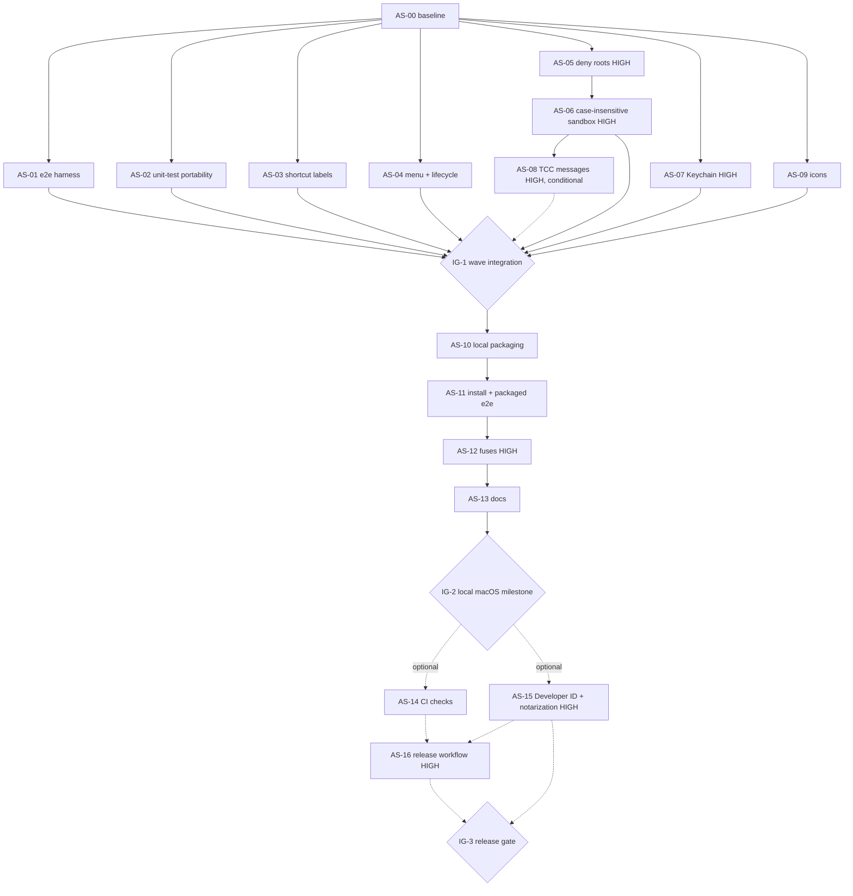

# OpenVern — Apple Silicon (macOS arm64) plan

> **Status (2026-11-10):** AS-00 to AS-13 are implemented and reviewed on macOS arm64 (AS-13 after accuracy-review fixes). AS-06 R4 and AS-08 have review
> approval and your H4 approval (2026-11-10). Each task is one commit on `feature/apple-silicon` (AS-01 to AS-13). Nothing
> is merged or pushed. CB-2 PASS (you, 2026-11-10). IG-2's macOS run (which covers IG-1's macOS half) is done: the A2
> artifacts are built, verified, installed and pass on macOS (§8, §9). Open: Linux runs LX-1 and LX-2 (not run) and H4 for AS-05,
> AS-07, AS-12, IG-1 and IG-2. The IG-1/IG-2 Sol max review was CONDITIONAL (LX-1/LX-2 and H4); its doc fixes D1–D3 are applied. AS-14 to AS-16 and IG-3 are optional and not started. Remaining
> work: `docs/apple-silicon-remaining-tasks.md` · **Owner:** Stefanos · **Last updated:** 2026-11-10
> *Original status (2026-11-08, historical):* AS-00 baseline **partial** (V1–V3, V11 and the secret scan measured; V5
> and V14 partial, AS-04 gate cleared 2026-11-08; V4 interactive and V10 manual checks pending), no implementation task
> started; conditional start order in §6.1.
> **Orchestration:** `orchestrator-ruleset.md` v1 (Orchestrator Ruleset v1, 2026-11-06). §5 routes every stage.
> **This document** was written by the frontier planning stage (Opus 5.5, before max). Tag of the planning task:
> `plan` / **high** (secrets, the tool sandbox's trust boundary and run/stream concurrency all need platform validation).
> **No implementation tasks had been executed when this plan was written (2026-11-08).** Read-only inspection and
> temporary baseline probes informed this plan. Later execution is recorded in §3.3, §9 and
> `docs/apple-silicon-remaining-tasks.md`.
> No approvals are requested now; future approvals are listed in §5.7.

## How to use this document (read first if you are an agent)

1. Read **§1–§6 in full**, then **your task in §7**. §3 holds the evidence. Don't re-derive it.
2. Touch only your task's **allowed files**. If you need another file, a new dependency, or a change to
   `package-lock.json`, **stop and report** (ruleset §9, §10). No task in this plan adds a dependency.
3. Run the static checks in §5.3 on every change, on macOS arm64 and (for code, scripts and config) on Linux x86_64.
4. Never commit `reports/` or `research_notes/` (see `AGENTS.md`). Stage files by path, never with `git add -A` / `.`.
   AS-00's evidence goes to `reports/`, which is local-only.
5. When your task finishes, report its status and any facts AS-13 (docs) needs. The integrator alone updates §9
   during parallel execution; sequential tasks may update their own row.
6. Remaining work after 2026-11-10 is specified as task cards in `docs/apple-silicon-remaining-tasks.md`. This plan
   stays normative for the §1–§6 rules and the original task scopes.

---

## 1. Goal and scope

### 1.1 Goal

OpenVern runs **natively on Apple Silicon Macs (arm64)**: from source (`npm run dev`, `dev:web`, `preview`, tests,
e2e) and as a **locally built app bundle**. Linux x86_64 keeps working exactly as today (**regression support**).

| Milestone | Outcome | Needs an Apple account |
|---|---|---|
| **M0** Baseline | Measured facts for every validation item in §3.3 | no |
| **M1** Dev and test parity | Tests, e2e and dev modes pass on macOS; macOS shortcut labels and native menu | no |
| **M2** Trust-boundary correctness | Data-dir deny roots, case-insensitive FS sandbox, Keychain behaviour (high risk) | no |
| **M3** Local packaging | Ad-hoc signed arm64 `.app` + `.dmg`, install script, packaged e2e, fuses, docs | no |
| **M4** *(optional)* Public release | Developer ID signed, notarized and stapled build, optional CI | **yes** |

### 1.2 Non-goals

Intel, universal or Rosetta builds · local model inference · Mac App Store / App Sandbox (`mas`) · auto-update
(`zip` + Squirrel.Mac) · Windows · migrating `safeStorage` to its async API (D13) · changing any Linux artifact name,
path or install location · any install step that removes the quarantine attribute, disables Gatekeeper, or runs the
app with `--no-sandbox`.

### 1.3 Done when (local milestone, IG-2)

On an Apple Silicon Mac: `npm ci`, `npm run typecheck && npm run lint && npm test`, `npm run e2e`,
`npm run dist:mac`, `scripts/install-local-mac.sh` and the packaged e2e all pass, and the §8 manual checklist is
ticked. On Linux: the same checks, `npm run dist` still produces `release/OpenVern-<version>-x86_64.AppImage`, and
`scripts/install-local.sh` still installs it.

---

## 2. Task tags at a glance

| ID | Title | Type | Risk | Milestone |
|---|---|---|---|---|
| AS-00 | Baseline validation on Apple Silicon | test | low | M0 |
| AS-01 | E2E harness portability | automation | low | M1 |
| AS-02 | Unit-test portability (non-owned tests) | test | low | M1 |
| AS-03 | Platform-aware shortcut labels | routine-implement | low | M1 |
| AS-04 | macOS application menu and lifecycle | implement | low | M1 |
| AS-05 | macOS data-dir deny roots and migration gate | implement | **high** | M2 |
| AS-06 | Case- and Unicode-insensitive FS sandbox | test → implement | **high** | M2 |
| AS-07 | `safeStorage` / Keychain behaviour | implement | **high** | M2 |
| AS-08 | TCC denial messages *(conditional)* | implement | **high** | M2 |
| AS-09 | macOS icon assets | automation | low | M3 |
| AS-10 | Local ad-hoc packaging config | implement | low (non-routine) | M3 |
| AS-11 | Install script and packaged-app e2e | automation | low | M3 |
| AS-12 | Electron fuses hardening | implement | **high** | M3 |
| AS-13 | macOS documentation | docs | low | M3 |
| AS-14 | CI checks *(optional)* | automation | low (non-routine) | M4 |
| AS-15 | Developer ID signing and notarization *(optional)* | implement | **high** | M4 |
| AS-16 | Signed release workflow *(optional)* | automation | **high** | M4 |
| IG-1/2/3 | Integration gates | review | per content | — |

**17 tasks** (10 low, 7 high; AS-08 conditional; AS-14–AS-16 optional) and **3 integration gates**.
**Fast path:** none qualifies (each task spans more than one file).

---

## 3. Findings (grounded in this repo and on this Mac)

Inspected on 2026-11-08 on macOS 26.6 (25G72), arm64, Aqua session, `/bin/bash` 3.2.57, Node 24.13.0 (arm64),
Xcode present, Homebrew `rsvg-convert` present, **`gitleaks`, `setsid`, `shellcheck`, ImageMagick absent**, and
`node_modules` **not installed** (so Electron-dependent checks are validation items, not results).

### 3.1 Verified blockers and gaps

| # | Finding | Where | Effect on macOS | Task |
|---|---|---|---|---|
| B1 | e2e starts every process with `setsid`, which macOS doesn't ship (`command -v setsid` is empty here) | `scripts/e2e/lib.sh:45` | `npm run e2e` can't start anything | AS-01 |
| B2 | Electron e2e hard-codes `node_modules/electron/dist/electron`. On macOS, the binary is inside `Electron.app` | `scripts/e2e/run-electron.sh:15` | Exits with "Electron binary missing" | AS-01 |
| B3 | Electron e2e requires `DISPLAY` / `WAYLAND_DISPLAY` | `scripts/e2e/run-electron.sh:20` | Exits 2 ("no display") | AS-01 |
| B4 | Chromium discovery looks only at Linux paths. This Mac's Playwright Chromium is at `~/Library/Caches/ms-playwright/chromium-1248/chrome-mac-arm64/Google Chrome for Testing.app/Contents/MacOS/Google Chrome for Testing`, and there's no Chrome in `/Applications` | `scripts/e2e/run-web.sh:13-22` | "no Chromium found" unless `E2E_CHROME` is set | AS-01 |
| B5 | Packaging is Linux-only: `dist` is `--linux AppImage`, there's no `mac:` block, and the **top-level** `artifactName` hard-codes `x86_64` | `package.json:22`, `electron-builder.yml:23-26,36` | No mac build. A mac build would be mislabelled `x86_64` | AS-10 |
| B6 | No macOS icon (`build/icon.icns` absent). `build/icon.png` is 512×512 and `make-icon.mjs` renders only that size | `build/` | Generic or low-res Dock icon | AS-09 |
| B7 | electron-builder **26** skips signing when no identity is found, with no automatic ad-hoc fallback (v26 docs). Apple Silicon refuses to run arm64 code without a valid signature (ad-hoc is enough). electron-builder edits the bundle, so Electron's own signature won't hold | `electron-builder.yml` (no `mac.identity`) | An unsigned arm64 build won't launch | AS-10 |
| B8 | Production sets `Menu.setApplicationMenu(null)` on **every** platform. **Corrected by V5 (2026-11-08, measured):** on macOS this does **not** remove the menu bar. Electron's **default** menu (App, File, Edit, View, Window) stays, so native Edit shortcuts, Cmd+W and Cmd+Q already work. The earlier "no menu, so editing shortcuts are expected to fail" assumption was wrong for macOS. Likely cause (unverified: the 45.x menu code is native): the default menu is installed before `ready`, and a `null` set after `ready` doesn't remove it on macOS. Electron's typings promise menu-bar removal only "on Windows and Linux". Measured only in an unpackaged, preview-equivalent run | `src/main/index.ts:38` | The macOS menu is Electron's default, not the app's own. Its View menu offers Reload, Force Reload and Toggle Developer Tools in a non-dev build, and its contents follow Electron internals. Packaged: not measured, no claim. Linux: no menu bar, as intended | AS-04 |
| B9 | Default data-dir deny roots are XDG / `~/.config` only. The packaged macOS data dir is `~/Library/Application Support/openvern` (`app.getPath('appData')` + `APP_SLUG`, `src/main/startup.ts:38`) | `src/core/index.ts:20-32` | Another instance (dev, preview, e2e) doesn't name-deny the installed app's data dir. `secrets.json` stays blocked by name (`sandbox.ts:19`) and full data dirs by content (`sandbox.ts:53-59`), so this is a **defense-in-depth gap, not a demonstrated leak** | AS-05 |
| B10 | The 0.1 migration runs on macOS too and would copy `~/Library/Application Support/harness/{settings,secrets,projects}.json`, `chats/` etc. 0.1 never shipped on macOS, so any such folder belongs to something else | `src/main/backend.ts:27-29`, `src/core/storage/migrate.ts:35-57` | Unrelated data copied into OpenVern's data dir (unlikely, but sensitive) | AS-05 |
| B11 | `second-instance` calls `focusMainWindow()`, which does nothing when no window exists. On macOS the app keeps running after the last window closes (`index.ts:59-61`) | `src/main/window.ts:16-22`, `src/main/index.ts:34` | A second launch from a terminal shows nothing (code reading; not measured). Ordering constraint: `second-instance` is only guaranteed after `ready`, but `createBackend()` (which can wait on the startup Keychain prompt) runs between `ready` and the first window, so "app is ready" isn't a safe point to create one | AS-04 |
| B12 | Shortcut **handlers** already accept Ctrl **or** Cmd (`shortcuts.ts:30`), but the labels are hard-coded "Ctrl N" and "(Ctrl ])", tests only send `ctrlKey`, and the path placeholder is `/home/you/...` | `Sidebar.tsx:95`, `RightPanelToggle.tsx:17`, `App.test.tsx:13`, `RightPanel.test.tsx:30`, `NewProjectModal.tsx:119` | Wrong hints. The Cmd path has no test | AS-03 |
| B13 | **Suspected (code reading, high confidence, to confirm with a failing test):** `resolveInProject` compares `deniedRoots` lexically and case-sensitively before `realpath`. For a path that doesn't exist yet, the real path is the lexical one, and `resolveForWrite`'s final check omits `deniedRoots`. On case-insensitive APFS, a case variant of a **not-yet-existing** denied root (`…/Application Support/OPENVERN/projects.json`) is accepted, and `changes` apply would create it | `src/core/tools/sandbox.ts:153-168,225`, `src/core/changes/index.ts:198-219` | Planting files into a future data dir. Needs a project rooted at `~`, a prompt-injected agent and the user applying the change | AS-06 |
| B14 | The home Files panel walks the whole home folder breadth-first (`project-files/index.ts:124-131`) except `Library` and dotfiles (`home-deny.ts:16`), and unreadable dirs are skipped silently (`walk.ts:105-107`) | as listed | Expected TCC prompts for Desktop/Documents/Downloads on first open, and an empty, unexplained subtree if denied (confirm in V10) | AS-10 (usage strings), AS-08 |

### 3.2 Verified non-issues (don't "fix" these)

- **Cmd already works in handlers:** `src/renderer/app/shortcuts.ts:30` checks `event.ctrlKey || event.metaKey`.
- **macOS lifecycle exists:** `activate` re-creates the window (`index.ts:54-56`), and `window-all-closed` skips
  `quit` on darwin (`index.ts:59-61`). Only B11 is missing. V14 saw `activate` recreate the window after Cmd+W, through a
  LaunchServices re-activation of the running app. Electron documents that a Dock click raises the same event; the
  user's literal Dock reopen (AS-04 M5) passed later.
- **Native optional binaries are in the lockfile** for darwin-arm64: `@biomejs/cli-darwin-arm64`,
  `@esbuild/darwin-arm64`, `@rolldown/binding-darwin-arm64`, `@tailwindcss/oxide-darwin-arm64`,
  `lightningcss-darwin-arm64`, `@typescript/typescript-darwin-arm64` (`package-lock.json`, lockfile v3).
- **No native addons in the app:** main and renderer bundle all JS deps (`electron.vite.config.ts:11-14`), and
  storage is "no native modules" (`src/core/storage/index.ts:1`). There's no `child_process` / `fork` anywhere in
  `src/` (relevant to the `runAsNode` fuse).
- **`@electron/fuses`, `@electron/osx-sign`, `@electron/notarize`, `dmg-builder`** are already transitive deps in
  `package-lock.json`. Fuses and signing need no new dependency.
- **Async `realpath` canonicalizes case and Unicode on APFS.** A probe on this Mac (Node 24.13) showed
  `fs.promises.realpath` and `realpathSync.native` return the on-disk case and on-disk normalization form (APFS keeps
  the form a name was created with; NFC and NFD spellings both resolve to it), while JS `realpathSync` and the callback
  `fs.realpath` do **not** canonicalize. Every sandbox and storage call site uses async `realpath` (`sandbox.ts:149,173`,
  `projects.ts:38`, `core/index.ts:29,41`, `project-files/index.ts:89,118`, `home-deny.ts:69`, `changes/index.ts:212`).
  That's why only paths that don't exist yet are exposed (B13). **V3 confirmed the same inside the Electron 45.2.1
  main process** (asar-patched `fs`, embedded Node 24.22.1).
- **Deny names are lower-cased** (`sandbox.ts:14`, `home-deny.ts:45`), and `HOME_DENIED_TOP` already includes
  `library` (`home-deny.ts:16`).
- **`/var` → `/private/var` and `/tmp` symlinked roots** are mapped onto the real root (`sandbox.ts:157-160`). The
  macOS `os.tmpdir()` is `/var/folders/...` and resolves to `/private/var/...` (probe).
- **`getSelectedStorageBackend` is Linux-only** (Electron docs). The code calls it optionally
  (`safe-storage-secret-store.ts:17,119`), so it reports "n/a" on macOS (confirm on 45.2.1 in V4).
- **`ensure-electron.mjs` reads `path.txt`**, so it should work with the macOS `.app` layout (confirm in V2).
- **A stream disconnect stops the run** (`src/server/sse.ts:6`). Closing the window on macOS aborts the turn as on
  Linux. The app just stays alive. *Measured in V14:* the reply is saved as Stopped about 149 ms after the user message.
- **Quit mid-stream drops the in-flight reply. That's the persistence design, not corruption (V14).** The user message
  is appended before the model call, and the assistant record only once, when the stream ends or stops
  (`loop.ts:191,343`). Every write is atomic: tmp + fsync + rename (`json-file.ts:24`). On Cmd+Q the process exits
  before the abort's `stopped` record is written, so the chat keeps its last complete record, the user message: a
  state the chat already had on disk while the reply streamed. History accepts that tail (an empty stopped reply is
  already skipped, giving the same consecutive-user shape, `history.ts:98`, tested), and so does Retry
  (`truncateAfterLastUser` keeps a user tail, `chats.ts:264`). By code reading, a crash, a kill, or closing the last
  window on Linux (`window-all-closed` → `quit`) hits the same race (unmeasured). It is **not** a graceful final reply:
  the partial text and the Stopped marker are lost. Saving a `stopped` record on quit would change quit and run
  teardown (concurrency), so it's an optional high-risk follow-up outside AS-04 (see AS-04).
- **Bash 3.2:** apart from `setsid` (and `sort -V` in the Linux-only `install-local.sh:53`), the e2e scripts use no
  Bash-4 or GNU-only features (grep for `declare -A`, `mapfile`, `${x,,}`, `readlink -f`, `sed -i`, `stat -c`, `timeout`).

### 3.3 Validation items (measure in AS-00, or in the task named)

Each item's result is recorded in `reports/apple-silicon-baseline.md` (local-only) **and** as one line in the
Result column here.

| # | Question | How to measure | Feeds | Result |
|---|---|---|---|---|
| V1 | Minimum macOS of the **locked** Electron 45.2.1 | `plutil -extract LSMinimumSystemVersion raw node_modules/electron/dist/Electron.app/Contents/Info.plist` (expected ≥ 13.0, see §3.4) | D1, AS-10, AS-13 | 13.0 (PASS, 2026-11-08) |
| V2 | Which tests fail on macOS, and does `npm ci` fetch an **arm64** Electron? | `npm test` (by file); `file …/Electron.app/Contents/MacOS/Electron`; `node -p process.arch` | AS-02 + owners | Electron arm64 confirmed; 1 failed test (`src/server/v02-routes.test.ts`, expected 400 got 404), 59 files pass, 1 skipped; 1060 passed / 1 failed / 1 skipped (2026-11-08). Re-confirmed by review. **Cause:** the fixture links to `/etc/hostname`, which doesn't exist on macOS, so the link dangles and the read is `not_found` (404). No product bug; AS-02 fixture fix (see AS-02) |
| V3 | Does `fs.promises.realpath` canonicalize case/NFD **inside the Electron main process** (asar-patched `fs`)? | A scratch-dir main-process probe (no repo files) | AS-06 | **PASS** (2026-11-08): main process (`process.type` browser, app ready, Electron 45.2.1 / Node 24.22.1). `fs.promises.realpath` returns on-disk case and normalization for case and NFD variants (`realpathSync.native` same; JS `realpathSync` and callback `fs.realpath` don't). Missing paths: ENOENT, as B13 assumes. The earlier block came from `ELECTRON_RUN_AS_NODE` in the runner's env (reproduced) |
| V4 | Native safeStorage/Keychain behavior | Isolated native validation builds with dummy key and own service | AS-07, AS-13 | **Partial** (2026-11-08; isolated validation identities, one disposable app-name Keychain service, own temp data, fake provider, dummy key only). **Measured:** a native Settings save writes `enc: safeStorage`, mode 0600, under an app-name-specific item. Allow (or Always Allow; ambiguous) at the prompt decrypts the saved entry. A new exact Always Allow check supersedes the earlier ambiguous response: the user explicitly confirmed Always Allow for the disposable second identity; Settings showed Connected, then the same signed app restarted without a prompt and again read the dummy key back as Connected. Ciphertext remained byte-identical/0600. **Deny at the startup prompt** (second identity, same service): `isEncryptionAvailable()` false, so the D15 `FileSecretStore` fallback is selected with the macOS log wording. The existing `enc: safeStorage` entry stays byte-identical and reads as not configured. A later save of the dummy key writes `enc: plain`, 0600. No key, ciphertext or raw native error logged. This **is D15 working as specified, not a defect** (re-plan 2026-11-08: AS-07 manual AC corrected, D15 clarified, no policy change). **Not shown by startup Deny:** an `encryptString` failure *after* `safeStorage` was selected (fake unit tests only, no native reproduction). **Item-deleted check and recovery measured (2026-11-08, explicit user approval):** exact disposable service/account removed; current-tree restart selects safeStorage and recreates the item, reports not configured without crashing, leaves the encrypted file byte-identical/0600, and logs only a sanitized decrypt warning. Re-entered dummy key is encrypted; another prompt-free restart reads it back as Connected. The later explicit Always Allow check separately establishes that response and restart read-back. **AS-07 native checks and isolated macOS E2E measured;** post-selection encryption failure remains accepted fake-only coverage. **Pending:** optional plain → safeStorage re-encryption, actual Linux validation and ad-hoc rebuild re-prompt/packaging (IG-2). See local native-validation evidence |
| V5 | With `Menu.setApplicationMenu(null)`: do Cmd+C/V/X/A/Z work in the composer, API-key and path fields? Cmd+Q/W/M/H? | Manual in `npm run preview` | AS-04 | **Partial; contradicts B8 (AS-04 re-planned)** (2026-11-08). Isolated own-identity copy of the locked Electron 45.2.1 (unique bundle/productName/runtime name, ad-hoc signed and verified) running the unchanged `out/` (main SHA-256 `d4f748e5…f85`, matches `out/`). An ESM bootstrap sets the own name, own data dir and fake provider, clears `ELECTRON_RENDERER_URL`, then top-level-awaits only the product import (no module-level `await app.whenReady()`), so product main registers before `ready`. `app.isPackaged` false, `app://` renderer. This is equivalent to unpackaged preview wiring, not literal `npm run preview` and not packaged. **Measured:** the native menu bar has App, File, Edit, View and Window despite `setApplicationMenu(null)`. Composer: Cmd+A/C/V, Cut, Undo and Shift-Cmd-Z checked by field values. API-key field (dummy key only): Select All works, and Cut doesn't clear it while it's a secure field (observed, not classified as a defect). With Show key on, Cut, Undo, Redo and Paste all work, and saving re-hides the field and shows Connected (own service metadata, file 0600). Cmd+W closes the window and Cmd+Q quits. The View menu holds Reload, Force Reload, Toggle Developer Tools, zoom and full screen (none invoked). **Not measured:** Cmd+M, Cmd+H, the path field and folder picker, a Dock click, anything packaged. These move to AS-04's manual AC (M2, M4, M5) and IG-2 L5. Evidence: `reports/apple-silicon-native-menu-baseline.md`. *Later (AS-04 native, 2026-11-08): the path field is read-only and opens the chooser (M2); Cmd+M, Cmd+H and Cmd+W, with user-confirmed Dock restores, passed (M4/M5).* |
| V6 | Does `electronLanguages: [en-US]` keep an English `.lproj` / `locale.pak` in the mac bundle? | Inspect the `--mac dir` output (AS-10) | AS-10 | **PASS** (2026-11-10, AS-10): `release/mac-arm64/openvern.app` keeps `Resources/en.lproj` and the Electron Framework `en.lproj`. No mac-specific `electronLanguages` entry was needed. |
| V7 | electron-builder 26.18.0 with `mac.identity: "-"`: valid signature, launches, hardened-runtime interaction | `codesign --verify --deep --strict --verbose=2`, `codesign -dv` | AS-10 | **PASS** (2026-11-10, AS-10): `codesign --verify --deep --strict` valid. `codesign -dv` shows `Signature=adhoc` and `flags=0x2(adhoc)` (no runtime flag). Launch: a validation build passed the packaged e2e (AS-11, 176 checks). Real-identity launch pending IG-2. |
| V8 | Output paths and binary name inside the `.app` (`executableName: openvern` vs productName) | Inspect `release/` after `--mac dir` | AS-11, AS-12 | **PASS** (2026-11-10, AS-10): `release/mac-arm64/openvern.app/Contents/MacOS/openvern`, arm64 only (`lipo`). The bundle directory is lowercase `openvern.app`, and `CFBundleName` is `OpenVern`. The install script installs it as `OpenVern.app`. |
| V9 | `electronFuses` support in 26.18.0, whether it can be scoped per platform, and the read-back CLI without installing anything | Build and run `npx --no-install` against the transitive `@electron/fuses` | AS-12 | **PASS** (2026-11-10, AS-12): `npx --no-install @electron/fuses read --app` (`@electron/fuses` 1.8.0, transitive) reads back all six D4 values on the release and validation `.app`. One top-level block applies to every platform. AppImage read-back pending LX-2. |
| V10 | TCC prompts and folder-permission denial behavior | Isolated native LaunchServices identities; seeded owned Documents project, no picker before denial | AS-08, AS-10, AS-13 | **NEEDS AS-08 (2026-11-08).** Phase A permitted listing/read without a prompt (control only). Fresh identity OpenVern V10 TCC 6cbf07ac prompted for Documents; user explicitly chose Don’t Allow. Native Files misleadingly showed This project has no files despite unchanged owned README/sub. Native read_file failed with Cannot read README.md: EPERM. Same signed app restart had no new prompt and still showed empty Files. Afterwards selecting only the owned folder via the picker allowed a fresh read_file to succeed. No global grant/lifetime claim. Fixture unchanged; apps quit; original AS04 data restored. Real-home panel excluded. AS-08 re-plan required; AS-06 approval dependency remains. See ignored reports/apple-silicon-v10.md *Later (2026-11-10, AS-08 S6): native recheck PASS on a fresh validation identity (Don't Allow → actionable message, persists after restart; picker restores reads; real-empty control). Real-home panel (B14) not measured; no owner, nonblocking.* |
| V11 | `/bin/bash` 3.2: `/dev/tcp` redirection (`lib.sh:64`) and `kill -TERM -- -PGID` | Scratch shell checks | AS-01 | **PASS** (2026-11-08): Bash 3.2.57. A Node `spawn({detached:true})` child is a session and group leader (PGID = PID). `kill -TERM -- -PGID` reaches every member (3 → 0), and lib.sh's `stop_bg` cleans up a group. `/dev/tcp` to a self-owned loopback listener connects (exit 0), and fails (exit 1) once it's closed |
| V12 | Playwright's mac Chromium folder names (both `chrome-mac*` and app names) | Directory listing (one layout already verified in B4) | AS-01 | **Partial** (2026-11-08, AS-01): the `chromium-1248/chrome-mac-arm64/Google Chrome for Testing.app` layout is found by the new glob and `npm run e2e:web` ran with it (path with spaces, quoted). The `Chromium.app` cache layout and `/Applications` Chrome/Chromium are pattern-only: none is installed here |
| V13 | Keychain in the unpackaged-Electron e2e: item collisions with an installed app, blocking prompts, and whether Chromium's `--use-mock-keychain` is honoured by Electron's `safeStorage` | After AS-01, run the Electron e2e twice (fresh, and after a packaged run) | AS-01, AS-11, D12 | **Partial** (2026-11-08, AS-01): two fresh unpackaged runs, each with new scratch and data dirs. Neither blocked on a Keychain prompt (both completed unattended). Login item `OpenVern Safe Storage` was absent before run 1 and **present after it** (created by the e2e run; not deleted, since that needs your OK). `--use-mock-keychain` not tested (D12 unchanged). Packaged-run leg done in AS-11 (2026-11-10): `npm run e2e:packaged` on a validation build reused the validation item (unchanged after the run) and no prompt appeared. Real-identity collision or prompt pending IG-2. Item collision with an installed app not tested (none installed). **Own-identity alternative (2026-11-08, AS-07 attempt 3):** a scratch ad-hoc signed copy of the locked Electron.app with a unique name (bundle, `productName` and runtime `app.getName()` matched) and the current `out/` (tree hash verified) passed a native positive control: its own `<name> Safe Storage` / `<name> Key` login item was absent before first use and present after a dummy encrypt/decrypt, and a restart on the same profile read the blob back without a prompt. A full serial Electron e2e through a scratch copy of `run-electron.sh` (original `lib.sh` and unchanged suites; only the binary and the positional `.` differ) passed 80/0, 11/0, 60/0, 25/0 with `enc: safeStorage`, 0600, and no processes left behind. Measured `app.isPackaged` was false, as in the standard runner. Not the standard `npm run e2e:electron`, and not a mock-keychain result. The new own item is kept until you approve cleanup. Evidence: `reports/apple-silicon-as07-e2e.md` |
| V14 | Close the window mid-stream, then reopen it from the Dock: consistent chat state? Cmd+Q mid-stream: no corrupt files? | Manual (fake provider `[fake:slow]`) | AS-04 | **Partial; AS-04 gate cleared** (2026-11-08, same isolated harness as V5). A first slow fake turn completed (about 4.3 s) as the control. Send and the shortcut were adjacent native actions. **Close:** `[fake:slow]` Send, then immediately Cmd+W: no window, app still running. Re-activating the running app through LaunchServices recreated the window (`activate`). The chat has earlier history, the new prompt, and the reply as **Stopped** with Retry. The stopped record was written about 149 ms after the user message, so the state was settled before the reopen. **Quit:** Send, then immediately Cmd+Q: the app quits. Relaunching the same signed bundle opens the chat with earlier history and both new prompts. The in-flight reply is **absent** (the tail is the user message). Chat and index JSON are valid, no corrupt files, and no in-progress status (the schema has none: `complete \| stopped \| error`). No crash. **Assessment:** both legs meet this item's contract: consistent state after close, no corrupt files after quit. The quit tail is a crash-consistent earlier state, not corruption, but **not** a graceful final reply (§3.2). AS-04's re-tag condition (corrupt or inconsistent state) is not met. **Not measured:** a literal Dock click, and continuing the chat (Send or Retry) after the quit relaunch. Both are AS-04 manual AC (M5, M7), not start gates. Evidence: `reports/apple-silicon-native-menu-baseline.md`. *Later (AS-04 native): the user's literal Dock reopen (M5) and chat continuation after the quit relaunch (M7) passed.* |
| V15 | Do GitHub `macos-15` arm64 runners give a GUI session and Keychain usable by Electron? | Only if AS-14 is approved | AS-14 | _pending_ |
| V16 | `dmg` target builds without `dmg-license` (not in the lockfile) | AS-10 build | AS-10 | **PASS** (2026-11-10, AS-10): `release/OpenVern-0.3.0-arm64.dmg` built without `dmg-license`. |

### 3.4 Platform facts from official sources (checked 2026-11-08)

- **Electron macOS support:** the Electron README says "macOS (Ventura and up)", with Intel and Apple Silicon
  binaries. Breaking changes: **Electron 44 removed macOS 12** ("macOS 13 or later is required for v44.0.0 and
  higher"). Electron 45: Chromium M156, Node 24.22.0, stable 2026-10-20, EOL 2027-04-27 (tentative; the locked
  45.2.1 embeds Node 24.22.1 and Chrome 156.0.8078.75, measured in V3). **The
  deployment minimum stays undecided until V1 measures the locked 45.2.1** (D1). This plan doesn't invent a number.
- **Electron 45 deprecates the sync `safeStorage` API** (`encryptString`, `decryptString`, `isEncryptionAvailable`),
  and it "will be removed in Electron 46". On macOS, keys live in the Keychain, calls can block to collect user
  input, and without a consistent code signature macOS may re-prompt on every update.
- **Fuses:** `runAsNode`, `nodeOptions`, `nodeCliInspect`, `grantFileProtocolExtraPrivileges` default to enabled.
  `embeddedAsarIntegrityValidation` and `onlyLoadAppFromAsar` default to disabled. Integrity validation applies on
  macOS and Windows. `cookieEncryption` is effectively one-way. electron-builder flips fuses after packaging and
  before signing, and re-applies the ad-hoc signature on Apple Silicon.
- **electron-builder v26 (`mac`):** `identity: null` skips signing, `"-"` is ad-hoc (runs only on the building
  machine), and with no identity found signing is skipped. `hardenedRuntime` defaults to `true` (required for
  notarization). Ad-hoc plus hardened runtime may need `hardenedRuntime: false` or
  `disable-library-validation`. Notarization takes `APPLE_API_KEY` / `APPLE_API_KEY_ID` / `APPLE_API_ISSUER`
  (recommended) or the Apple ID trio. Default targets are `dmg` + `zip`. `minimumSystemVersion` maps to
  `LSMinimumSystemVersion` (never below Electron's). The latest docs (v27) rename this to `mac.sign.identity`, so
  **use the v26 names while the lock is 26.18.0.**
- **Apple:** arm64 executables must carry a valid signature, and ad-hoc is enough (Big Sur universal apps release
  notes). Notarization needs Developer ID signing and the hardened runtime. For an app that isn't notarized, users
  use **System Settings › Privacy & Security › Open Anyway** (Apple support 102445). Folder prompts can carry
  `NSDesktopFolderUsageDescription` / `NSDocumentsFolderUsageDescription` / `NSDownloadsFolderUsageDescription`.
- **GitHub-hosted runners:** standard arm64 (M1, 3 CPU, 7 GB) labels are `macos-latest`, `macos-15`, `macos-26`.
  Intel is `macos-15-intel` / `macos-26-intel`.
- **Playwright** caches browsers in `~/Library/Caches/ms-playwright` on macOS.

Source URLs are at the end of this document.

---

## 4. Decisions

### 4.1 Locked by this plan

arm64 only (no `x64`, `universal`, Rosetta) · Linux artifact name, `dist` script and `install-local.sh` unchanged ·
**no new dependencies, `package-lock.json` never changes** · renderer `sandbox: true`, `contextIsolation`, window
hardening, IPC sender checks and the `app://` protocol are untouched · `appId dev.stefanos.openvern`
(= `APP_ID`, `src/shared/constants.ts:8`) and productName `OpenVern` are kept (Keychain/TCC continuity) · no
documentation of quarantine removal, Gatekeeper disabling or `--no-sandbox` · platform detection in the renderer
uses `navigator` (no preload or bridge change).

### 4.2 Open, nonblocking (default applies unless you say otherwise)

| # | Decision | Default | Blocks |
|---|---|---|---|
| D1 | Minimum macOS deployment target | Inherit the locked Electron's `LSMinimumSystemVersion` (V1). Don't set `minimumSystemVersion`. README says "tested on macOS 26.x" | AS-10 text |
| D2 | Local artifacts | `dir` (`.app`) + `dmg`, arm64. No `zip` (no auto-update) | — |
| D3 | Local signing profile | Ad-hoc `identity: "-"` + `hardenedRuntime: false`. The hardened runtime comes with M4 | — |
| D4 | Fuse set | `runAsNode` off, `nodeOptions` off, `nodeCliInspect` off, `onlyLoadAppFromAsar` on, `embeddedAsarIntegrityValidation` on, `grantFileProtocolExtraPrivileges` off; `cookieEncryption` untouched (one-way); applies to Linux too | — |
| D5 | High-risk reviewer | **GPT 6.1 Sol max** (ruleset: different model, frontier, max). v0.3 excluded Sol for billing. If that still holds, any alternative breaks "different model" and needs your explicit OK per task. *AS-06 exception (2026-11-10):* the Sol max review of AS-06 was refused by the provider's safety check (no verdict), and you authorized Kimi K3.1 Pro (`opencode` · `openrouter/moonshotai/kimi-k3.1-pro`, `variant: max`) for that one review only. It doesn't extend to other reviews and doesn't mean Sol access is restored | high-risk merges |
| D6 | Do M4 (signed release) at all | Not now. Needs the Apple Developer Program | AS-15/16 |
| D7 | Bundle id and name final? | Keep `dev.stefanos.openvern` / `OpenVern`. Lock it before any signed build | AS-15 |
| D8 | GitHub CI | Not now. If yes: `macos-15` + `ubuntu-24.04`, pinned actions, gitleaks from a pinned, checksummed binary | AS-14 |
| D9 | TCC folders in the home Files panel | Accept the prompts, add usage strings (AS-10), message denials (AS-08 if needed). Don't skip folders | — |
| D10 | Hide `.DS_Store` in the Files panel and agent listings | Defer (walker change = trust-boundary module) | — |
| D11 | Also deny the `openvern-dev` / `openvern-preview` profile roots | Defer (changes Linux too; separate high-risk change) | — |
| D12 | e2e Keychain isolation | Use `--use-mock-keychain` in e2e **only** if V13 shows it works. Never in app defaults. Else accept a one-time prompt and document it. *Status 2026-11-08:* mock flag still untested. A scratch own-signed-identity run (V13) is measured evidence only; it is not a harness change and doesn't change this default | — |
| D13 | `safeStorage` async migration (before Electron 46) | Out of scope. Schedule a separate high-risk task before upgrading Electron | Electron 46 |
| D14 | Icon format | `.icns` from the SVG. Icon Composer `.icon` (macOS 26 style) later | — |
| D15 | Keychain unavailable at startup on macOS | Same as Linux: plaintext `secrets.json` (0600) plus a warning (a log line, as on Linux). *Clarified 2026-11-08 from V4, same policy:* "unavailable" includes **Deny at the Keychain prompt during startup selection**. An existing `enc: safeStorage` entry stays as is and reads as not configured. The next save writes that name as `enc: plain`. A later start with Keychain access re-encrypts it (S8-N1; fake-tested). D15 covers only the startup choice: once `safeStorage` is selected, an encryption failure is a save error and never falls back to plaintext (AS-07 scope 2). *Optional, not planned:* fail closed on macOS (no plaintext fallback) would be a separate high-risk task, started only if you choose it | — |

---

## 5. Orchestration (ruleset v1)

### 5.1 Exact model ids

From `orchestrator_capabilities` on 2026-11-08. Run every stage with T3 `delegate_task`, passing provider and model.

| Model | Tier | Provider instance · model id | Effort option |
|---|---|---|---|
| Opus 5.5 | Frontier (1st) | `claudeAgent` · `claude-opus-5-5` | `effort`: medium / high / xhigh / max |
| GPT 6.1 Sol | Frontier (2nd) | `codex` · `gpt-6.1-sol` | `reasoningEffort`: medium / high / xhigh / max |
| DeepSeek V4.1 Flash 1017 | Medium (historical preference; temporarily overridden by user) | `opencode` · `openrouter/deepseek/deepseek-v4.1-flash-1017` | `variant`: omit (= default) / high / max |
| Sonnet 5.5 | Medium (2nd) | `claudeAgent` · `claude-sonnet-5-5` | `effort` |
| GPT 6.1 Terra | Medium (3rd) | `codex` · `gpt-6.1-terra` | `reasoningEffort` |
| Haiku 5.5 | Small (1st) | `claudeAgent` · `claude-haiku-5-5` | `effort` |
| GPT 6 Luna | Small (2nd) | `codex` · `gpt-6-luna` | `reasoningEffort` |

Ruleset levels: standard = Anthropic `medium` / OpenAI `medium` / DeepSeek default · above standard = `high` /
`high` / `high` · before max = `xhigh` / `xhigh` / `max` · max = `max` / `max` / `max`.
Fallback (ruleset §1): on a usage limit or outage, move down one model **in the same row**. The reviewer must still
differ from the implementer (for example, if GPT 6.1 Sol implements a high-risk task, Opus 5.5 `max` reviews it).

### 5.2 Routing matrix (every task names one profile)

**Temporary user override (2026-11-08):** use GPT 6.1 Terra (`codex` · `gpt-6.1-terra`) for all DeepSeek roles until further notice: standard → `reasoningEffort: medium`; above standard → `high`; before max → `xhigh`; max → `max`. The DeepSeek preference above is retained as historical. AS-00 used GPT 6 Luna at standard/medium as the user-authorized small-tier Haiku outage fallback.

| Profile | Used by | Implementation | Test code (separate stage) | Debug / fix | Review (fresh context, different model) | Human |
|---|---|---|---|---|---|---|
| **R0 Validation** | AS-00 | Runbook execution: GPT 6 Luna · `medium` (Haiku outage fallback) | — | Interpretation and re-plan: Opus 5.5 · `high` | Sonnet 5.5 · `high` (plan delta) | — |
| **R1 Low automation / docs** | AS-01, 09, 11, 13, 14 | Haiku 5.5 · `medium` | Haiku 5.5 · `high` (if any) | GPT 6.1 Terra · `high` | Sonnet 5.5 · `high`; Opus 5.5 · `high` if the diff spans several modules | — |
| **R2 Routine** | AS-03 | Haiku 5.5 · `high` | Haiku 5.5 · `high` | GPT 6.1 Terra · `high` | Sonnet 5.5 · `high` | — |
| **R3 Low implement** | AS-04, 10 | GPT 6.1 Terra · `medium` (standard; override) | Haiku 5.5 · `high` | GPT 6.1 Terra · `high` | Sonnet 5.5 · `high`; Opus 5.5 · `high` if large / multi-module | — |
| **R4 Low test** | AS-02 | — | Haiku 5.5 · `high` | GPT 6.1 Terra · `high` | Sonnet 5.5 · `high` | — |
| **R5 High implement** | AS-05, 06, 07, 08, 12, 15 | Opus 5.5 · `high` | GPT 6.1 Terra · `medium` (standard; override) | Opus 5.5 · `high` | **GPT 6.1 Sol · `max`** | **approve before merge** |
| **R6 High automation** | AS-16 | Haiku 5.5 · `medium` (ruleset row 5), from a detailed spec | — | Opus 5.5 · `high` | **GPT 6.1 Sol · `max`** | **approve before merge, push and secret creation** |
| **R7 Integration** | IG-1/2/3 | Integrator: Opus 5.5 · `high` | — | Opus 5.5 · `high` | GPT 6.1 Sol · `high` (no high-risk content) / `max` (any high-risk content) | **approve before merge to `main`** |

Planning for every task is this document (frontier, before max). A re-plan after a reclassification or a
contradicting V-result is done by Opus 5.5 at `xhigh` (high) or `high` (low).

### 5.3 Static checks (every change, ruleset rule 8)

```bash
npm run lint                      # Biome (also format check)
npm run typecheck                 # tsc on node + web projects
npm test                          # Vitest, both projects
npm run secrets:scan              # gitleaks git + gitleaks dir (needs gitleaks with the `git`/`dir` subcommands)
npm audit --omit=dev --audit-level=high   # gate: no high/critical in runtime deps
npm audit                                 # report-only: electron + electron-builder are devDeps but produce the shipped app
git diff --exit-code -- package-lock.json # no task changes the lockfile
/bin/bash -n <each changed .sh>           # Bash 3.2 syntax (shellcheck only if already installed)
git status --short                        # nothing under reports/ or research_notes/ staged
```

Docs-only changes still run the required lint, typecheck, secret scan and dependency audit. Biome ignores `*.md`,
but the run catches stray files. Unit tests are unnecessary for a plan-only change; the commands above are the full
implementation check set.

### 5.4 Platform test matrix

- **macOS arm64 (primary):** this Mac (macOS 26.6, Aqua session). Every task.
- **Linux x86_64 (regression):** the CachyOS machine. Required before merging anything that touches `src/`, `scripts/`,
  `electron-builder.yml` or `package.json`. Not needed for `docs/`-only changes.
- **Shared resources:** web e2e binds fixed ports **8787 and 5173** (`run-web.sh:25-27`), and Electron e2e touches the
  login Keychain, so **e2e runs one at a time across lanes**.

### 5.5 Review protocol

The reviewer runs in a **fresh context** and sees only: this document's §1–§6 plus the task's §7 block, the diff,
and the check and test output. It never sees the implementer's transcript or reasoning. A Sonnet review that is unsure
escalates to Opus 5.5 `high` instead of approving. A security finding in a low-risk task re-tags it high and re-plans
it (ruleset §8.4). High-risk reviews end with a summary for your approval. Nothing merges until you approve.

### 5.6 Escalation and stop rules

- Ruleset §8: retry the same model one effort level up; at `max`, go up one tier; after 3 attempts, stop and report.
- **Stop and report** when a task needs an unlisted file, a new dependency, a lockfile change, a `src/shared/` contract
  change, or (for low-risk tasks) any change to `sandbox.ts`, `walk.ts`, `home-deny.ts`, `changes/`, `projects.ts`,
  `safe-storage-secret-store.ts`, `ipc.ts`, `protocol.ts`, `origin.ts` or window hardening. Each of these re-tags the
  task high.
- A routine task (AS-03) that turns out to need judgment is reclassified to R3, per ruleset §4.

### 5.7 Approvals you will be asked for later (none now)

**Required by the ruleset:**
- Merge approval for every high-risk task (AS-05, 06, 07, 08, 12, 15, 16) and for IG-1/2/3.
- Any dependency for a high-risk task (none planned). Any file outside a task's list.
- Irreversible actions under §9: merging or pushing to `main`, deploying or publishing a release.
- Optional external operations (notary uploads, CI credentials or publication) require explicit authorization
  when that optional release work is requested. Ordinary branch pushes follow the authorization for that task.
- An exhausted escalation ladder.

**Execution prerequisites** (not approvals required by the supplied ruleset):
- Run `npm ci` from the existing lockfile on the Mac when implementation is authorized (downloads Electron and
  platform binaries). This does not add a project dependency.
- Make `gitleaks` available for `npm run secrets:scan`. Prefer an existing or temporary pinned, verified binary;
  obtain authorization before a persistent machine-wide installation when that installation is outside task scope.
  *Done for AS-00 (2026-11-08):* official v8.30.1 `darwin_arm64` tarball, SHA-256 matched the release's
  `checksums.txt`. It's session-local (scratchpad, PATH prefix only), so each new session repeats the verified
  download.
- Optional: Playwright Chromium is already present here, so nothing else is needed for e2e.
- AS-00 probe cleanup: deleting the probe's own Keychain item.
- `tccutil reset` of a test bundle's grants.
- M4 only: Apple Developer Program enrollment, creating a Developer ID certificate and an App Store Connect API key
  (you do these. Agents never handle raw credentials).

---

## 6. Order, lanes and file ownership

### 6.1 DAG



**Sequential baseline (always valid):** AS-00 → 01 → 02 → 03 → 04 → 05 → 06 → 07 → (08) → 09 → IG-1 → 10 → 11 → 12 →
13 → IG-2 → (14 → 15 → 16 → IG-3).

**Conditional start after the partial AS-00 (frontier review, 2026-11-08).** AS-00 stays partial until V4
(interactive), V5, V10 and V14 are measured. These pending manual checks gate only the tasks they feed:

| Task | May start now? | Gate kept |
|---|---|---|
| AS-01 | yes (V11 PASS) | V12's alternate layout and V13 are measured inside AS-01 |
| AS-02 | yes (V2 measured; one fixture fix) | — |
| AS-03 | yes | — |
| AS-05 | yes (no pending V-item feeds it) | High-risk review and approval |
| AS-06 | after AS-05 (V3 PASS, no re-plan). *2026-11-10:* started and implemented; latest review requested changes; further implementation needs your resume decision (ruleset §8.3, §9) | — |
| AS-09 | yes | — |
| AS-07 | implementation and unit tests yes (non-interactive V4 matches §3) | V4's interactive results (prompt, deny, Always Allow, item deleted) recorded **before AS-07's review and merge approval**. A contradiction triggers an Opus re-plan first. *(Recorded 2026-11-08; gate met.)* |
| AS-04 | **yes** (re-plan 2026-11-08 after V5/V14 on the unmodified tree) | V5 contradicted B8: re-plan done (B8, AS-04 scope). V14's re-tag condition isn't met: no corrupt or inconsistent state. The unmeasured legs (Cmd+M/H, path field, literal Dock click, terminal relaunch, continuing a chat after a quit) are AS-04 manual AC after implementation. Packaged menu: IG-2 L5. Linux preview before merge (§5.4). Changes to run, abort, claim or quit-time persistence stay out of AS-04 (optional high-risk follow-up) |
| AS-08 | **no** | *2026-11-10:* V10 was measured on 2026-11-08 and met the trigger. Still gated by an Opus re-plan, your approval of any file or scope beyond §7 AS-08 before implementation (ruleset §9), and AS-06 |

Run them sequentially, or as §6.1 lanes in separate worktrees. E2E stays serialized (§5.4).

**Optional parallel wave after AS-00** (each lane in its own git worktree or branch via `delegate_task`
`isolation:"worktree"`. No two lanes share a file. E2E runs are serialized per §5.4):

| Lane | Tasks | Files touched (exclusive in the wave) |
|---|---|---|
| L1 scripts | AS-01 | `scripts/e2e/*` |
| L2 tests | AS-02 | non-owned tests (see AS-02) |
| L3 renderer | AS-03 | listed renderer files |
| L4 main UX | AS-04 | `src/main/{index,window,startup,menu}.ts` + tests |
| L5 assets | AS-09 | `build/*`, `.gitleaks-dir.toml` |
| L6 secrets | AS-07 | `src/main/safe-storage-secret-store*.ts` |
| Spine (sequential) | AS-05 → AS-06 → AS-08 | `src/core/{index,tools,changes,storage/projects,project-files}…`, `src/main/backend.ts`, `src/main/migration-policy*.ts`, data-dir tests |

IG-1 is **required only if lanes ran in parallel**. With the sequential baseline, each merge is reviewed by its own
task and IG-1 becomes a full-matrix check run.

### 6.2 Shared-file ownership (one writer at a time)

| File | Owner(s), in order |
|---|---|
| `package.json` (scripts only) | AS-10 → AS-11 → AS-15 |
| `electron-builder.yml` | AS-10 → AS-12 → AS-15 |
| `src/main/electron-builder-config.test.ts` | AS-10 → AS-12 → AS-15 |
| `.gitleaks-dir.toml` | AS-09 only |
| `README.md` | AS-13 only (other tasks report doc facts in their summary) |
| `package-lock.json` | **nobody** |
| `docs/apple-silicon-plan.md` | AS-00 first; integrator only during parallel lanes; AS-13 afterward. Sequential tasks may update their tracker row |

---

## 7. Tasks

Each block gives: type, risk and why, route (§5.2), dependencies, suggested branch, allowed files, scope, acceptance
criteria (AC), and checks with the reason for each level. Branch names are suggestions (personal project). Integration stays local. High-risk merges and merges to `main` require the approvals listed in §5.7.

### AS-00 Baseline validation on Apple Silicon

**Type** test · **Risk** low: read-only investigation with temp data dirs, the fake provider, no repo source changes
and no real credentials · **Route** R0 · **Depends** — · **Branch** `docs/apple-silicon-baseline` (for the §3.3 results)

- **Allowed files:** `docs/apple-silicon-plan.md` (the §3.3 Result column and §9 only). Local-only
  `reports/apple-silicon-baseline.md` (never staged). Probe scripts **only** in the session scratchpad, never in the repo.
- **Preconditions (§5.7):** `npm ci` from the lockfile; `gitleaks` available. No new project dependency is planned.
- **Scope:** measure V1–V5, V10, V11, V14 (and V2's arm64 check). Per item, record the command, raw output, verdict
  and date. Probes use a throwaway `--user-data-dir` and a throwaway app name (so the Keychain item is not
  `OpenVern`'s), and a dummy plaintext, never an API key. Don't edit `src/`, `scripts/` or config.
- **AC:** every listed V-item has a result line. Any result that contradicts §3 (for example, editing shortcuts work
  without a menu, or Electron's `realpath` doesn't canonicalize) triggers an Opus re-plan of the affected task **before
  it starts**. `git status` shows only the plan doc changed.
- **Checks:** the task *is* the check. Static checks on the doc change (secret scan).

### AS-01 E2E harness portability

**Type** automation · **Risk** low: test harness only, temp dirs, no product code · **Route** R1 · **Depends** AS-00 ·
**Branch** `feature/macos-e2e-harness`

- **Allowed files:** `scripts/e2e/lib.sh`, `scripts/e2e/run-web.sh`, `scripts/e2e/run-electron.sh`,
  `scripts/e2e/cdp.mjs`, `scripts/e2e/smoke.mjs` (A15 modifier, A4 hover-independent count read, and A13 submenu screenshot timing, per scope clarification, and pickModel focus-restoration wait per fresh review); **new** `scripts/e2e/spawn-group.mjs`.
- **Scope:**
  1. **Process groups (B1):** keep `setsid` when it exists (Linux unchanged). Otherwise use `spawn-group.mjs`: Node
     `spawn(cmd, args, { detached: true, stdio: ['ignore', log, log] })` (a new session, so PGID = PID), print the
     PID, `unref()`, exit. Cleanup semantics (`kill -TERM -- -PGID`, then `-KILL`) stay identical. Rejected
     alternative: `set -m` (job-control noise, terminal signals).
  2. **Electron binary (B2):** `ELECTRON="$(node -p "require('electron')")"` (the electron package's own resolved
     path, correct on both OSes). Keep the existing missing-binary hint.
  3. **Display gate (B3):** Linux keeps the `DISPLAY` / `WAYLAND_DISPLAY` check. On darwin, require
     `launchctl managername` = `Aqua`, else exit 2 with "needs a logged-in GUI session (not plain SSH)".
  4. **Chromium (B4, V12):** `E2E_CHROME` first, then Linux paths unchanged, then
     `~/Library/Caches/ms-playwright/chromium-*/chrome-mac*/{Google Chrome for Testing,Chromium}.app/Contents/MacOS/*`,
     `/Applications/Google Chrome.app/Contents/MacOS/Google Chrome`, `/Applications/Chromium.app/Contents/MacOS/Chromium`.
     Quote paths (they contain spaces).
  5. The test browser's `--no-sandbox` stays **Linux-only** (`run-web.sh:42`). Omit it on darwin.
  6. **A15 (`smoke.mjs:789-797`):** on darwin, also press Meta+N (`modifiers` 4) to prove the Cmd path with real CDP
     key events. The Ctrl check stays on all platforms.
  7. Bash 3.2 only (V11): no `declare -A`, `mapfile`, `${x,,}`, `wait -n`, negative array indexes.
  8. *V11 observation (pre-existing, both OSes):* `stop_bg`'s wait loop checks only the leader (`kill -0 "$1"`). A
     group member that outlives a TERM'd leader never gets the `-KILL`. To meet the no-survivor AC, check group
     liveness (`kill -0 -- "-$1"`) before returning. Same semantics on Linux.
- **AC:** `npm run e2e` passes on macOS (web + Electron). No OpenVern, Vite, API or Chrome process survives a passing
  run, a forced failure, or Ctrl+C (check `pgrep -fl openvern-e2e`, and that ports 8787/5173 and the CDP port are
  free). Linux `npm run e2e` passes with unchanged output. `/bin/bash -n` is clean for all three scripts.
- **Checks:** E2E (it is the harness for the critical flows). Manual Ctrl+C cleanup on both OSes, because process-group
  teardown can't be unit-tested. Record V13 here.
- **Stop:** if a failure comes from app behaviour, report it to the owning task. Don't touch `src/`.

### AS-02 Unit-test portability (non-owned tests)

**Type** test · **Risk** low: test files only, no product change · **Route** R4 · **Depends** AS-00 (V2 list) ·
**Branch** `fix/macos-unit-tests`

- **Allowed files:** any `src/**/*.test.ts(x)`, `src/**/test-helpers.ts`, `src/renderer/test-setup.ts`, **except the
  owned files**: `src/core/tools/{sandbox,walk,edit-tools,edit-tools-real,data-dir}.test.ts`,
  `src/core/tools/test-fixture.ts`, `src/server/{data-dir,security}.test.ts`, `src/core/project-files/*.test.ts`,
  `src/core/changes/*.test.ts`, `src/core/storage/projects.test.ts` (→ AS-05/06/08);
  `src/main/safe-storage-secret-store.test.ts` (→ AS-07); `src/main/startup.test.ts` (→ AS-04);
  `src/main/electron-builder-config.test.ts` (→ AS-10); `App.test.tsx`, `RightPanel.test.tsx`,
  `NewProjectModal.test.tsx` (→ AS-03).
- **Scope:** fix **environment assumptions** only: tmpdir realpath (`/var` vs `/private/var`), path spelling,
  timing, file-mode semantics, case-colliding fixture names. Never remove or weaken an assertion. A darwin `skipIf`
  needs a written reason and the reviewer's agreement.
- **V2 result (the only failure):** `src/server/v02-routes.test.ts` (not owned, so already in scope),
  "refuses traversal, absolute paths, denied files and symlink escapes". `symlink('/etc/hostname', …/link)`
  assumes a Linux-only file. On macOS the link dangles, `realpath` fails with ENOENT, and the read route answers 404.
  **Fix the fixture, not the expectation:** point `link` at a file the test creates **outside** the project root
  and inside the harness temp dir (for example `outside.txt` next to `h.projectDir`), so the link resolves outside
  on every OS and `link` keeps expecting **400**. Don't use `/etc/*` targets, and never relax 400 to 404.
  The review verified that a dangling link is not an escape: reads return 404 with no data, and apply's
  `writeFileAtomic` renames over the link entry without following it.
- **AC:** `npm test` passes on macOS for every non-owned file, and Linux stays green. The reviewer confirms that no
  assertion lost strength. If V2 lists no failures in non-owned files, close this task as "not needed".
- **Checks:** unit (the suite itself).
- **Stop:** a failure that shows a product bug → report it and route it to the owner or a new high-risk task.

### AS-03 Platform-aware shortcut labels

**Type** routine-implement · **Risk** low: display text and tests, handler logic unchanged · **Route** R2 · **Depends**
AS-00 · **Branch** `feature/macos-shortcut-labels`

- **Allowed files:** **new** `src/renderer/lib/platform.ts` and `platform.test.ts`;
  `src/renderer/features/sidebar/Sidebar.tsx`; `src/renderer/features/right-panel/RightPanelToggle.tsx`;
  `src/renderer/components/ui/Kbd.tsx` (doc comment); `src/renderer/app/shortcuts.ts` and `queries.ts` (comments only);
  `src/renderer/app/App.test.tsx`; `src/renderer/features/right-panel/RightPanel.test.tsx`;
  `src/renderer/features/projects/NewProjectModal.tsx` and `.test.tsx`.
- **Scope:** `isMacPlatform(nav = navigator)` via `userAgentData?.platform`, falling back to
  `navigator.platform` / `userAgent`. This works in web dev and in the sandboxed renderer, with no preload change.
  `modKeyLabel()` returns `⌘` on mac and `Ctrl` elsewhere. The sidebar shows `⌘ N` or `Ctrl N`, and the tooltip
  reads "Toggle right panel (⌘ ])". The placeholder becomes the platform-neutral `~/code/my-app` (`~` is already
  expanded, `projects.ts:34`). `shortcuts.ts:30` stays unchanged.
- **AC:** a mac UA shows ⌘ labels and a Linux UA shows today's text. `metaKey` triggers N, B and ] exactly like
  `ctrlKey`, and both are ignored while a dialog or menu is open.
- **Checks:** unit and component tests (detection both ways, labels, tooltip, `metaKey` variants of the existing
  Ctrl+N/B/] tests). Manual visual check in `npm run dev` on both OSes. E2E coverage comes from AS-01's Meta+N.

### AS-04 macOS application menu and lifecycle

**Type** implement · **Risk** low: native menu roles and window lifecycle UX. No secrets, IPC, protocol,
window-hardening, core or run/abort change (stop rule §5.6) · **Route** R3 · **Depends** AS-00 (V5, V14: measured,
**may start**) · **Branch** `feature/macos-app-menu`

*Re-plan 2026-11-08* (Opus 5.5, before max; tagged `plan` / high until the lifecycle risk was assessed). V5 showed that
the macOS menu is already Electron's default (B8 corrected), so this task replaces it with the app's own menu without
the developer items. It doesn't "add a missing Edit menu". V14 found no corrupt or inconsistent state. The Cmd+W and
Cmd+Q paths that AS-04 keeps are the same roles the baseline measured, and B11 reuses `createMainWindow` the way
`activate` already does. So the risk stays **low**.

- **Allowed files** (unchanged): `src/main/index.ts`; **new** `src/main/menu.ts` and `src/main/menu.test.ts`;
  `src/main/window.ts` (`focusMainWindow` only); `src/main/startup.ts` (warning text, doc comments);
  `src/main/startup.test.ts`.
- **Scope:**
  1. `menu.ts` exports a pure `buildAppMenuTemplate(platform: NodeJS.Platform): MenuItemConstructorOptions[] | null`
     (a type-only `electron` import is fine; nothing from `electron` at runtime). On `darwin` it returns exactly
     `[{ role: 'appMenu' }, { role: 'fileMenu' }, { role: 'editMenu' }, { role: 'windowMenu' }]`. There is no
     `viewMenu`, `help`, reload, force-reload, DevTools, zoom or full-screen item. Any other platform gets `null`.
     `index.ts:38`, still inside the existing `!isDev()` branch, applies it:
     `Menu.setApplicationMenu(t ? Menu.buildFromTemplate(t) : null)`. Dev keeps Electron's default menu by
     construction (so the earlier `isDev` parameter is dropped), and Linux gets the same `null` call as today.
     *Why `fileMenu` (new vs the first plan):* Electron 45.2.1 builds its default menu natively from `appMenu`,
     `fileMenu`, `editMenu`, `viewMenu` and `windowMenu` (role list next to "Failed to build the default application
     menu" in the framework), which matches V5. Keeping every role except `viewMenu` keeps each shortcut V5 measured
     (Edit, Cmd+W, Cmd+Q) on the same role. On macOS, Close Window (Cmd+W) normally sits in File, not Window, so
     dropping `fileMenu` could lose Cmd+W.
  2. No item sets `accelerator`. Cmd+N, Cmd+B and Cmd+] stay with the renderer, which handles only exact
     Mod+N/B/] without Shift or Alt (`shortcuts.ts:31-42`; `Launcher.tsx` ignores modified keys). *Collision check
     (done in this re-plan):* the role keys are Cmd+Z, Shift-Cmd-Z, Cmd+X/C/V, Opt-Shift-Cmd-V and Cmd+A (Edit),
     Cmd+H, Opt-Cmd-H and Cmd+Q (app), Cmd+W (File) and Cmd+M (Window). None is N, B or ]. The items macOS inserts
     itself (AutoFill, Dictation, Emoji & Symbols, window tiling) use Globe/Fn or Ctrl chords. The removed View keys
     (Cmd+R, Shift-Cmd-R, Opt-Cmd-I, zoom, Ctrl-Cmd-F) aren't used by the renderer. These are the standard macOS
     key equivalents of those roles; the native 45.x role table isn't readable as text, so M1 and M3 confirm them.
  3. **B11:** `focusMainWindow()` returns `boolean`: false when there's no window, otherwise today's restore, show
     and focus, then true. Move the `second-instance` registration from `index.ts:34` into the `whenReady` callback,
     right after the first `createMainWindow()` and next to `activate`:
     `app.on('second-instance', () => { if (!focusMainWindow()) createMainWindow(); })`. *Why not "app is ready":*
     see B11. A window created during `createBackend()` would load `app://` before `handleAppProtocol`, and a second
     window would follow when startup finished. Before the registration, a second launch shows nothing, as today,
     and the first window appears when startup finishes. `activate` and `window-all-closed` stay unchanged.
  4. `startup.ts`: `noSandboxWarning(hasNoSandboxSwitch, platform = process.platform)`. Linux returns today's
     `NO_SANDBOX_WARNING` byte for byte. Other platforms get the same warning without the AppImage hint. Doc comments
     add the macOS profile paths (`~/Library/Application Support/{openvern,openvern-dev,openvern-preview}`).
     `resolveUserDataDir` doesn't change.
  - **Out of scope:** View, zoom and full-screen menu items (*default, nonblocking:* none. This matches Linux
    production, which has no menu at all. Full screen stays on the window's green button). Also out: quit-time
    persistence; run, abort and claim logic; IPC; protocol; window hardening; `createMainWindow`; the renderer.
    *Optional high-risk follow-up (not planned; it starts only if you choose it):* write a `stopped` record when the
    app quits mid-stream, for example with a bounded `before-quit` wait on active runs. It touches main and core run
    teardown (concurrency), so it would be R5 with its own plan. AS-04 doesn't depend on it, because Cmd+Q keeps the
    measured baseline behavior.
- **Test cases** (frontier-planned; Haiku 5.5 high writes them):
  - `menu.test.ts`: (a) `darwin` returns exactly the four roles, in order. (b) `darwin`, deep walk over every
    `submenu`: no role in `viewMenu`, `help`, `reload`, `forceReload`, `toggleDevTools`, `resetZoom`, `zoomIn`,
    `zoomOut`, `togglefullscreen`, and no item with `accelerator` or `click`. (c) `linux`, `win32` and `freebsd`
    return `null`.
  - `startup.test.ts`: (d) macOS `appDataDir` `/Users/u/Library/Application Support`: packaged → `…/openvern`, dev →
    `…/openvern-dev`, preview → `…/openvern-preview`, `OPENVERN_DATA_DIR` → `<dir>/electron-profile`, explicit
    `--user-data-dir` → `null`. (e) `noSandboxWarning(true, 'linux') === NO_SANDBOX_WARNING` (Linux text
    unchanged); the `darwin` text contains `--no-sandbox` and not `AppImage`; `false` gives `null` on both. Existing
    tests stay as they are.
  - There's no unit test for B11. No test in the repo mocks `electron`, and adding that would go outside the allowed
    files. Review and M6 cover it.
- **AC:**
  - Automated: the cases above pass, plus the full unit suite, §5.3, and `npm run e2e` on macOS as regression
    (CDP-synthesized keys never reach NSMenu, so e2e proves nothing about the menu).
  - Manual, native macOS, after implementation. Run one session in the AS-00 isolated own-identity harness re-pointed
    at the rebuilt `out/` (record the new main SHA-256; same pre-`ready` bootstrap ordering), or in literal
    `npm run preview` without saving a key. Use the fake provider and a dummy key only.
    - **M1** The menu bar is App, File, Edit, Window: no View, and no Reload, Force Reload or Toggle Developer Tools
      anywhere. Record File's items.
    - **M2** Composer: Cmd+A/C/V/X/Z and Shift-Cmd-Z, checked by field values. API-key field with Show key on (dummy
      only): the same keys. With the key hidden, Cut not clearing the field is accepted (V5: secure field). Path
      field: record whether it's editable under Electron. If it is, the same keys; if it's read-only, Cmd+A/C only.
    - **M3** Real-key Cmd+N, Cmd+B and Cmd+] reach the renderer: new chat, sidebar toggle, right-panel toggle.
    - **M4** Cmd+M minimizes and a Dock click restores the window. Cmd+H hides the app, and a Dock click shows it
      again.
    - **M5** Cmd+W closes the window, and a **literal Dock click** reopens a working window.
    - **M6** With no window (after Cmd+W), a second launch from a terminal (the bundle's executable, or a second
      `npm run preview`) shows exactly one window. With the window open, a second launch focuses it and adds no
      window.
    - **M7** V14 regression and continuation. Cmd+W mid-stream: Stopped with Retry after the reopen. Cmd+Q
      mid-stream: after the relaunch, the files are valid and the tail is the user message, as in V14. Then one
      `[fake]` Send (or Retry) in that chat completes. If that continuation fails, it's a pre-existing core defect:
      record it and raise the optional follow-up. It doesn't stop or re-tag AS-04, because AS-04 changes neither quit
      nor persistence.
    - Linux (CachyOS) preview, before merge: no menu bar, Ctrl+N/B/] unchanged, `--no-sandbox` warning text
      unchanged.
    - Packaged menu and shortcuts: IG-2 L5. Not claimed by AS-04.
- **Checks:** unit tests (menu template, startup), full unit suite, §5.3 static checks and `npm run e2e` on macOS,
  serialized per §5.4; the Linux unit suite and preview before merge. **Manual M1–M7 are required**, because
  CDP-synthesized keys never reach NSMenu key equivalents.
- **Stop (report, don't widen):** any change to run, abort, claim or quit-time persistence, to `createMainWindow` or
  window hardening, or to IPC, protocol or core; any file outside the allowed list; any need for an explicit
  accelerator or a hand-built replacement item. If M1–M6 show a measured shortcut missing (for example, no Cmd+W),
  report it with the menu contents for a re-plan. A security finding re-tags the task high (§5.5).

### AS-05 macOS data-dir deny roots and migration gate — HIGH

**Type** implement · **Risk** high: edits the tools' deny list (§11 trust-boundary input handling) and the legacy
migration of sensitive data (§11 secrets / data storage) · **Route** R5 · **Depends** AS-00 · **Branch**
`fix/macos-data-deny-roots`

- **Allowed files:** `src/core/index.ts` (`defaultDataDirRoots`, comments); `src/core/tools/data-dir.test.ts`;
  `src/main/backend.ts` (migration call, comments); **new** `src/main/migration-policy.ts` and
  `src/main/migration-policy.test.ts`.
- **Scope:**
  1. **B9:** `defaultDataDirRoots(env, home, platform = process.platform)`. Linux and other platforms are unchanged.
     On darwin, return the **union** of `~/Library/Application Support/{openvern,harness}` and the existing
     XDG / `~/.config` set (denying more is fail-safe). Realpath when the dir exists, lexical otherwise
     (existing rule). Case variants are AS-06's job.
  2. **B10:** a pure `shouldMigrateLegacy({ platform, dataDirEnv, userData })`. It returns false on darwin, and
     Linux behaviour is identical to `backend.ts:27`.
  3. Out of scope: the dev/preview profile roots (D11).
- **AC:** unit tests: exact darwin list (existing and absent cases); Linux list unchanged, with the existing tests
  untouched; the migration policy table. Integration (server data-dir style, temp HOME): a dev-instance project rooted
  at the temp home can't read, list, search or stage edits in `Library/Application Support/openvern/…`. Manual: with
  a dummy `~/Library/Application Support/harness/settings.json`, the first packaged launch doesn't copy it and writes
  no marker.
- **Checks:** unit and integration as above. **E2E:** full `npm run e2e` on macOS and Linux (high-risk rule).

### AS-06 Case- and Unicode-insensitive filesystem sandbox — HIGH

**Type** test, then implement (characterization first) · **Risk** high: tool sandbox and changes-apply path (§11
trust boundary) · **Route** R5 (stage 1: test code by GPT 6.1 Terra · `medium` (standard override); stage 2: Opus) · **Depends** AS-05 · **Branch**
`fix/macos-fs-case-sandbox`

> *Status 2026-11-10:* implemented through the dangling-root remediation. The latest review requested changes: P1,
> `/System/Volumes/Data` firmlink spellings; P2, Unicode aliases of denied names; P3, a misleading diagnostic. The
> remaining delta, its fail-first cases and the resume decision are in `docs/apple-silicon-remaining-tasks.md`
> (AS-06 card).

- **Allowed files:** tests: `src/core/tools/{sandbox,walk,edit-tools,edit-tools-real}.test.ts`,
  `src/core/tools/test-fixture.ts`, **new** `src/core/tools/case-insensitive-fs.test.ts`,
  `src/core/changes/index.test.ts`, `src/core/project-files/project-files.test.ts`,
  `src/core/storage/projects.test.ts`, `src/server/data-dir.test.ts`. Implementation, **only for a failing test or for
  message clarity:** `src/core/tools/sandbox.ts`, `src/core/changes/index.ts` (`resolveTarget` only),
  `src/core/storage/projects.ts` (duplicate check only).
- **Stage 1 tests.** File-system tests detect case-insensitivity at runtime (create `probe`, stat `PROBE`) and skip
  otherwise, but they **must execute** in the macOS gate (a skip there fails the gate). Pure-helper tests run
  everywhere.
  - **T1** Case variants of denied names are blocked for read, list, search and write: `.ENV`, `Secrets.JSON`,
    `.Git/config`, `ID_RSA`, home-layer `.SSH/config`. This is a regression lock and is expected to pass.
  - **T2** A case variant of an **existing** denied root is blocked.
  - **T3** A case variant of a **not-yet-existing** denied root is blocked by `resolveForWrite` **and** by changes apply
    (`resolveTarget` → `mkdir` → re-check). **B13: expected to fail today.**
  - **T4** NFC and NFD spellings of an existing dir or file resolve to one canonical rel, deny checks hold, and one
    pending record is created.
  - **T5** Staging `readme.md` while `README.md` exists either records the canonical `README.md` or is rejected with a
    clear message. There are never two records for one inode, and apply never writes through the variant.
  - **T6** Adding `/…/Proj` and then `/…/proj` as projects is a `conflict` (`projects.ts:85`).
  - **T7** Absolute paths spelled through `/var` → `/private/var` and `/tmp` → `/private/tmp` map onto the real root.
  - **T8** A hardlink of `secrets.json` under an allowed name is still blocked on APFS.
- **Stage 2 implementation** (failing tests only). For a missing target, re-run the `deniedRoots` check on
  `realpath(nearest existing ancestor)` plus the remaining segments. On case-insensitive volumes (or fail-safe on
  darwin), compare against `deniedRoots` case-folded and NFC-normalized. Linux behaviour stays unchanged. If
  conservative matching on darwin also denies aliases on case-sensitive APFS, document and test that fail-safe
  tradeoff explicitly; do not claim case-sensitive APFS behaviour is unchanged. *Should:* when an existing path differs from its canonical spelling only by case or normalization, say so
  instead of "Path goes through a symbolic link" (`changes/index.ts:205`). It is still rejected.
- **AC:** T1–T8 pass on macOS, and the Linux suite is unchanged and green. The reviewer confirms that every changed
  condition **only adds denial**. `bench.test.ts`, when enabled, shows no clear regression.
- **Checks:** unit and integration as above. **E2E** on both OSes, including `edits.mjs` B12 refusals. Manual in
  `npm run dev` on macOS: `[fake:write=.ENV]`, `[fake:read=SECRETS.JSON]` and `[fake:write=../ESCAPE.txt]` are refused.

### AS-07 `safeStorage` / Keychain behaviour on macOS — HIGH

**Type** implement · **Risk** high: secrets storage and encryption (§11) · **Route** R5 · **Depends** AS-00 (V4) ·
**Branch** `fix/macos-keychain-secrets` (lane L6 allowed: its files are disjoint)

- **Allowed files:** `src/main/safe-storage-secret-store.ts`, `src/main/safe-storage-secret-store.test.ts`. Stop if
  `settings.ts`, `src/shared/errors.ts` or `backend.ts` would need changes (reuse the existing `internal` code with a
  message).
- **Scope:**
  1. Injectable `platform`. The selection log says "macOS Keychain" on darwin and never logs values.
  2. `set`: if `encryptString` throws (Keychain denied or locked), throw `CoreError('internal', <actionable, no key, no
     ciphertext>)`, leave the file untouched, and **never** fall back to plaintext once `safeStorage` was selected.
  3. `get`: a decrypt failure returns null and warns by name (existing). The entry is never deleted or rewritten by a
     read.
  4. Keychain unavailable at startup (including a Deny at the startup prompt, V4) → D15 parity, with a
     platform-accurate message.
  5. No migration to the async API (D13).
- **V4 facts (non-interactive, 2026-11-08):** `getSelectedStorageBackend` is absent on darwin. `isEncryptionAvailable()`
  is true after ready, with no prompt for a new item. Each sync call prints Electron's deprecation notice on stderr
  (not a `process` warning). The item is named `<app name> Safe Storage` / `<app name> Key`. OpenVern's name is
  inferred from `productName`, and unpackaged runs from the repo likely share it with the packaged app. Record the
  real name and the prompt/deny behaviour in this task's manual AC, and in V13.
- **AC (unit):** a darwin-style fake without `getSelectedStorageBackend` selects `SafeStorageSecretStore`. Encryption
  failure → rejection with `internal`, no secret in the message, and `secrets.json` byte-identical. Decryption failure →
  null, with the file byte-identical. The plain-entry migration under encrypt failure is unchanged, and the Linux fakes
  are unchanged.
- **Checks:** unit as above. **E2E:** on macOS, the integrator accepts the documented isolated-identity equivalent (2026-11-08, V13) for AS-07: current hash-matched `out/`, measured `app.isPackaged=false`, import-before-ready ordering, unchanged original smoke/persist/edits/archive assertions and teardown, verified own real Keychain item, 176/0 including storage `enc: safeStorage`/0600/no plaintext. The literal standard unflagged command was not run; stock/installed identity continuity and packaging remain AS-11/IG-2/V13, and D12 mock-keychain isolation remains unproven. This resolves only AS-07’s macOS critical-flow E2E checkbox, not any Linux or packaging check. On Linux, `npm run e2e:electron` remains required. **Manual** on macOS (corrected 2026-11-08 after V4). Run either in `npm run preview` or in an isolated
  validation build of the current `out/` with its own app name, Keychain service and temp data. Use the fake provider
  and a dummy key only. Never use the real `OpenVern Safe Storage` item or a real key.
  1. First save creates the app-name-specific item and writes `enc: safeStorage`, 0600. **Measured.** The
     unpackaged OpenVern item name is `OpenVern Safe Storage` (V13).
  2. Allow at the prompt → the saved key reads back. **Measured.**
  3. Always Allow → the next start shows no prompt and reads the key back. **Measured 2026-11-08:** user explicitly confirmed Always Allow on the second disposable identity; Settings Connected before and after a prompt-free restart of the same unchanged signed app, with ciphertext byte-identical/0600. This fresh check supersedes the earlier ambiguous interaction.
  4. Deny at the **startup** prompt = D15 "unavailable at startup". Expect the platform-accurate fallback warning.
     The existing `enc: safeStorage` entry stays byte-identical and reads as "not configured". No crash. No key,
     ciphertext or raw native error is logged. A later save writes `enc: plain`, 0600, by design. **Measured.** A save
     error is **not** expected on this path.
  5. `encryptString` fails *after* `safeStorage` was selected → actionable `internal` save error, `secrets.json`
     byte-identical, never plaintext. The unit AC (fakes) covers this. A startup Deny doesn't exercise it, and no
     native result is claimed. If a non-destructive trigger in an isolated identity turns up, record it. Otherwise
     the review and merge summaries list it as a fake-only residual.
  6. Delete the item → key reads as "not configured", no crash, nothing sensitive logged. **Measured 2026-11-08, with explicit user approval, exact disposable service/account only.** Current-tree restart recreated the item, left ciphertext byte-identical/0600 and logged only a sanitized decrypt warning. Re-entering the dummy key saved encrypted/0600; another prompt-free restart showed Connected. No real OpenVern item was accessed. Any further deletion still needs per-action approval (ruleset §9).

  The rebuild-prompt check for ad-hoc packages is in §8 (IG-2).

### AS-08 TCC denial messages — HIGH, conditional

**Trigger:** only if V10 shows that a macOS privacy denial produces a misleading generic `path_invalid` or a silently
empty tree. Otherwise close it as "not needed".
*Status 2026-11-10:* triggered by V10 (an empty Files tree and `EPERM` after a real Documents denial). The trace shows
that the root `readdir` failure is swallowed in `walk.ts:104-107`. The re-plan delta and the scope request (ruleset
§9) are in `docs/apple-silicon-remaining-tasks.md` (AS-08 card).
**Type** implement · **Risk** high: project-root validation and the home walker are trust-boundary code · **Route** R5
· **Depends** AS-06 (shared test files) · **Branch** `fix/macos-tcc-errors`

- **Allowed files:** `src/core/storage/projects.ts` (the error branch of `resolveProjectRoot` only),
  `src/core/storage/projects.test.ts`, `src/core/project-files/index.ts` (root error mapping only),
  `src/core/project-files/project-files.test.ts`.
- **Scope:** map `EPERM` / `EACCES` on the root to `path_invalid` with an actionable message (on darwin: "macOS blocked
  access. Allow OpenVern in System Settings › Privacy & Security › Files and Folders."). Every accept/reject decision
  stays the same. No new API fields.
- **AC:** unit tests with an injected `EPERM` show the message. The decision table is unchanged. Linux `ENOENT` and
  `EACCES` messages are unchanged.
- **Checks:** unit. E2E regression on both OSes. Manual: deny Documents access, then add a project under
  `~/Documents` → actionable message.

### AS-09 macOS icon assets

**Type** automation · **Risk** low: generated asset and script; one scanner path rule · **Route** R1 · **Depends** AS-00
· **Branch** `feature/macos-icons`

- **Allowed files:** `build/make-icon.mjs`; **new** `build/icon.icns` (generated); `.gitleaks-dir.toml` (an exact
  `^build/icon\.icns$` entry, only if `gitleaks dir` flags the binary, mirroring the existing `icon.png` entry).
- **Scope:** keep the 512 px `icon.png` (Linux; `install-local.sh` installs it as `hicolor/512x512`). On darwin, also
  render the iconset sizes 16–1024 including @2x with `rsvg-convert` (present here), and run `iconutil -c icns`
  (built into macOS). No npm dependency. Icon Composer `.icon` is deferred (D14).
- **AC:** `build/icon.icns` is valid (`iconutil` succeeds, and `sips -g pixelWidth` reports 1024 for the largest
  size); `icon.png` is unchanged unless it was deliberately regenerated; the secret scan is clean; Linux `make-icon`
  behaviour is unchanged.
- **Checks:** none automated (static asset). Visual check in Finder and the Dock after AS-10.

### AS-10 Local ad-hoc packaging config

**Type** implement · **Risk** low, non-routine: shared build config, local ad-hoc signature only, no certificates or
credentials. Stop and re-tag high if certificates, extra entitlements, fuses or notarization come up · **Route** R3 ·
**Depends** AS-04, AS-09, IG-1 (or the sequential predecessors), V1; measure V6/V7/V8/V16 within this task · **Branch** `feature/macos-packaging`

- **Allowed files:** `electron-builder.yml`, `package.json` (scripts only), `src/main/electron-builder-config.test.ts`.
- **Scope:**
  1. Add a `mac:` block: targets `dir` + `dmg`, `arch: [arm64]` (D2); `identity: "-"`, `hardenedRuntime: false`
     (D3, v26 option names); `category: public.app-category.developer-tools`; `icon: build/icon.icns`;
     `extendInfo` with the Desktop/Documents/Downloads folder usage descriptions (D9). No `minimumSystemVersion`
     (D1).
  2. **B5:** move `artifactName` to `linux.artifactName: OpenVern-${version}-x86_64.${ext}` (an identical Linux
     filename) and add `mac.artifactName: OpenVern-${version}-arm64.${ext}`. Remove the top-level key.
  3. Add a mac-specific `electronLanguages` only if V6 shows English locales were stripped.
  4. Add `"dist:mac": "electron-vite build && electron-builder --mac --arm64"`. `dist` stays as it is.
  5. Config tests: the mac block exists and is arm64 only (no `x64` / `universal` under `mac`); per-platform
     artifact names, with the Linux string unchanged and no top-level `artifactName`; still no `no-sandbox`;
     `identity: "-"`; no `CSC_` / `APPLE_` / credential-looking values.
- **AC:** `npm run dist:mac` produces `release/OpenVern-<version>-arm64.dmg` and the unpacked `.app` (path recorded,
  V8). `lipo -archs` lists `arm64` only. `codesign --verify --deep --strict --verbose=2` passes, and
  `codesign -dv` shows `Signature=adhoc`. `plutil` shows `CFBundleIdentifier` `dev.stefanos.openvern`, the right
  version, and Electron's `LSMinimumSystemVersion`. The local build launches by double-click with no Gatekeeper step
  (it was never downloaded, so it has no quarantine attribute; nothing removes one). On Linux, `npm run dist` makes the
  same-named AppImage and `install-local.sh` installs it.
- **Checks:** unit (config test). Integration: the build and verify commands above (packaging can't be unit-tested).
  E2E is in AS-11. Manual: launch, menu, ⌘ shortcuts, folder picker, Keychain, TCC prompt text.

### AS-11 Install script and packaged-app e2e

**Type** automation · **Risk** low: copies a locally built bundle, never touches data or the Keychain · **Route** R1 ·
**Depends** AS-10, AS-01 · **Branch** `feature/macos-install-packaged-e2e`

- **Allowed files:** **new** `scripts/install-local-mac.sh`, **new** `scripts/e2e/run-packaged.sh`, `package.json`
  (`e2e:packaged` only).
- **Scope:**
  1. **Install:** take the newest `.app` under `release/` (V8 path) and `ditto` it to a temp name in
     `~/Applications`, then `mv`. Refuse while OpenVern is running. `--uninstall` removes only the `.app` and prints
     the data dir and the Keychain item name for manual removal. Bash 3.2, no `sudo`, no `xattr` / `spctl` /
     `codesign` changes.
  2. **Packaged e2e:** launch the packaged binary with `OPENVERN_FAKE_PROVIDER=1`, a temp `OPENVERN_DATA_DIR`, a temp
     `--user-data-dir` and a free CDP port, then run smoke (main + persist), edits and archive through `lib.sh`. macOS
     by default; Linux AppImage through `E2E_APP=<path>`. If a Keychain prompt stalls a step (V13), fail with a clear
     hint instead of hanging.
- **AC:** install and uninstall are idempotent. The packaged e2e passes on macOS. `install-local.sh` is unchanged.
  `/bin/bash -n` is clean.
- **Checks:** E2E (critical flows in the real production wiring). Manual install, uninstall and Spotlight launch.

### AS-12 Electron fuses hardening — HIGH

**Type** implement · **Risk** high: changes the code-loading and env/CLI injection surface that guards
Keychain-backed secrets. macOS Keychain and TCC grants follow the app's signature, so `ELECTRON_RUN_AS_NODE`,
`NODE_OPTIONS` or `--inspect` would run foreign code under OpenVern's identity. A wrong fuse can also brick launches,
and fuses apply to the Linux AppImage too · **Route** R5 · **Depends** AS-11 · **Branch** `feature/electron-fuses`

- **Allowed files:** `electron-builder.yml` (an `electronFuses` block), `src/main/electron-builder-config.test.ts`,
  `scripts/e2e/run-packaged.sh` (a fuse read-back assertion only).
- **Scope:** the D4 set. `@electron/fuses` is already a transitive dependency, so nothing new. There's no
  `child_process` in `src/`, so `runAsNode: false` is safe. If V9 shows the read-back CLI can't run without installing
  something, stop and ask.
- **AC:** the config test asserts every key and value. The fuse read-back matches on the mac `.app` and the Linux
  AppImage binary. `codesign --verify --deep --strict` passes after the flip. The packaged e2e passes on macOS, and the
  Linux AppImage launches and passes a smoke run. Negative manual checks on a **copy** of the app:
  `ELECTRON_RUN_AS_NODE=1 <bin> -e "console.log(42)"` does not print 42; `NODE_OPTIONS=--require=<file>` and
  `--inspect` are ignored; a byte-modified `app.asar` refuses to launch.
- **Checks:** unit (config), integration (read-back, codesign), **E2E** (packaged, both OSes), manual negatives above.

### AS-13 macOS documentation

**Type** docs · **Risk** low · **Route** R1 · **Depends** AS-01 … AS-12 (facts) · **Branch** `docs/macos`

- **Allowed files:** `README.md`, `docs/apple-silicon-plan.md` (tracker and status), `src/server/README.md` (only if
  it states platform facts).
- **Scope:**
  - **Prerequisites:** Apple Silicon, the macOS minimum from D1/V1, arm64 Node (not under Rosetta).
  - **Running from source:** install, run and e2e on macOS (GUI session, browser discovery, possible Keychain prompt).
  - **Building and installing:** `dist:mac` and `install-local-mac.sh`.
  - **Data and profiles:** the macOS paths (`~/Library/Application Support/openvern`, `openvern-dev`,
    `openvern-preview`).
  - **API key and Keychain:** how the key is stored. Ad-hoc rebuilds prompt again; "Always Allow"; a denial means
    re-entering the key; the Keychain item outlives an uninstall.
  - **macOS privacy prompts (TCC):** what prompts appear and where to change the choice.
  - **Gatekeeper:** local builds aren't quarantined. On another Mac, use the signed release (M4) or Apple's Open
    Anyway flow. **No** quarantine removal, Gatekeeper disabling or `--no-sandbox`.
  - **Limitations:** update `README.md:165` and `:171` (macOS arm64 supported; Intel / universal not).
- **AC:** every command shown was run on its platform. The Linux sections keep their meaning. Facts match §3, and links
  resolve.
- **Checks:** static checks; reviewer accuracy pass against §3 and the task summaries.

### AS-14 CI checks — optional

**Type** automation · **Risk** low (no secrets, read-only), non-routine: shared config and third-party actions
(supply chain) · **Route** R1 · **Depends** IG-2, D8 · **Branch** `ci/checks`

- **Allowed files:** **new** `.github/workflows/ci.yml`.
- **Scope:** a `ubuntu-24.04` + `macos-15` (arm64) matrix: checkout, Node 24, `npm ci`, lint, typecheck, test,
  `npm audit --omit=dev --audit-level=high`, gitleaks (pinned binary plus checksum). On mac only: `npm run dist:mac` and
  `codesign --verify`. Actions pinned by full commit SHA, `permissions: contents: read`, no secrets, no e2e until V15
  is known.
- **AC:** green on a branch run. The mac job reports `uname -m` = `arm64`. No `secrets.` references.
- **Approval:** pushing the workflow or branch to GitHub.

### AS-15 Developer ID signing and notarization — optional, HIGH

**Type** implement · **Risk** high: signing identities and notary credentials (secrets), public distribution, Keychain
and TCC continuity for users · **Route** R5 · **Depends** IG-2, D6, D7 · **Branch** `feature/macos-release-signing`

- **Your prerequisites:** Apple Developer Program; a Developer ID Application certificate in the login keychain (or
  `CSC_LINK` + `CSC_KEY_PASSWORD`); an App Store Connect API key (`APPLE_API_KEY`, `APPLE_API_KEY_ID`,
  `APPLE_API_ISSUER`). All are provided through env or the keychain at build time and never enter the repo.
- **Allowed files:** **new** `electron-builder.release.yml` (a release profile layered on the base config; if v26
  can't layer config files, stop and use CLI overrides in `package.json` instead); **new**
  `build/entitlements.mac.plist` and `build/entitlements.mac.inherit.plist` (minimal: `allow-jit`, anything more only
  with evidence); `package.json` (`dist:mac:release`); `src/main/electron-builder-config.test.ts`; **new**
  `docs/macos-release.md`.
- **Scope:** the release profile uses the Developer ID identity, `hardenedRuntime: true`, `notarize: true` (fails
  without credentials), `forceCodeSigning: true`, the same appId and productName, and the AS-12 fuses. The runbook
  covers `codesign --verify --deep --strict`, `spctl -a -vvv -t exec`, `xcrun stapler validate`, the one-time Keychain
  prompt when moving from ad-hoc to Developer ID, TCC re-grant expectations, and rollback.
- **AC:** a downloaded (quarantined) build opens on a clean Mac without Open Anyway. The ticket is stapled. Tests
  assert no `get-task-allow` and no `disable-library-validation` without a written reason, and no credentials in the
  repo. The secret scan is clean.
- **Checks:** unit (config), integration (the verify commands), E2E (packaged, against the signed build), manual
  clean-Mac install.
- **Approval:** before **each** notary upload and before any publication.

### AS-16 Signed release workflow — optional, HIGH

**Type** automation · **Risk** high: CI handling of signing certificates and API keys (§11 secrets) · **Route** R6 ·
**Depends** AS-14, AS-15 · **Branch** `ci/macos-release`

- **Allowed files:** **new** `.github/workflows/release-mac.yml`.
- **Scope:** manual dispatch or tag trigger; a protected `environment` with you as required reviewer; a temporary
  keychain imports the p12 from an encrypted secret, and the API key goes to a temp file; both are removed in an
  `always()` step; actions pinned by SHA; minimal `permissions`; output to a **draft** release only.
- **AC:** without secrets, the workflow fails closed. Secrets are masked and never echoed, and the keychain is deleted
  in every outcome. You create the secrets yourself.
- **Approvals:** secret creation, push, every release publication.

### IG-1 / IG-2 / IG-3 Integration gates

**Route** R7. The integrator merges the lanes on a throwaway local branch (`integration/macos-wave1`,
`integration/macos-local`, `integration/macos-release`), resolves conflicts, and hands the **combined** diff to a fresh-context GPT 6.1 Sol reviewer (R7), then runs
§5.3 plus the full unit suite and `npm run e2e` on **macOS and Linux** (IG-2 adds `dist:mac`, the packaged e2e,
`dist` + `install-local.sh` on Linux, and the §8 manual list). Each gate ends with a report and your approval before
anything merges into `main`. Nothing is pushed.

---

## 8. Acceptance checklist

**Local macOS milestone (IG-2):**
*IG-2 macOS results (2026-11-10, HEAD `8e01a87`; evidence in the local `reports/apple-silicon-ig2.md`). A box is
ticked only when every platform it names has passed. Linux (LX-1, LX-2) was not run, so no Linux claim is made.*

- [x] L1 `npm ci` plus the README's Electron binary-fetch step installs an arm64 Electron. `npm run dev`, `dev:web` and `preview` work. *macOS: `npm ci` rc 0,
      lockfile unchanged. Electron 45.2.1 has no install script, so the binary came from the README's
      `node node_modules/electron/install.js` step (arm64 Mach-O). That is pre-existing and not macOS-specific. `dev`
      (CB-2, you), `dev:web` (vite 200, API up) and `preview` (safeStorage selected, no prompt) all start.*
- [ ] L2 Typecheck, lint, tests, audit and secret scan pass on macOS and Linux. *macOS PASS: lint, typecheck,
      1,302 passed / 1 skipped, gitleaks 8.30.1 git+dir clean, prod audit 0 (full audit: 6 moderate, report-only).
      Linux pending (LX-1).*
- [ ] L3 `npm run e2e` passes on macOS and Linux, and no processes are left behind. *macOS PASS: web 79/11/60/25,
      literal `e2e:electron` 80/11/60/25, all 0 failed, nothing left behind. Linux pending (LX-1).*
- [ ] L4 Labels show ⌘ on macOS and Ctrl on Linux. Cmd and Ctrl shortcuts both work. *macOS PASS (CB-2, you, `npm run
      dev`: ⌘ N, "Toggle right panel (⌘ ])", `~/code/my-app`, Cmd+N/B/]). Linux Ctrl pending (LX-1).*
- [x] L5 Native Edit shortcuts, Cmd+Q/W/M/H and Dock reopen all work in the packaged app. *Installed real-identity
      app, you: menus App/File/Edit/Window only; Cmd+A/C/X/V/Z, Shift+Cmd+Z; Cmd+M/H/W each restored from the Dock;
      Cmd+Q quits.*
- [x] L6 Case-variant and NFC/NFD paths can't reach denied files or data dirs (AS-06 tests run on APFS). *183/183
      focused tests (AS-06 + AS-08), no skips, APFS boot volume.*
- [x] L7 The key is stored with `enc: safeStorage` in the Keychain. Deny, Always Allow and item-deleted paths behave
      as specified, and an **ad-hoc rebuild** re-prompts once. *Installed app, dummy key: `enc: safeStorage`, 0600, no
      plaintext. Deny, Always Allow and item-deleted were measured in AS-07 (V4). In one measured run, after prompt-free
      access was established, a rebuild with changed contents (`-c.buildVersion` override, new CDHash) prompted once,
      then Connected. Two repeated unchanged-input builds kept the same CDHash. Later prompt behaviour depends on the
      Keychain state and the button chosen; TCC re-prompts were not measured.*
- [x] L8 `dist:mac` gives an ad-hoc signed arm64 `.app` and `.dmg` that verify and launch. The packaged e2e passes.
      *`lipo` arm64, `--deep --strict` valid, `Signature=adhoc`, DMG checksum valid; Finder and Spotlight launches with
      no Gatekeeper step; `e2e:packaged` on validation package `dev.stefanos.openvern.ig2val`: 176/0.*
- [ ] L9 Fuses read back as D4. The negative checks pass. *macOS PASS: release, validation and installed `.app` read
      back D4; on a validation copy, RunAsNode, `NODE_OPTIONS` and `--inspect` have no effect and a tampered `app.asar`
      refuses to launch. AppImage read-back pending (LX-2).*
- [x] L10 `install-local-mac.sh` installs and uninstalls cleanly. *Real `~/Applications` install ×3 and uninstall ×2
      (idempotent); data and Keychain untouched.*
- [ ] L11 Linux: same-named AppImage, `install-local.sh` OK, no menu bar, unchanged behaviour. *Pending (LX-2).*
- [x] L12 README is accurate for macOS. No doc suggests quarantine removal, Gatekeeper disabling or `--no-sandbox`.
      *No unsafe advice found. The rebuild bullet and the run-results tables were corrected after the IG-2
      integration review (D1–D3, 2026-11-10). macOS documentation is accurate as far as reviewed; the Linux side waits
      for LX-1/LX-2.*

**Release milestone (IG-3, optional):** signed, notarized and stapled; opens on a clean Mac after download; the CI
release run fails closed without secrets.

---

## 9. Completion tracker

| Task | Implementer | Reviewer | Done |
|---|---|---|---|
| AS-00 | GPT 6 Luna (runbook; Haiku API outage fallback) + Opus 5.5 high (fresh-context review, interpretation and narrow re-plan, 2026-11-08: V2 cause, V3/V11/secret scan PASS, V4 partial) | Sonnet 5.5 high (CB-1 plan delta, APPROVE 2026-11-10) | **Closed (2026-11-10).** CB-1 (Sonnet 5.5 high) APPROVE, with its wording suggestions S1 (V4) and S2 (V5, V14) applied. V1, V3 and V11 PASS (2026-11-08). V4 measured under AS-07. V5 and V14 measured under AS-04 (M1–M7). V10 triggered AS-08, which measured it natively (S6, 2026-11-10). V6–V9 and V16 measured in AS-10 and AS-12. V13's packaged leg measured in AS-11. V12 is residual (pattern-only, nonblocking). V15 pending (optional AS-14). CB-2 (your manual ⌘ check in `npm run dev`, from AS-03) is pending you. Linux runs pending. Commits: one per task on `feature/apple-silicon`; not merged or pushed. |
| AS-01 | Haiku 5.5 medium; Terra high debugging | Sonnet 5.5 high + Opus 5.5 high | Implemented/reviewed; focus wait verified in full web79/0+11/0+60/0+25/0 and final Electron80/0+11/0+60/0+25/0. macOS cleanup verified. Linux pending; not merged |
| AS-02 | Haiku 5.5 high | Opus 5.5 high (combined review) | Implemented and approved on macOS: targeted 22/22; full unit suite 1061 passed, 0 failed, 1 skipped. Linux pending; not merged |
| AS-03 | Haiku 5.5 high | Sonnet 5.5 high | Implemented and approved on macOS. Targeted59/59; full1091/0/1; Electron80/0+11/0+60/0+25/0, screenshots1440/1080 no overflow. Linux/manual dev-look pending; not merged |
| AS-04 | GPT 6.1 Terra medium implementation; Haiku 5.5 high tests; Haiku medium regression; Opus 5.5 re-plan | Sonnet 5.5 high, fresh code review APPROVE (no required findings) | Implemented; main tests 53/53, full unit 1182/0/1. macOS web 79/11/60/25 and isolated own-identity Electron 80/11/60/25, all 0 failed; encrypted storage/0600 and cleanup pass. Native M1/M2/M3/M6/M7 measured: explicit menu, native keys, readonly path copy, terminal relaunch recreates/focuses exactly one window, interrupted-chat continuation completes. Reviewer independently passed main tests, lint/typecheck, secret scans and audits (prod 0; full 6 known moderate). Native M4/M5 literal Dock checks passed by user confirmation and final working-window AX observation; all M1–M7 now measured. Pending: actual Linux unit/E2E/preview and applicable integration gates. Packaged checks stay IG-2 L5. Not complete or merged |
| AS-05 | Opus 5.5 high; Terra medium tests | GPT 6.1 Sol max | Code/security approved, no findings. Unit1095/0/1; full web/Electron all green on macOS. Linux, packaged dummy-home migration check after AS10, and human merge approval pending. Not merged |
| AS-06 | GPT 6.1 Terra medium → high (tests, incomplete) → Opus 5.5 high (attempt 3: tests + fix; review P1/P2 fix) → Opus 5.5 xhigh (re-review P2: dangling default-root symlink) | GPT 6.1 Sol max + you | Remediation 3 implemented on macOS; **fresh Sol max review blocked by the provider cybersecurity safety check (possible cybersecurity risk), no verdict produced**. AS-06 remains unapproved; no automatic retry of the blocked review. Dangling-root regressions PRE focused 8 fail/51 pass, POST 59/0 (+sweep in full); dependent 266/0; full 1155/0/1; web 79/11/60/25, Electron 80/11/60/25 (all 0 fail). Linux, manual dev checks, Sol review and human merge approval pending. Not merged. *2026-11-10:* resumed independent review by Kimi K3.1 Pro (`opencode` · `openrouter/moonshotai/kimi-k3.1-pro`, `variant: max`; a per-task user exception, for review only): **CHANGES REQUESTED**. P1: `/System/Volumes/Data` firmlink spellings bypass existing and missing denied roots (read, list, search, tree, stage, apply). P2: Unicode full-case aliases of denied names (`secretſ.json`) are exposed. P3: the symlink message is misleading for `poſt.txt`. The earlier remediations were re-checked as effective. The independent run (12 files 267/0/0, focused 60/0/0) doesn't cover P1–P3. With at least 3 attempts used, further implementation needs your resume decision (ruleset §8.3, §9). *Superseded by R4 (P1–P3, 2026-11-10):* implemented. Independent review GPT 6.1 Sol max **APPROVE**, no code, security or test findings. Reviewer runs: 164/0 targeted, `npm test` 1,236 passed (1 skipped). Supplied E2E: web 79/11/60/25 and literal `npm run e2e:electron` 80/11/60/25, all 0 failures. Human **H4 approval recorded 2026-11-10**. Linux LX-1 (IG-1) pending. Not merged or pushed. |
| AS-07 | Opus 5.5 high; Terra medium tests; Opus 5.5 xhigh re-plan (2026-11-08) | GPT 6.1 Sol max + you | Implementation and unit tests: 1169/0/1 pass. Native V4: save, Allow, startup Deny, and exact user-confirmed Always Allow followed by prompt-free restart/Connected read-back measured; ciphertext unchanged/0600. Startup Deny is D15 as specified; the manual AC was corrected with no policy change. Post-selection encryption failure is fake-tested only. Item-deleted handling and dummy-key recovery/read-back measured on current tree with explicit approval; ciphertext preserved before re-entry, sanitized native decrypt warning, recovery encrypted/0600. macOS Electron e2e (attempt 3, Opus 5.5 high, 2026-11-08): the attempt-2 hang was a bootstrap deadlock (ESM top-level `await app.whenReady()`, reproduced without Keychain), not a prompt. A scratch own-signed identity with the current `out/` passed its native positive control and a full serial run of 80/0+11/0+60/0+25/0, `enc: safeStorage`, 0600, cleanup clean (V13). The standard unflagged run was not executed. Sol max fresh review 2026-11-08: CONDITIONAL, no code/security findings; independently 21/21 targeted tests and static checks passed. Integrator explicitly accepts the documented isolated 176/0 run as AS-07 macOS E2E equivalent (scope above); standard command not run, stock identity/packaging claims deferred to AS-11/IG-2. Remaining macOS review conditions recorded by integrator: isolated E2E equivalent and exact Always Allow/restart read-back. Pending: Linux `e2e:electron` and unit run, human/integration approvals, cleanup approval for own test items. Not complete or merged |
| AS-08 *(triggered)* | Opus 5.5 high after frontier re-plan | GPT 6.1 Sol max + you | **Implemented (2026-11-10)** for the V10 denial. Files shows the macOS message instead of an empty tree, the file-viewer and attachment reads map `EPERM` and `EACCES` (agent `read_file` messages unchanged, residual R6), and adding a project explains a denied folder. Scope H3a–c applied. S6 native recheck **PASS** on a fresh validation identity: Don't Allow, the message persists after restart, re-adding the folder through the picker restores reads, and a real empty folder still shows "This project has no files." S7 fresh review GPT 6.1 Sol max **APPROVE**, no code or security findings (`npm test` 1,270 passed, 1 skipped). Human **H4 approval recorded 2026-11-10**. Linux LX-1 pending. Not merged or pushed. |
| AS-09 | Haiku 5.5 medium | Sonnet 5.5 high | Script approved; missing artifact regenerated by root after review. icon.icns109535 bytes SHA256761bc9d064e050e509d515afda45e65bf82988b587e47b0b9414dc1066e918ba matches reviewer. Linux PNG hash unchanged. Linux/native Dock-Finder look after AS10 pending. Not merged |
| IG-1 | Opus 5.5 high | GPT 6.1 Sol max + you | **macOS half done in IG-2 (2026-11-10, D-ORDER yes).** Provenance clean: the recorded hash-bearing snapshots match (AS-05/06/07/08/09/12; AS-01/02/04 and part of AS-03 checked by scope review, no historical hashes; no drift found; AS-10 N3 and AS-11 finding-1 fixes are inside blobs the AS-12 review saw in full). Combined branch review by GPT 6.1 Sol max (2026-11-10): CONDITIONAL, no code or security findings; conditions LX-1/LX-2, doc fixes D1–D3 (applied) and H4. SC-CODE and MAC-E2E green on HEAD `8e01a87`. Pending: LX-1, the R7 review and H4. |
| AS-10 | GPT 6.1 Terra · `medium` (temporary override) | Sonnet 5.5 high | Implemented. Review **APPROVE** (Sonnet 5.5 high, 2026-11-10; nits optional). `dist:mac` passes: arm64-only `dir` and `dmg`, ad-hoc (`identity "-"`), `codesign --verify --deep --strict` valid. The Linux `artifactName` is byte-identical. Config tests pass. Real-identity launch pending IG-2. Linux build LX-2 pending. Not merged or pushed. |
| AS-11 | Haiku 5.5 medium | Sonnet 5.5 high | Implemented. Review **APPROVE** (Sonnet 5.5 high, 2026-11-10; nits optional). Install and uninstall are idempotent in an owned temp folder. `npm run e2e:packaged` on a validation build: 176 passed (smoke 80, persist 11, edits 60, archive 25). The real `~/Applications` install (X4) and the real-identity run (IG-2) are pending. Linux pending. Not merged or pushed. |
| AS-12 | Opus 5.5 high | GPT 6.1 Sol max + you | Implemented. Review GPT 6.1 Sol max **CONDITIONAL**, no code or security findings (2026-11-10). Read-back of all six D4 values on the release and validation `.app`. On copies, `RunAsNode`, `NODE_OPTIONS` and `--inspect` have no effect, and a tampered `app.asar` refuses to launch. `e2e:packaged` 176 passed. Conditions: LX-2 on Linux with the final tree, and H4 human approval (not yet recorded). Not merged or pushed. |
| AS-13 | Haiku 5.5 medium | Sonnet 5.5 high | Docs written (2026-11-10): README macOS section, tracker and status updates, and a local fact list in `reports/apple-silicon-as13.md`. SC-DOC run. Sonnet 5.5 high accuracy review: CHANGES REQUESTED (5 text fixes R1–R5), fixed by the orchestrator; gitleaks/audit clean. IG-2 pending (real-identity checks and LX-2). |
| IG-2 | Opus 5.5 high | GPT 6.1 Sol max + you | **macOS run done (2026-11-10, HEAD `8e01a87`).** SC-PKG, MAC-E2E, `dist:mac` with its verify commands, and packaged e2e 176/0 all passed. Real-identity session with you: L5, L7 (exactly one re-prompt after a code-changing rebuild), L8, L10 and CB-2 pass. §8: L1 and L5–L8 and L10 ticked; L2–L4 and L9 pass on macOS, Linux pending; L11 pending; L12 closed after doc fixes D1–D3; IG-2 review GPT 6.1 Sol max CONDITIONAL (LX-1/LX-2, H4). Not complete: LX-1/LX-2 and H4. App installed as the HEAD build. |
| AS-14 *(opt.)* | Haiku 5.5 medium | Sonnet 5.5 high | [ ] |
| AS-15 *(opt.)* | Opus 5.5 high | GPT 6.1 Sol max + you | [ ] |
| AS-16 *(opt.)* | Haiku 5.5 medium | GPT 6.1 Sol max + you | [ ] |
| IG-3 *(opt.)* | Opus 5.5 high | GPT 6.1 Sol max + you | [ ] |

---

## 10. Risks

| Risk | Mitigation |
|---|---|
| Every ad-hoc rebuild changes the code identity, so macOS re-prompts for the Keychain item and TCC folders | Documented (AS-13). Developer ID signing (M4) gives a stable identity |
| Electron 46 removes the sync `safeStorage` API | D13: a separate high-risk migration before any Electron 46 upgrade |
| electron-builder docs moved to v27 names (`mac.sign.identity`) | Use the v26 names while the lock is 26.18.0. Re-validate on upgrade |
| Fuses or asar integrity brick the app | Test on copies; packaged e2e on both OSes; Linux AppImage smoke |
| Case-folded deny checks over-deny on case-sensitive APFS volumes | Accepted (fail-safe); stated in AS-06 |
| Parallel lanes collide on ports 8787/5173 or the Keychain | e2e serialized (§5.4) |
| The home Files panel prompts for Desktop/Documents/Downloads | Usage strings (AS-10); actionable denials (AS-08 if needed); D9 |
| Hosted macOS runners can't run GUI e2e or use the Keychain | CI runs static checks, unit tests and packaging only (AS-14) until V15 |

---

## Sources (official unless marked)

- Electron README, platform support: https://github.com/electron/electron#platform-support
- Electron breaking changes (44: macOS 12 removed; 45: sync `safeStorage` deprecated): https://www.electronjs.org/docs/latest/breaking-changes
- Electron release schedule: https://releases.electronjs.org/schedule
- Electron `safeStorage`: https://www.electronjs.org/docs/latest/api/safe-storage
- Electron `app` (`appData` on macOS, `activate`, single instance): https://www.electronjs.org/docs/latest/api/app
- Electron `Menu` and menus tutorial: https://www.electronjs.org/docs/latest/api/menu · https://www.electronjs.org/docs/latest/tutorial/menus
- Electron fuses: https://www.electronjs.org/docs/latest/tutorial/fuses
- electron-builder v26 macOS options: https://www.electron.build/v26/docs/mac (latest/v27: https://www.electron.build/docs/mac)
- electron-builder fuses: https://www.electron.build/docs/tutorials/adding-electron-fuses/
- Apple, arm64 signing requirement (Big Sur universal apps release notes): https://developer.apple.com/documentation/macos-release-notes/macos-big-sur-11_0_1-universal-apps-release-notes
- Apple, notarization: https://developer.apple.com/documentation/security/notarizing-macos-software-before-distribution
- Apple support, opening apps safely (Open Anyway): https://support.apple.com/en-us/102445
- Apple, folder usage keys: https://developer.apple.com/documentation/bundleresources/information-property-list/nsdesktopfolderusagedescription · https://developer.apple.com/documentation/bundleresources/information-property-list/nsdownloadsfolderusagedescription
- GitHub-hosted runners: https://docs.github.com/en/actions/reference/runners/github-hosted-runners
- Playwright browser cache locations: https://playwright.dev/docs/browsers
- *Issue tracker, not docs:* Cmd+C/V without an Edit menu: https://github.com/electron/electron/issues/1902
