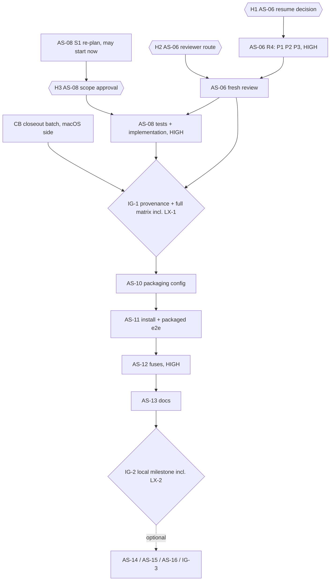

# OpenVern — Apple Silicon remaining tasks

> **Status (2026-11-10):** CB-1 approved; CB-2 pending you. AS-06 R4 and AS-08 have review approval and H4 approval.
> AS-10 to AS-13 are implemented and reviewed on macOS (AS-13 after accuracy-review fixes) (AS-12 is conditional on LX-2 and H4). AS-01 to AS-12 are one commit
> each on `feature/apple-silicon`, not merged or pushed. Linux runs (LX-1, LX-2), IG-1 and IG-2 are pending.
> **Companion to:** `docs/apple-silicon-plan.md` (the plan). The plan's §1–§6 rules, decisions and original task
> scopes stay normative. This document lists only the **remaining deltas**, as implementation-ready cards.
> **Orchestration:** Orchestrator Ruleset v1 (2026-11-06). Tag of this planning task: `plan` / **high** (filesystem
> trust boundary, secrets, shared packaging config).
> **Evidence used:** source on `feature/apple-silicon` at planning time (HEAD `f402a3e`, then uncommitted) and the
> local-only reports listed in §1.4. Where a report and the plan's tracker disagree, the newer report and the source win.

## How to use this document

1. Read the plan's §1–§6 first, then §1–§4 here, then your card in §5.
2. Each card names a route block (§4.1), a stage protocol (§4.2), check blocks (§4.3–§4.5) and its own deltas.
3. Touch only a card's allowed files. Anything else stops the task (ruleset §9).
4. Never stage or commit `reports/` or `research_notes/` (`AGENTS.md`). Stage by path, only when the user asks.
5. Run sequentially in the existing checkout. Git worktrees would start from `f402a3e` without the uncommitted
   Apple Silicon changes, so parallel lanes aren't used unless the user first asks for commits. E2E runs one at a time.

---

## 1. Where things stood at planning time

> **Historical (as of 2026-11-10, before execution).** For the current state see the status header above and the
> plan's §9 tracker: AS-06 R4 and AS-08 are approved and committed, packaging (V6–V9, V16) passed, A2 artifacts are
> built and validated with validation identities, and AS-01 to AS-12 are committed on `feature/apple-silicon`.

### 1.1 Three app states (don't conflate them)

| State | What it is | Status |
|---|---|---|
| **A1 Dev/test app** | Unpackaged Electron running the current `out/`: `npm run dev`, `dev:web`, `preview`, and the isolated own-identity copies used for AS-04/AS-07/V10 evidence (`app.isPackaged` false) | **Running and measured on macOS.** Linux not run |
| **A2 Verified locally installable app** | `npm run dist:mac` arm64 `.app` + `.dmg`, ad-hoc signed `dev.stefanos.openvern` / `OpenVern`, verified, installed by `install-local-mac.sh`, packaged e2e green, fuses on | **Not built.** AS-10 to AS-13 and IG-2 |
| **A3 Public notarized release** | Developer ID, hardened runtime, notarized and stapled; opens on another Mac after download | **Optional (M4), not planned.** Needs the Apple Developer Program. Not needed for A2 |

### 1.2 Done: don't reopen

- **AS-04:** native M1–M7 all measured, including the user's literal Dock confirmations for M4/M5. Sonnet 5.5 high
  code review APPROVE.
- **AS-07:** native V4 save, Allow, startup Deny (D15 as specified), the user's exact Always Allow followed by a
  prompt-free restart showing Connected, and item-deleted recovery are measured. The integrator accepted the isolated
  own-identity 176/0 E2E for AS-07's **macOS critical-flow checkbox only**. Post-selection encryption failure is an
  accepted fake-only residual (final AC 5). The Sol max review was CONDITIONAL with no code or security findings; the
  integrator recorded both macOS conditions as met.
- **AS-09:** `build/icon.icns` is present: 109535 bytes, SHA-256 `761bc9d0…918ba`, matching the reviewer's
  regeneration (re-hashed 2026-11-10). Script approved.
- **AS-01, AS-02, AS-03, AS-05:** implemented and reviewed on macOS (see the plan's §9).
- **AS-00:** V1, V2, V3, V11 and the secret scan measured. V4's interactive legs were measured under AS-07, V5/V14's
  open legs under AS-04 (M1–M7), and V10 triggered AS-08.

### 1.3 Not done, or not proven

- **Linux x86_64:** no actual run of any unit test, E2E, preview, AppImage or install step. Injected-platform tests on
  macOS don't substitute.
- **AS-06:** latest review CHANGES REQUESTED (§5.2). The 60 tests in `case-insensitive-fs.test.ts` and the 267 in the
  12-file dependent set pass, but **they don't cover the three new findings**.
- **AS-08:** triggered, not implemented. No earlier AS-08 re-plan proposal exists (the planner run was cancelled).
- **Keychain isolation:** `--use-mock-keychain` is **unproven** (D12). The standard unflagged `npm run e2e:electron`
  uses the real `OpenVern Safe Storage` login item, which exists since the V13 run (created by the e2e, not deleted).
- **Packaging:** V6, V7, V8, V9, V16 pending. Nothing packaged has run.
- **Approvals:** no high-risk task is approved for merge. Nothing is committed, merged or pushed.

### 1.4 Evidence (local-only, ignored by git)

`reports/apple-silicon-as06-kimi-review.md` (latest AS-06 review), `…-as06-dangling-root.md`, `…-v10.md`,
`…-as07-review.md`, `…-native-validation.md`, `…-as04-native.md`, `…-as04-review.md`, `…-as09-review.md`, plus the
earlier AS-06/AS-07 reports. Blobs at the latest AS-06 review, unchanged on 2026-11-10: `sandbox.ts` `eb04232`,
`changes/index.ts` `e6d9821`, `case-insensitive-fs.test.ts` `bb6111f`. `walk.ts`, `storage/projects.ts` and
`project-files/index.ts` are unchanged from HEAD.

---

## 2. Order and gates



**Sequence:** CB and the AS-08 re-plan (S1) can run now, because neither changes code. Then come H1 and H2, then
AS-06 R4, then AS-08 S3–S8, then IG-1. After that, AS-10 → AS-11 → AS-12 → AS-13 → IG-2. Optional M4 work comes last.

- Linux runs are consolidated: **LX-1** in IG-1, on the tree after AS-06/AS-08, and **LX-2** in IG-2. A Linux run on an
  older tree doesn't count for later code.
- **D-ORDER** (nonblocking; default **no**): may AS-10/AS-11 macOS work start before IG-1 when only Linux access is
  missing? If you say yes, everything packaged is re-run on the post-IG-1 tree in IG-2.
- **D-AS08-DEP** (nonblocking; default **keep**): AS-08 S3+ waits for AS-06's review verdict. The AS-08 files don't
  overlap the AS-06 R4 files (§5.2, §5.3), so you may decouple them if AS-06 stays paused.

---

## 3. Decision register

### 3.1 Approvals the ruleset requires

| # | Decision | Ruleset basis | Options and recommendation | Blocks |
|---|---|---|---|---|
| **H1** | Resume AS-06 implementation (round 4) | §8.3 and §9: escalation ladder exhausted. Attempts so far: attempts 1–2 (Terra medium, then high; tests incomplete), attempt 3 (Opus high, tests + fix), the review-P1/P2 remediation (Opus high), and the dangling-root remediation (Opus xhigh; the reports call it "remediation 3") | (a) **Recommended:** authorize one round limited to P1–P3 (§5.2), implementer Opus 5.5 at `effort: max` (the next rung after `xhigh`), or `xhigh` if you prefer. Stop rule: a new finding after this round stops again, with no automatic round 5. (b) Accept or defer a finding as residual risk. That's your risk call; not recommended for P1/P2, which are measured bypasses. (c) Pause AS-06, which also pauses IG-1 | AS-06 S2–S4 |
| **H2** | Reviewer for the post-remediation AS-06 review | Rule 7: frontier, max, a different model, fresh context. Kimi isn't in §1's model table, so §9 "fits no rule" applies | (a) GPT 6.1 Sol `max`, the ruleset default. Its last AS-06 attempt was refused by the provider's safety check with no verdict, and the plan says no automatic retry, so whether to try again is your call. (b) Kimi K3.1 Pro: `opencode` · `openrouter/moonshotai/kimi-k3.1-pro`, `variant: max`. Your 2026-11-10 authorization covered only that one review, so this needs a fresh per-task authorization, and it's a paid OpenRouter run. (c) Another arrangement you specify. This document schedules no review run | AS-06 merge |
| **H3** | AS-08 scope beyond the plan's §7 AS-08 list and wording | §9: files or modules the plan didn't mention | **H3a (minimum, required):** a new root readability probe in `listTree`; an internal `platform` field on `ProjectFilesDeps`; **new** `src/core/project-files/tcc-denial.test.ts`. **H3b (recommended):** file-open `EPERM`/`EACCES` mapping in `readAt`/`readBytesAt`. **H3c (recommended, test only):** a renderer case in `src/renderer/features/files/Files.test.tsx`. **Option W** (agent-facing tool messages: `walk.ts`, `list-files.ts`, `search.ts`, `read-file.ts`, `tree.ts`) is **not recommended now** (§5.3) | AS-08 S3+ |
| **H4** | Merge approvals | Rule 7 (high risk) and §9 (merge or push to `main`) | AS-05, AS-06, AS-07, AS-08 and AS-12, plus IG-1 and IG-2 (and optional AS-15, AS-16, IG-3). Each comes with a review summary. Nothing merges or pushes without it | merges |
| **H5** | Deleting data | §9 irreversible actions | Per action only: any Keychain item or ACL (including cleanup of your own validation items), any TCC record (`tccutil reset`), owned fixtures and evidence (for example `~/Documents/openvern-v10-f5956597`). **Nothing is authorized here.** The one-time disposable-item deletion approval was already used | optional cleanup |
| — | New dependency | §10 | None planned. Any dependency for a high-risk task needs your OK first | — |

### 3.2 Execution prerequisites you control (not ruleset approvals)

| # | Prerequisite | Why |
|---|---|---|
| **X1** | Linux access for LX-1 and LX-2: you run them on the CachyOS machine, or you link it (it's not assumed linked). Also, how the exact tree gets there: commits when you ask, then a `git bundle` or a branch push (pushing needs your OK), or a copy that excludes `reports/` and `research_notes/` | Nothing is committed yet |
| **X2** | Real-identity Keychain sessions: anything run as `OpenVern` (`npm run preview`, the standard `npm run e2e:electron`, `dist:mac` output) reads or creates the real `OpenVern Safe Storage` item and may prompt you | §4.5 |
| **X3** | TCC prompts for the AS-08 native recheck: a fresh validation identity, and you choose Don't Allow. No `tccutil`, no System Settings edits | §5.3 |
| **X4** | A real install into `~/Applications` (AS-11 manual check, IG-2 L10) | It changes your machine state |
| **X5** | gitleaks: a verified 8.30.1 binary (the darwin_arm64 tarball's SHA-256 `b40ab0ae…9aeb6a5` matches the release `checksums.txt`; binary `ba52fb1b…0e84f`). If a later session lacks it, use a temporary verified download per the plan's §5.7. No machine-wide install without asking | Static checks |
| **X6** | `npm ci` from the lockfile on Linux (and on the Mac if `node_modules` is missing) | Downloads Electron and the platform binaries; adds no dependency |

### 3.3 Nonblocking design defaults (apply unless you say otherwise)

| # | Decision | Default |
|---|---|---|
| D-ORDER | AS-10/AS-11 before IG-1 | No (§2) |
| D-AS08-DEP | Decouple AS-08 from AS-06 | Keep (§2) |
| D-AS08-L | Also surface an unreadable project root as an error on Linux | **No.** Linux keeps today's empty tree (§5.3) |
| D-KC-PKG | Which identity packaged functional checks use | A validation-identity package for AS-10/11/12 functional evidence; the real identity once, in IG-2 (L5, L7, L8, L10), under X2 (§4.5) |
| D16 | Firmlink duplicate project roots (`/Users/x` and `/System/Volumes/Data/Users/x`) | Residual. No `projects.ts` change (§7) |
| D17 | Unicode folding for the home deny layer and `isDeniedRel` callbacks | Residual. A separate optional high-risk task (§7) |

D1–D15 in the plan are unchanged. D5 now records the AS-06 Kimi exception.

---

## 4. Reusable blocks

### 4.1 Route blocks

Exact ids: check `orchestrator_capabilities` once per thread before the first `delegate_task` (ruleset §3). This
document claims nothing about current availability. On a usage limit or outage, move down one model in the same
ruleset row. The reviewer must always differ from the implementer. A provider **safety refusal** (as with AS-06) is
neither a limit nor an outage: stop and ask, following the H2 pattern.

| Block | Planning / re-plan | Test code (own stage) | Implementation | Debug / fix | Fresh review | Human |
|---|---|---|---|---|---|---|
| **RT-H** high-risk code | `claudeAgent` · `claude-opus-5-5` · `effort: xhigh` | `codex` · `gpt-6.1-terra` · `reasoningEffort: medium` (override of the DeepSeek role) | `claudeAgent` · `claude-opus-5-5` · `effort: high` | `claudeAgent` · `claude-opus-5-5` · `effort: high` | `codex` · `gpt-6.1-sol` · `reasoningEffort: max` | merge approval (H4) |
| **RT-L** low-risk, non-routine implement | `claude-opus-5-5` · `effort: high` | `claudeAgent` · `claude-haiku-5-5` · `effort: high` | `gpt-6.1-terra` · `reasoningEffort: medium` (override) | `gpt-6.1-terra` · `reasoningEffort: high` (override) | `claudeAgent` · `claude-sonnet-5-5` · `effort: high`. If large or multi-module: `claude-opus-5-5` · `effort: high` (frontier, different vendor from Terra). If Sonnet is unsure, escalate to frontier | — |
| **RT-A** low-risk automation, scripts, docs | `claude-opus-5-5` · `effort: high` | `claude-haiku-5-5` · `effort: high` (if any) | `claude-haiku-5-5` · `effort: medium` | `gpt-6.1-terra` · `reasoningEffort: high` | `claude-sonnet-5-5` · `effort: high`; multi-module: `claude-opus-5-5` · `effort: high` | — |
| **RT-V** validation, no code change | Interpretation / re-plan on a contradicting result: `claude-opus-5-5` `high` (low-risk task) or `xhigh` (high-risk task) | — | Execution: you (native GUI, Keychain, TCC, Linux), or an agent you designate for non-GUI command runs | — | Tracker and doc update: `claude-haiku-5-5` `medium`, reviewed by `claude-sonnet-5-5` `high` | — |
| **RT-I** integration gate | — | — | Integrator: `claude-opus-5-5` · `effort: high` | `claude-opus-5-5` · `effort: high` | `gpt-6.1-sol` · `reasoningEffort: max` (any high-risk content) | approval before merge to `main` |
| **RT-HA** high-risk automation (optional AS-16 only) | `claude-opus-5-5` `xhigh` | — | `claude-haiku-5-5` · `effort: medium`, from a detailed spec | `claude-opus-5-5` `high` | `gpt-6.1-sol` `max` | merge, push and secret creation |

Small-tier fallback: `codex` · `gpt-6-luna`. The Kimi target is **not** a route block. It's the recorded exception
for the 2026-11-10 AS-06 review only.

### 4.2 Stage protocol (every code card)

1. **Test-code stage first, separate from implementation.** The test model writes tests only. For a security finding,
   a PRE run against the unchanged product blobs must show every **FF** (fail-first) case failing and every control
   passing. Record the counts, plus `git hash-object` of each product file before and after the stage (it must be
   unchanged).
2. **Implementation stage.** It edits product files only. It never removes or weakens an assertion. If a test looks
   wrong, it stops and reports back to the test stage. It doesn't add tests silently.
3. **Post-fix runs:** focused, then dependent, then the full `npm test`, then the card's E2E.
4. **Static checks:** §4.3, on every change.
5. **Fresh-context review.** The reviewer sees only the plan's §1–§6, this document's §1–§4, the card, the diff and
   the check outputs. Never the implementer's transcript or reasoning report. A new review is a new `delegate_task`.
6. **Stop and report** on an unlisted file, a dependency or lockfile change, a `src/shared/` contract change, any
   Keychain or TCC change, or any real data or credential.

### 4.3 Static check blocks

**SC-DOC** (docs-only changes, ruleset rule 8):

```bash
npm run lint
npm run typecheck
GL=<verified gitleaks 8.30.1 binary, X5>
"$GL" git --config .gitleaks.toml --redact --no-banner
"$GL" dir --config .gitleaks-dir.toml --redact --no-banner .
npm audit --omit=dev --audit-level=high        # gate
npm audit                                       # report-only; last recorded: 6 moderate build-tool findings
git diff --check                                # tracked files
grep -nE '[[:space:]]+$' <new untracked files>  # expect no output
git diff --exit-code -- package.json package-lock.json
git diff --cached --quiet && git status --short # nothing staged; nothing under reports/ or research_notes/
```

**SC-CODE** = SC-DOC + the card's focused tests + `npm test` + `/bin/bash -n` on each changed `.sh` (shellcheck only
if already installed).
**SC-PKG** = SC-CODE + the card's packaging verify commands.

### 4.4 Platform blocks

**MAC-E2E** (serialized; ports 8787/5173):
- `npm run e2e:web`.
- Electron leg, one of two variants, chosen and recorded per run:
  - **(i) Own-identity runner.** The recipe is in §4.5. AS-07 accepted it as an equivalent; any other task needs its
    reviewer or integrator to accept it explicitly.
  - **(ii) The literal `npm run e2e:electron`,** under X2. The AS-01 and AS-06 runs used it.

**LX** (Linux x86_64, CachyOS; never run so far; needs X1 and X6):
- `node -p process.arch` reports `x64`.
- SC-CODE, with a Linux gitleaks binary verified the same way.
- `npm run e2e` (web + Electron, with `DISPLAY`/`WAYLAND_DISPLAY`), then a manual Ctrl+C cleanup check (AS-01).
- `npm run preview`: no menu bar, Ctrl+N/B/] work, Ctrl labels, `--no-sandbox` warning text unchanged (AS-03, AS-04).
- `node build/make-icon.mjs` **in a scratch copy** of the repo: a 512×512 PNG, exit 0. The repo's `icon.png` stays
  untouched (AS-09).
- LX-2 adds packaging: `npm run dist` gives `release/OpenVern-<version>-x86_64.AppImage`, `scripts/install-local.sh`
  installs it, the AppImage fuse read-back and a smoke run pass, and an owned-temp check confirms the Linux legacy
  migration still runs (the counterpart of AS-05).
- Results are recorded per item. No Linux claim is made without an actual run.

### 4.5 KC-ISO: Keychain, TCC and identity rules

1. **Keychain-free modes:** `npm run dev` and `npm run dev:web`. The backend runs in the Node dev server with the file
   store (`src/server/dev.ts:18`), and dev Electron only renders (`src/main/index.ts:36`). Use them, with
   `OPENVERN_FAKE_PROVIDER=1` and a temp `OPENVERN_DATA_DIR`, for renderer and tool checks.
2. **Keychain modes:** `npm run preview`, `npm run e2e:electron` and every packaged build use safeStorage, which
   reads or creates the login item `<app name> Safe Storage`. That's `OpenVern Safe Storage` for the default
   unpackaged identity (measured in V13) and, inferred from `productName`, for the packaged release identity.
3. **Temp profiles isolate files, not the Keychain or TCC.** A temp `--user-data-dir` or `OPENVERN_DATA_DIR` doesn't
   change the Keychain service name or the TCC records. No blanket isolation claim.
4. **`--use-mock-keychain` is unproven (D12).** Don't rely on it, and never add it to app defaults.
5. **Own-identity recipe** (AS-04/AS-07 reports): a scratch ad-hoc-signed copy of the locked `Electron.app`, or a
   validation package, with a unique bundle id, `productName` and runtime `app.getName()`, running the hash-matched
   current `out/`.
   - Bootstrap: import the product before `ready`. No module-level `await app.whenReady()`; that caused the AS-07
     attempt-2 deadlock.
   - Fake provider and the allowlisted dummy key only.
   - Positive control: `<unique name> Safe Storage` is absent before and present after a dummy encrypt.
   - A **validation package** comes from CLI overrides into a scratch output dir (`-c.appId`, `-c.productName`,
     `-c.extraMetadata.productName`, `-c.directories.output`), with no config-file change. If the positive control
     doesn't show the unique item, stop. Don't edit `electron-builder.yml` to make it work.
6. **Identities and signatures:**
   - **Validation identities:** evidence only, never shipped. They get their own Keychain and TCC records.
   - **Local release identity:** `dev.stefanos.openvern` / `OpenVern`, ad-hoc signed. Each ad-hoc rebuild changes the
     code signature, so expect one Keychain re-prompt and new TCC prompts (L7, measured once in IG-2).
     Double-clicking it uses the real profile `~/Library/Application Support/openvern` (X2).
   - **Public identity:** Developer ID (M4). Moving from ad-hoc to Developer ID prompts once more.
7. **Never without a per-action approval (H5):** deleting or editing a Keychain item or its ACL, Keychain Access edits,
   `security delete-*`, `tccutil reset`, privacy setting changes, or reading the value of the real
   `OpenVern Safe Storage` item. Never use a real API key.

---

## 5. Task cards

### 5.1 CB: closeout batch for AS-00, 01, 02, 03, 04, 05, 07, 09

**Type** test / docs (validation closeout). **Risk** low: no code change. The underlying high-risk tasks (AS-05,
AS-07) keep their H4 merge approval. **Route** RT-V. **Start** now. **Merge gate** none of its own; the items roll up
into IG-1 and IG-2.

**Allowed files:**
- `docs/apple-silicon-plan.md`: §3.3 Result cells and §9 rows for AS-00 to AS-09 only.
- `docs/apple-silicon-remaining-tasks.md`: status lines only.
- Local reports, never staged.

| Task | Remaining delta | Discharged in |
|---|---|---|
| AS-00 | **CB-1:** the plan-delta review that is still pending: `claude-sonnet-5-5` · `effort: high`, fresh context, checks that §3.3 rows V1–V5, V10, V11, V14 match their reports. Then the tracker reads "measurements complete or handed to the owning task" (V6–V9, V16 → AS-10/12; V12 → AS-01; V13 → AS-11; V15 → AS-14) | CB |
| AS-01 | Linux `npm run e2e` with unchanged output, and Linux Ctrl+C cleanup. The V12 alternate layouts stay pattern-only (no browser install; nonblocking). V13's packaged leg goes to AS-11 | LX-1, AS-11 |
| AS-02 | Linux `npm test` | LX-1 |
| AS-03 | **CB-2:** a macOS manual visual check in `npm run dev` (Keychain-free, §4.5.1): `⌘ N`, "Toggle right panel (⌘ ])", placeholder `~/code/my-app`, real Cmd+N/B/] work. You run it, or an agent with your GUI permission does. The Linux check (`npm run dev`, Ctrl labels) is in LX-1 | CB, LX-1 |
| AS-04 | Linux unit, E2E and preview. The packaged menu and shortcuts are IG-2 L5. The two nonblocking review nits stay optional | LX-1, IG-2 |
| AS-05 | Linux unit and E2E. The packaged migration check uses an owned temp `--user-data-dir=<tmp>/openvern` and a dummy `<tmp>/harness/settings.json`, no `OPENVERN_DATA_DIR`, on the validation package: expect no copy and no marker, with no real-home file created. H4 | LX-1, AS-11, H4 |
| AS-07 | Linux unit and `e2e:electron`. The ad-hoc rebuild re-prompt (L7). Optional: the plain → safeStorage re-encryption check, and cleanup of your own test items (H5, not a functional blocker). H4 | LX-1, IG-2, H4/H5 |
| AS-09 | The Linux non-darwin `make-icon` run (scratch copy), and the Dock/Finder look | LX-1, AS-11 |

**AC:** every row has a recorded result or a named owner; no completed item is reopened; no source or test change;
SC-DOC passes. **Tests:** none new (no logic changes). **Stages:** one doc pass at the end of the batch
(`claude-haiku-5-5` `medium`), reviewed once (`claude-sonnet-5-5` `high`). Not one delegation per row.

### 5.2 AS-06 R4: remaining delta for findings P1, P2, P3 (HIGH)

**Type** test, then implement (characterization first). **Risk** high: deny matching for the tools, the walker and
change apply (§11, input handling at a trust boundary). It guards data dirs that hold `secrets.json`.
**Route** RT-H, except the implementer effort (H1) and the reviewer (H2).
**Start gate:** H1. The S1 plan confirmation can run once H1 is decided.
**Merge gate:** an S4 approve verdict under H2, LX-1 in IG-1, and H4.

**Baseline:** implemented through the dangling-root remediation (the reports' "remediation 3"). Blobs as in §1.4. The latest review (Kimi K3.1 Pro, 2026-11-10,
per-task exception) found that the earlier Unicode-fold, lexical-`/tmp` and dangling-root fixes work. It requested
changes for the three findings below. Don't recreate the completed work.

**Allowed files** (a subset of the plan's AS-06 list; no new files):
- Implementation:
  - `src/core/tools/sandbox.ts`: P1 in the darwin branch of `isWithinAny` plus private firmlink helpers. P2: an
    optional `platform` parameter on `isDeniedName` / `isDeniedPath` / `isDeniedEntryName`. P3: one exported pure
    comparison helper.
  - `src/core/changes/index.ts`: the `resolveTarget` message predicate only.
- Tests:
  - `src/core/tools/case-insensitive-fs.test.ts`: filesystem cases, reusing its `exerciseDeniedRoot` harness.
  - `src/core/tools/sandbox.test.ts`: pure, platform-injected name tests.
  - `src/core/changes/index.test.ts` and `src/core/tools/walk.test.ts`: only if a case doesn't fit the first file.
- **Stop and report** if any of these would change:
  - `src/core/index.ts` (AS-05; roots stay as produced, and the comparison owns aliasing)
  - `src/core/storage/projects.ts` (D16)
  - `walk.ts` (it gets P2 through `isDeniedEntryName`'s default parameter)
  - anything under `src/core/project-files/`, including `home-deny.ts` (D17) and `project-files.test.ts` (kept free
    for AS-08)
  - `src/shared/`, a dependency or the lockfile

**Behavior:**

- **P1: firmlink spellings, darwin only.** Today `realpath` keeps `/System/Volumes/Data/…` spellings, and folding
  can't remove the extra prefix, so existing and missing denied roots are bypassed through read, list, search, tree,
  stage and apply (Kimi P1; pre-existing, now part of acceptance).
  - Add a constant table of firmlink source paths, taken from this Mac's `/usr/share/firmlinks` (macOS 26.6, read on
    2026-11-10, 19 entries): `/AppleInternal`, `/Applications`, `/Library`, `/System/Library/Caches`,
    `/System/Library/Assets`, `/System/Library/PreinstalledAssets`, `/System/Library/AssetsV2`,
    `/System/Library/PreinstalledAssetsV2`, `/System/Library/CoreServices/CoreTypes.bundle/Contents/Library`,
    `/System/Library/Speech`, `/Users`, `/Volumes`, `/cores`, `/opt`, `/pkg`, `/private`, `/usr/local`,
    `/usr/libexec/cups`, `/usr/share/snmp`. On this Mac each entry's target is the same path below
    `/System/Volumes/Data`. The table isn't read at runtime, so it adds no I/O.
  - **Short form:** on folded segments, drop the leading `system`/`volumes`/`data` segments only when the remainder
    starts, segment-bounded, with a folded firmlink source. Anything else is unchanged: other `/System/Volumes/*`
    paths, a non-firmlinked remainder, `/System/Volumes/DataX`, `/Users2`, `/usr/localx`.
  - In the darwin branch of `isWithinAny`, also compare the short forms of the target with those of the lexical
    root and the canonical root (`startsWithSegments`). Normalizing both sides covers both directions with one rule.
    The exact check stays first. Non-darwin still returns before any of this. Every new branch can only return
    `true`. P1 adds no filesystem call.
  - S1 must re-confirm that the `keepsLastSegment` skip stays sound (the root's last segment doesn't change). If it
    doesn't, drop the skip for prefix-spelled roots only.
  - Containment (`isInside(realRoot, …)`) doesn't change. A target spelled in the other form stays `outside`
    (fail-closed).
- **P2: Unicode aliases of denied names, darwin only.** Today name matching only lowercases, so `secretſ.json`
  (which APFS treats as `secrets.json`) is readable, listable, searchable and writable (Kimi P2).
  - Rule: `denied(name) = rule(lower(name)) || (darwin && !printableAscii(name) && rule(foldSegment(name)))`.
  - The OR keeps every old denial. The `.env.example` / `.env.sample` exceptions apply per spelling, so a name that
    lowercasing denies stays denied even when it folds to a safe name (for example `.env.ｅxample`). Printable ASCII
    names do no extra work.
  - `isDeniedPath(rel, platform = process.platform)` and `isDeniedEntryName(name, platform = process.platform)`.
    Existing callers don't change, so the sandbox and the walker agree. Linux keeps exact behavior.
  - **Deliberately not covered** (residual, D17): `isHomeDeniedRel` and `HOME_DENIED_*` (the home Files panel, which
    is read-only; home chats get no agent tools, `core/agent/loop.ts:237-240`), arbitrary `isDeniedRel` callbacks,
    `ALWAYS_SKIPPED_DIRS` and ignore rules, and the `isOpenVernDataDir` marker names. Don't claim these fixed.
- **P3: diagnostic only.** Today `poſt.txt` against an existing `post.txt` is rejected (correct), but the message
  says "Path goes through a symbolic link" (Kimi P3).
  - Add an exported pure helper, for example `sameFoldedRel(a, b, platform = process.platform)`. It compares
    per-segment `foldSegment` on darwin and keeps today's NFC + lowercase comparison elsewhere.
  - `resolveTarget` uses it only to pick the message. The rejection predicate, `kind: 'link'` and `path_invalid` stay
    as they are. The canonical spelling shown is the project-relative `res.rel`, available only after
    `resolveInProject` passed.

**Stages:**
- **S1 plan confirmation:** RT-H planning, fresh context. It checks this card against the blobs and the Kimi report
  and may tighten it, never widen it. It's needed because H1 resumes an exhausted ladder.
- **S2 test code:** Terra `medium`. FF cases against the unchanged blobs.
- **S3 implementation:** Opus at the H1 effort.
- **S3b debug:** Opus `high`, or the H1 effort.
- **S4 fresh review:** per H2.
- **S5 human approval:** in IG-1.

**Acceptance cases** (FF = must fail in the S2 PRE run):

*Fixtures.* Owned `mkdtemp` bases under `os.tmpdir()`, spelled both as the `realpath` (`/private/var/folders/…`) and
as `/System/Volumes/Data/private/var/folders/…`. Dummy content only. No `chats/index.json`, so the data-dir content
fallback can't mask the root check. Allowed controls in every scenario. Results are asserted through the real tools,
`renderTree`, a `ProjectFilesService` built in the test, and a real `ChangesService` (stage, then `acceptAll`).

- **A6-P1-1 (FF)** An existing marker-free denied root, with the project spelled long and the production roots
  short (`defaultDataDirRoots` with env passed as an argument, never `process.env`):
  - blocked: `read_file`, scoped and whole-project `search`, `list_files`, `renderTree`, Files `tree`/`read`
  - still visible: the `visible.txt` control
- **A6-P1-2 (FF)** A missing denied root, in the same shape:
  - `write_file` and stage are rejected
  - with the policy at apply only: a `blocked` conflict, and nothing is created under either spelling
  - the control applies
- **A6-P1-3 (FF)** Direction 2: the project spelled short, the denied root spelled long (passed directly, and via a
  long `XDG_CONFIG_HOME` argument). Same matrix, for existing and missing roots.
- **A6-P1-4** A project root inside a denied root through the other spelling blocks every tool. This also covers the
  spelling-sensitive data-dir check in `projects.ts` (D16).
- **A6-P1-5 (lock)** An absolute tool path in the project's other spelling stays `outside`.
- **A6-P1-6 (pure, all OSes)** Segment bounds:
  - not equated: `/System/Volumes/DataX/…`, `/System/Volumes/Data/Users2/…` vs `/Users/…`, `/usr/localx` vs
    `/usr/local`, and `/System/Volumes/Data/<non-firmlinked>/x` vs `/<non-firmlinked>/x`
  - equated: the deep firmlink `/System/Library/Caches`, and the case-variant prefix `/system/volumes/data/users/u`
    vs `/Users/u`
  - injected `linux` equates nothing
- **A6-P1-7 (darwin)** Drift guard: the table ⊇ the sources in `/usr/share/firmlinks`. It **fails, not skips**, on a
  Mac where the file can't be read.
- **A6-P1-8 (darwin)** Precondition: both fixture spellings have the same `dev`/`ino`. It fails, never skips, on macOS.
- **A6-P2-1 (FF)** An existing file stored as `secretſ.json` (dummy `NEEDLE`), with a README control:
  - blocked or hidden: `read_file`, `search`, `list_files`, `renderTree`, the walker, Files `tree`/`read`
  - still readable: the README
- **A6-P2-2 (FF)** A missing `secretſ.json`:
  - `write_file` and stage are rejected
  - with the policy at apply only: blocked, and `secrets.json` is still ENOENT afterwards
- **A6-P2-3 (FF where exposed today)** `ſecrets.json`, `SECRETſ.JSON`, `id_rſa` and `.git-credentialſ`. Each case
  first proves that the volume merges the pair, and fails, not skips, on macOS if it doesn't.
- **A6-P2-4 (monotonic controls)**
  - still blocked: canonical `secrets.json` read as `secretſ.json` (the old denial)
  - still allowed: exact `.env.example` and `.env.sample`, and `.ENV.EXAMPLE` (unchanged)
  - still denied: `.env.ſample` (unchanged; documented over-denial of an alias of an allowed name) and
    `.env.ｅxample` (the fold must not lift the lowercase denial)
- **A6-P2-5 (pure)** Injected `linux`: `secretſ.json` and `ſecrets.json` are not denied. Every existing
  `isDeniedPath` expectation is textually unchanged.
- **A6-P2-6** For every P2 name on darwin, `isDeniedEntryName(name) === isDeniedPath(name)`.
- **A6-P3-1 (FF)** An existing `post.txt`, staging `poſt.txt`: rejected, and the message names `post.txt`.
- **A6-P3-2 (FF)** Expansion: an existing `strasse.txt`, staging `straße.txt`, and the reverse. The test first
  proves the volume merges the pair.
- **A6-P3-3** The T5 `readme.md` / `README.md` message is unchanged. A real symlink still gets
  "Path goes through a symbolic link".
- **A6-P3-4** `secretſ.json` against an existing `secrets.json` gets `BLOCKED_MESSAGE` before the message branch and
  is never named.
- **A6-P3-5 (pure)** The non-darwin helper keeps NFC + lowercase semantics.
- **A6-G1** The existing 60 tests and the 12-file set stay textually unchanged and green, and so does the full
  `npm test`.
- **A6-G2** The review confirms: no new filesystem call on non-darwin; P1 and P2 add no syscall on darwin; every new
  branch only adds denial. A scratch microbench shaped like Kimi's is recorded as a characterization, not a gate. A
  clear regression is reported to the reviewer.
- **A6-G3** MAC-E2E once after the final fix, including the `edits.mjs` B12 refusals. Linux in LX-1.
- **A6-G4** Manual check in `npm run dev` or `dev:web` (the tools run in the Node dev server in both, Keychain-free):
  `[fake:write=.ENV]`, `[fake:read=SECRETS.JSON]`, `[fake:write=../ESCAPE.txt]` (original AC), plus
  `[fake:read=secretſ.json]` in an owned project. All refused.

**Test scope:**
- Unit tests for the pure fold and firmlink helpers.
- Integration tests through the real tools, walker, Files service and ChangesService, because the findings cross all
  of them.
- E2E, because the task is high risk.
- A manual refusal check, because the AC requires one.

**Checks:** SC-CODE; the Kimi focused and 12-file commands; MAC-E2E; LX-1.

### 5.3 AS-08: TCC denial messages (re-plan, then implementation; HIGH)

**Type** plan, then test, then implement. **Risk** high: project-root validation and the Files service sit at the
trust boundary, next to the shared walker. **Route** RT-H. The Kimi exception doesn't extend to AS-08: if Sol can't
review, use the H2 pattern again.
**Start gate:** S1 now. S3+ after H3, and after AS-06's S4 verdict (or D-AS08-DEP).
**Merge gate:** S7 approve, the S6 native recheck, LX-1, and H4.

**Trace, from the V10 symptoms to the code:**
1. `GET /api/projects/:id/files` (`routes/projects.ts:24`) calls `listTree` (`project-files/index.ts:111-140`).
   - `realpath(rootPath)` succeeds under the denial (V10 showed no error).
   - `walk()` hits `readdir` → `EPERM` at `walk.ts:104-107`, which is caught and skipped.
   - The response is `{entries: [], truncated: false}`, so `FilesSurface.tsx:92-95` shows "This project has no files."
2. The renderer already shows `ApiError.info.message` with "Try again" when the request fails
   (`FilesSurface.tsx:75-91`). CoreError messages reach the JSON (`server/app.ts:37-46`, `core/errors.ts:22-25`).
   **The renderer needs no change.**
3. `read_file` → `Cannot read README.md: EPERM` (`read-file.ts:100`): accurate, but not actionable.
   `list_files`, `search` and the prompt tree go through the same walker and come back silently empty.
4. Viewer and attach (`readAt`/`readBytesAt`): a raw `EPERM` from `open` would become `internal` ("Something went
   wrong inside OpenVern.") plus a server stack log. By code reading only; not measured.
5. Add project (`resolveProjectRoot`): whether `access` fails under TCC hasn't been measured. Today it maps every
   failure to the generic `path_invalid`.

**Option M** (recommended; H3a required, H3b and H3c recommended):

- `src/core/project-files/index.ts`:
  - **(H3a)** In `listTree`, after the `realpath`, a root readability probe: open the root for listing and close it,
    hitting the same error the walker's root `readdir` would. S1 picks the mechanism and proves it in tests. On
    darwin:
    - `EPERM` → `CoreError('path_invalid', <macOS privacy message>)`. Baseline wording, from the plan: "macOS
      blocked access. Allow OpenVern in System Settings › Privacy & Security › Files and Folders." S1 finalizes it
      without promising UI that doesn't exist (`dev:web` has no folder picker).
    - `EACCES` → `path_invalid` with a permissions message that doesn't blame TCC.
    - Anything else → today's default `path_invalid`.
    - On other platforms, no probe. The tree stays empty, as today (D-AS08-L).
  - **(H3a)** An internal `ProjectFilesDeps.platform?: NodeJS.Platform`, default `process.platform`. No HTTP or
    `src/shared/` change.
  - **(H3b)** In `readAt`/`readBytesAt`, map `EPERM`/`EACCES` from `open`, `readFile` or `stat` on darwin the same
    way, instead of `internal`. Other platforms unchanged.
- `src/core/project-files/project-files.test.ts`:
  - real `EACCES` from a `chmod 000` owned temp dir, with the mode restored in `finally`; skipped with a written
    reason only when the uid is 0
  - a real empty-folder control
- **New** `src/core/project-files/tcc-denial.test.ts` (H3a): `EPERM` injected with a `vi.mock('node:fs/promises', …)`
  scoped to this file.
- `src/core/storage/projects.ts`, the `resolveProjectRoot` error branch only (in the plan's list): on darwin, `EPERM`
  → the privacy message and `EACCES` → the permissions message. The accept/reject table and the Linux messages don't
  change.
- `src/core/storage/projects.test.ts`: `EPERM` injected with `vi.spyOn(promises, 'access')`. That works because
  `projects.ts` calls `fs.access` through the `promises` object.
- **(H3c)** `src/renderer/features/files/Files.test.tsx`: a `path_invalid` `ApiError` shows its message and "Try
  again", not the empty state. An empty result still shows "This project has no files."
- **Unchanged:** `walk.ts`, every tool, the renderer source, `src/shared/errors.ts` and the server routes.

**Option W** (not recommended now): agent-facing actionable messages through `walk.ts` (an opt-in start-directory
error), `list-files.ts`, `search.ts`, `read-file.ts` and `tree.ts`. These are trust-boundary modules shared by every
tool, so it means a larger high-risk review. Record it as a residual (R6). It can become its own task if you want it.

**API and error behavior:**
- darwin, unreadable root: HTTP 400 with `{"error":{"code":"path_invalid","message":"…","retryable":false}}`.
- Real empty folder: 200 with `entries: []`, unchanged.
- Linux: byte-identical responses.
- Denials of subfolders inside a tree stay silently empty. Representing them needs a new API field, which is a
  public contract change, so it's out of scope (R5).

**Stages:**
- **S1 re-plan:** Opus `xhigh`, fresh context. Confirms the trace against the source, picks the probe, finalizes the
  messages, and produces the exact H3 request. The trace above may be adopted as is.
- **S2:** H3.
- **S3 test code:** Terra `medium`, fail-first.
- **S4 implementation:** Opus `high`.
- **S5 debug:** Opus `high`.
- **S6 native recheck:** RT-V, user-attended, under X3.
- **S7 fresh review:** Sol `max`.
- **S8:** H4.

**Acceptance cases:**
- **A8-1 (FF)** darwin, injected `EPERM` on the root: the tree rejects with `path_invalid` and the privacy message.
  Today it resolves with `[]`.
- **A8-2 (FF)** darwin, real `EACCES` (`chmod 000`): `path_invalid` with the permissions message. Today: `[]`.
- **A8-3** A real empty folder returns `[]` with no error, on both platforms.
- **A8-4** Injected non-darwin `EPERM`/`EACCES` returns exactly today's `[]`.
- **A8-5 (FF)** `projects.ts` on darwin, injected `EPERM` from `access`: the privacy message. The ENOENT, non-dir and
  inside-data-dir messages, and the non-darwin generic message, are unchanged. The decision table is unchanged.
- **A8-6 (FF, H3b)** darwin, injected `EPERM` on `open` in the viewer: `path_invalid`, not `internal`. No file content
  in the message.
- **A8-7 (H3c)** The renderer error and empty states, as above.
- **A8-8** Deny decisions are unchanged: the existing project-files and projects tests stay unchanged and green, and
  `git diff` shows nothing for `walk.ts`.
- **A8-9 (S6, native)** Repeat V10 Phase B on a **fresh validation identity** with a seeded owned Documents fixture.
  The user chooses Don't Allow; then:
  - Files shows the actionable message (record the exact text)
  - it persists after a restart
  - the picker control restores reads
  - an owned real-empty folder elsewhere shows "This project has no files."

  No `tccutil`, no System Settings edits, no real-home panel. Record the identity's Keychain and TCC items for
  optional H5 cleanup.

**Test scope:**
- Unit tests for the mapping and the platform split.
- Integration tests on a real filesystem (`EACCES`, empty folder).
- One renderer component case, if H3c is approved.
- E2E regression on both OSes, because the task is high risk.
- The native recheck, because TCC can't be unit-tested.

**Checks:** SC-CODE; MAC-E2E; LX-1.

### 5.4 IG-1: wave integration and full matrix

**Type** review / integration. **Risk** high: it contains AS-05/06/07/08. **Route** RT-I.
**Start gate:** CB done; the AS-06 and AS-08 reviews approved (or a risk decision recorded under H1); X1 and X6.
**Merge gate:** H4 for AS-05/06/07/08 and for IG-1.

**Allowed files:** `docs/apple-silicon-plan.md` (§9) and this document's status. Source changes only by sending them
back to the owning task.

**Steps:**
1. **Provenance.** Map every changed path in `git status` to its task (plan §6.2). Confirm that the current blob is
   what its approving review saw: AS-06 and AS-07 recorded blobs and hashes; for the others, list the current blobs
   against the review's scope. Any post-review drift sends that task back for a re-review.
2. **Combined review.** Per the plan's §6.1, it's required only after parallel lanes. The tasks ran sequentially in
   one checkout, so the default is no combined review. Run an RT-I review if provenance drift or a cross-task
   interaction turns up.
3. **macOS:** SC-CODE and MAC-E2E. **LX-1:** the §4.4 Linux block on the same tree.
4. **Commits**, only when you ask: one commit per task on `feature/apple-silicon`, staged by path, with nothing from
   `reports/` or `research_notes/`, and an empty `git diff --cached` check before each commit. Merging or pushing to
   `main` needs H4.

**AC:** provenance is clean or re-reviewed; macOS and Linux are green with the results recorded; each high-risk task
has a review summary ready for your approval.

### 5.5 AS-10: local ad-hoc packaging config

**Type** implement. **Risk** low, non-routine: shared build config, the Linux artifact name, ad-hoc local signature
only. Re-tag it high on certificates, entitlements, fuses, notarization or credentials. **Route** RT-L.
**Depends** IG-1 (D-ORDER), AS-04, AS-09. **Merge gate:** review approve; no H4 (low risk).

**Allowed files:**
- `electron-builder.yml`
- `package.json` (scripts: add `dist:mac` only)
- `src/main/electron-builder-config.test.ts` (text checks; `js-yaml` isn't a direct dependency)

**Behavior:** the plan's §7 AS-10 scope items 1–5, unchanged:
- a `mac` block: `dir` + `dmg`, `arm64`, `identity: "-"`, `hardenedRuntime: false`, the category, `build/icon.icns`,
  and the three folder usage strings
- `artifactName` moved to `linux` with an identical string, plus a `mac.artifactName` ending in `arm64`
- `electronLanguages` only if V6 needs it
- `dist:mac`
- Measure V6, V7, V8 and V16 within this task.

**Stages:** Haiku `high` writes the config tests; Terra `medium` implements; Sonnet `high` reviews (Opus `high` if the
diff spans modules).

**AC:**
- The plan's AS-10 AC (`lipo` reports arm64 only; `codesign --verify --deep --strict` passes; `Signature=adhoc`;
  `plutil` shows the identifiers), plus the config tests (arm64 only, the Linux string unchanged, no top-level
  `artifactName`, `identity "-"`, no `CSC_`/`APPLE_` values, no `no-sandbox`).
- **Launch checks under D-KC-PKG:** functional launch and the TCC usage-string text on a validation package. The
  real-identity double-click launch (which uses the real profile and `OpenVern Safe Storage`, X2) goes to IG-2 unless
  you choose it earlier.

**Test scope:** unit (config text), integration (build and verify commands; packaging can't be unit-tested), manual
launch. E2E is in AS-11.

**Checks:** SC-PKG.

### 5.6 AS-11: install script and packaged-app e2e

**Type** automation. **Risk** low: it copies a locally built bundle. Packaged e2e follows KC-ISO. **Route** RT-A.
**Depends** AS-10, AS-01. **Merge gate:** review approve.

**Allowed files:**
- **new** `scripts/install-local-mac.sh`
- **new** `scripts/e2e/run-packaged.sh`
- `package.json` (`e2e:packaged` only)

**Behavior:** the plan's §7 AS-11 scope, plus four deltas:
1. An install-directory override (for example `OPENVERN_INSTALL_DIR`, default `~/Applications`), so the idempotency
   tests run in an owned temp dir. The real `~/Applications` run is X4.
2. `E2E_APP` defaults to the validation package (D-KC-PKG). A Keychain stall fails with a hint instead of hanging.
3. This task runs the AS-05 packaged migration check (§5.1).
4. It records the AS-09 Dock/Finder look and V13's packaged leg. Whether the real identity collides with or prompts
   for an existing item is checked in IG-2.

**Stages:** Haiku `medium` implements; Terra `high` debugs; Sonnet `high` reviews (Opus `high` if multi-module).

**AC:** install and uninstall are idempotent in the temp dir; the packaged e2e passes on macOS (validation package);
`install-local.sh` is unchanged; `/bin/bash -n` is clean; the AS-05 check shows no copy and no marker.

**Test scope:** E2E, the critical flows in the real production wiring. Manual install, uninstall and Spotlight launch
under X4.

**Checks:** SC-CODE, plus the packaged e2e.

### 5.7 AS-12: Electron fuses hardening (HIGH)

**Type** implement. **Risk** high: fuses control code loading and env/CLI injection under an identity that holds
Keychain and TCC grants. A wrong fuse can brick launches, and fuses apply to the Linux AppImage too. **Route** RT-H.
**Depends** AS-11. **Merge gate:** fresh review approve, LX-2, H4.

**Allowed files:**
- `electron-builder.yml` (the `electronFuses` block only)
- `src/main/electron-builder-config.test.ts`
- `scripts/e2e/run-packaged.sh` (a fuse read-back assertion only)

**Behavior:** the D4 set, measuring V9 within the task:
- Read-back via `npx --no-install` against the transitive `@electron/fuses`. If that needs an install, stop and ask
  (§10).
- There's no `child_process` in `src/`, so `runAsNode: false` is safe.

**Stages:**
- Terra `medium` writes the config tests and the read-back assertion (fail-first: the keys are absent today).
- Opus `high` implements and debugs.
- Sol `max` reviews.

**AC:**
- Every key and value is asserted, and the read-back matches on the `.app` and on the AppImage (LX-2).
- `codesign --verify --deep --strict` passes after the flip, and the packaged e2e passes.
- Manual negatives on a **copy** of the validation package: `ELECTRON_RUN_AS_NODE`, `NODE_OPTIONS=--require` and
  `--inspect` have no effect, and a byte-modified `app.asar` refuses to launch on macOS. On Linux, asar integrity
  validation doesn't apply, so no refusal is claimed there.

**Test scope:** unit (config), integration (read-back, codesign), packaged E2E on both OSes, manual negatives.

**Checks:** SC-PKG, LX-2.

### 5.8 AS-13: macOS documentation

**Type** docs. **Risk** low. **Route** RT-A. **Depends** the facts from AS-01 to AS-12, including the final AS-08
message text.

**Allowed files:**
- `README.md`
- `docs/apple-silicon-plan.md` (tracker and status)
- this document (status)
- `src/server/README.md` (only if it states platform facts)

**Behavior:** the plan's §7 AS-13 scope, plus:
- Dev modes are Keychain-free; preview and packaged builds use the Keychain.
- The TCC denial message, and where to allow access again.
- The three app states (§1.1).
- Ad-hoc rebuild re-prompts.
- No quarantine removal, Gatekeeper disabling or `--no-sandbox`.

**AC:** every command shown was run on its platform (Linux commands only with LX results); facts match the evidence;
links resolve.

**Checks:** SC-DOC; a Sonnet accuracy review.

### 5.9 IG-2: local macOS milestone (reaches A2)

**Type** review / integration. **Risk** high: AS-12, and the packaged Keychain and TCC behavior. **Route** RT-I.
**Start gate:** AS-10 to AS-13 reviewed; H4 for AS-12; X1, X2, X4.
**Merge gate:** H4 for IG-2 and before any merge to `main`.

**Steps:**
1. Provenance again, as in IG-1 step 1.
2. SC-PKG and MAC-E2E.
3. `dist:mac` and the verify commands; the packaged e2e on the validation package.
4. **One real-identity session** (X2, user-attended):
   - L5: packaged menu, native Edit keys, Cmd+Q/W/M/H, Dock reopen
   - L7: `enc: safeStorage` with a dummy key, then an ad-hoc rebuild re-prompts once
   - L8: double-click launch
   - L10: `install-local-mac.sh` install and uninstall (X4)
5. LX-2.
6. The plan's §8 L1–L12 ticked with evidence.

**AC:** every L item has a result. A2 is reached only when all pass. Nothing is pushed without approval.

---

## 6. Optional public distribution (M4; not needed for A2)

These stay as specified in the plan's §7. They need D6 (do M4 at all), D7 (lock the bundle id and name) and D8 (CI).
AS-15 and AS-16 also need the Apple Developer Program. Agents never handle raw credentials.

| Card | Type / risk | Route | Gates and approvals |
|---|---|---|---|
| **AS-14** CI checks | automation / low, non-routine (shared config, third-party actions) | RT-A | IG-2, D8. Actions pinned by SHA, no secrets, no e2e until V15. Pushing the workflow needs your OK |
| **AS-15** Developer ID + notarization | implement / **high** (signing identities, notary credentials, public distribution) | RT-H | IG-2, D6, D7. Approval before **each** notary upload and any publication; H4 |
| **AS-16** Signed release workflow | automation / **high** (CI secrets) | RT-HA | AS-14, AS-15. You create the secrets. Approvals for push and every release; H4 |
| **IG-3** Release gate (reaches A3) | review / high | RT-I | A downloaded build opens on a clean Mac without Open Anyway; the CI release fails closed without secrets; H4 |

---

## 7. Residuals and carry-forward (not in the remaining scope)

| # | Residual | Why it's not in scope | Default |
|---|---|---|---|
| R1 | Firmlink duplicate projects: `/Users/x` and `/System/Volumes/Data/Users/x` can both be added (`projects.ts:85` compares exactly). The data-dir check (`projects.ts:39`) is spelling-sensitive | Data consistency, not a deny bypass once P1 lands (A6-P1-4) | D16: no change |
| R2 | The home deny layer and `isDeniedRel` callbacks only lowercase (`home-deny.ts:42-49`). A folder stored as `.ſsh` at depth isn't hidden by the home layer | Read-only panel, no agent tools in home chats. A separate caller contract | D17: separate optional task |
| R3 | Aliases that aren't mapped: other mount points of the data volume, disk images, network, exFAT and HFS+ volumes. Fold soundness was measured on this APFS volume only | No justified table for them | Documented |
| R4 | A race between the check and the write; links that change during a check | Out of the AS-06 contract | Documented |
| R5 | Subfolder TCC denials inside a tree stay silently empty | Needs a new API field (public contract) | A separate high-risk task if wanted |
| R6 | Agent tool messages under a root denial (empty `list_files`/`search`/tree; `read_file` reports `EPERM`) | Option W | Deferred |
| R7 | The quit-time `stopped` record (AS-04 follow-up), D13 safeStorage async API before Electron 46, D10, D11, D12 | Plan decisions | Unchanged |
| R8 | Cleanup of your own validation Keychain items, the V10 fixture and owned scratch evidence | Not functional; H5 per action | Optional |
| R9 | Synchronous filesystem cost per call on darwin in `isWithinAny` (Kimi microbench: about 28–50 µs) | A characterization, not a defect | Reported at review |
