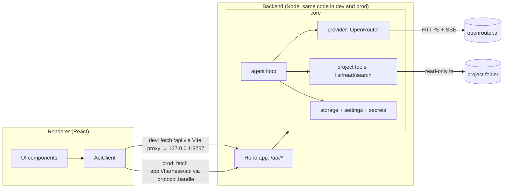
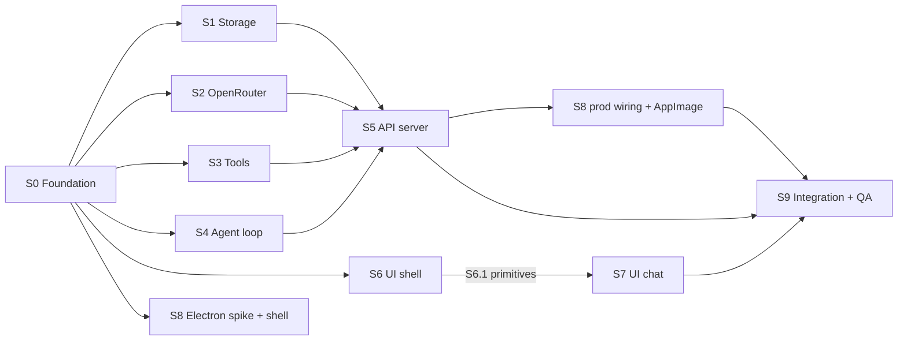

# harness — V0 plan

> **Status:** in progress (S0 done) · **Owner:** Stefanos · **Last updated:** 2026-10-31
> **Design:** [canvas](https://claude.ai/code/artifact/9b5c7910-9f0a-490d-a498-3c3253ec494c) (sources copied to [`docs/design/`](design/) for agents without access)

## How to use this document (read first if you are an agent)

1. Read **§1–§5 in full**, then **your section in §6**. §4 (contracts) is the source of truth for every
   type, route and event. Do not change a contract without updating §4 in the same PR and saying so in the PR description.
2. Work on a branch named `v0/<section-id>-<slug>` (e.g. `v0/s3-project-tools`). Touch only the paths your section
   **owns**. If you must touch another section's file, keep it minimal and call it out in the PR.
3. Do not add dependencies casually: S0 installs everything listed in §2. If you need a new one, justify it in the PR.
4. Tick the boxes in your section as you finish each requirement, and tick your row in **§9 Completion tracker**
   when the section's acceptance criteria pass.
5. Every PR must pass `npm run typecheck && npm run lint && npm test`.

---

## 1. Goal and scope

### 1.1 Product goal

A desktop AI harness: chat with LLMs about your local code projects. Long term it works with API keys from any
provider. **V0 supports OpenRouter only**, which already reaches most models.

### 1.2 V0 is done when

- Every element in the design (both artboards) is present **and working** (inventory in §5.2).
- A **Settings modal** (not in the design) lets the user add, see (masked) and remove an OpenRouter API key.
- The user can chat with any OpenRouter model, with streamed replies.
- In a chat attached to a project, the model can **read** the project (list, read, search files) through tool
  calls shown as tool rows. **No file modification, no command execution.**
- The user can attach text files and images to a message (rules in S7).
- Chats, projects and settings persist across restarts.
- It runs **in a browser in dev mode** and ships as an **AppImage** that works on Stefanos's CachyOS and Arch installs.
- The final acceptance checklist (§8) passes.

### 1.3 Non-goals for V0

Providers other than OpenRouter · editing files or running commands · editing/regenerating past messages ·
conversation branching · token/cost display (usage is stored, not shown) · context compaction/summarisation ·
showing model "thinking" · paste/drag-drop attachments · picking project files from the attach menu ·
searching chats · MCP · light theme · Windows/macOS builds · auto-update · pacman/AUR packaging · i18n · telemetry.

---

## 2. Decisions (locked for V0)

| Area | Decision | Why |
|---|---|---|
| App name | `harness`, in **one** constant (`APP_NAME`) + package metadata | Rename later is cheap |
| Language | TypeScript, `strict` + `noUncheckedIndexedAccess` | |
| Package manager | **npm** (workspaces not needed; single package) | Zero-config with Electron/electron-builder (pnpm needs hoisting + build-script allowlists) |
| Node | 22+ for tooling (machine has 24). Electron bundles its own | |
| Electron build | **electron-vite** (main / preload / renderer) | |
| Packaging | **electron-builder**, Linux **AppImage** (x86_64) | "Executable bundle"; `fuse2` is installed on this machine |
| UI | React 19, Vite, **Tailwind v4** (tokens in `@theme`), **Radix UI** primitives (Dialog, DropdownMenu, Popover), **cmdk** (model picker list), **lucide-react** icons | Accessible primitives, fast for agents |
| Routing | react-router v7, **hash** router (`#/new`, `#/chat/:id`) | Works on both `http://` (dev) and `app://` (prod) |
| Client state | **TanStack Query** for server data, **Zustand** for streaming runs + UI state | |
| Markdown | `react-markdown` + `remark-gfm`; code highlighting with **Shiki** (custom theme from tokens) | |
| Fonts | Self-hosted via `@fontsource-variable/{bricolage-grotesque,figtree,jetbrains-mono}` | No Google Fonts requests from the app |
| Server | **Hono** (+ `@hono/node-server` in dev) | Same `app.fetch` runs in Node (dev) and inside Electron's protocol handler (prod) |
| Validation | **zod v4** (request bodies, tool args; `z.toJSONSchema` for tool specs) | |
| SSE parsing | `eventsource-parser` (server: OpenRouter stream; renderer: our stream) | Spec-compliant, handles `:` keepalive comments |
| Provider layer | **Own thin adapter** over raw `fetch` (no SDK). Normalised message format; one adapter per provider | User decision |
| Storage | **JSON files** in a data dir, atomic writes. **No native Node modules** in V0 | Keeps packaging trivial |
| API key storage | `SecretStore` interface. Prod: Electron `safeStorage` (KWallet on KDE). Dev: plaintext file, mode `0600` | |
| Lint/format | **Biome** | One tool, one config |
| Tests | **Vitest** (node env for core/server, jsdom + Testing Library for renderer) | |
| IDs | `crypto.randomUUID()` | |
| Accent | `#f2cc8f` (design default). The `#e07a5f` alt stays a token, not a setting | |

---

## 3. Architecture

### 3.1 Overview



The renderer **only** talks to the backend through `ApiClient` (HTTP + SSE, relative URL `/api`). The backend is
**one Hono app** created by `createApp(core)`. Only how it is hosted changes:

### 3.2 Runtime modes

| Mode | Command | Renderer served by | Backend hosted by | Data dir |
|---|---|---|---|---|
| Web dev | `npm run dev:web` → open `http://localhost:5173` | Vite (5173), proxies `/api` → 8787 | `src/server/dev.ts` on `127.0.0.1:8787` (tsx watch) | `./.dev-data` |
| Electron dev | `npm run dev` | electron-vite's Vite (5173), same proxy | same standalone dev server (main does **not** host the API in dev) | `./.dev-data` |
| Prod preview | `npm run preview` | `app://harness/` | Electron main: `protocol.handle('app', …)` → `app.fetch` | `./.dev-data-preview` (via `HARNESS_DATA_DIR`) |
| Release | AppImage | `app://harness/` | Electron main, as above | `~/.config/harness` (`app.getPath('userData')`) |

- `HARNESS_DATA_DIR` overrides the data dir in every mode.
- `HARNESS_FAKE_PROVIDER=1` makes the dev server use `FakeProvider` (no key, no cost) — for UI work and tests.
- In Electron, the native folder picker goes over IPC (`window.harness.pickDirectory()`), the only non-HTTP channel.
  In the browser, `window.harness` is undefined and the UI falls back to a path text field.

**Risk + fallback (S8 spikes this first):** streaming a `Response` with a `ReadableStream` body through
`protocol.handle` must deliver chunks incrementally to `fetch().body.getReader()` in the renderer. If it buffers or
breaks, fall back to: main runs `@hono/node-server` on `127.0.0.1` at a **fixed** port (stable origin, so
`localStorage` survives restarts; pick a free one near 47615), window loads `http://127.0.0.1:<port>/`, and every
request carries a per-launch token header obtained via preload IPC. Record the outcome in §10.

### 3.3 Security model

- Dev server binds `127.0.0.1` only.
- Every `/api` request must carry header `X-Harness-Client: 1` (forces a CORS preflight for any foreign page).
  The server emits **no** CORS headers, so foreign preflights fail.
- `Host` must be `localhost`, `127.0.0.1` (any port) or `harness` (the `app://` host) → blocks DNS rebinding.
- `Origin`, when present, must be `http://localhost:5173`, `http://127.0.0.1:5173` or `app://harness`.
- The API key never goes to the renderer after saving: only `{ configured, keyHint }` (e.g. `sk-or-v1-…a1b2`).
- Electron: `contextIsolation: true`, `nodeIntegration: false`, `sandbox: true`, minimal preload, CSP in prod,
  external links open in the system browser, navigation away from the app origin is blocked.
- Project tools are sandboxed to the project root (S3) and block secret-looking files.

### 3.4 Repository layout

```
.
├─ docs/                      v0-plan.md, design/ (design sources)
├─ build/                     icon.png (512×512) and other packaging resources
├─ scripts/                   install-local.sh
├─ src/
│  ├─ shared/                 types.ts, api.ts (routes + zod bodies), events.ts, errors.ts, constants.ts, sse.ts
│  ├─ core/
│  │  ├─ index.ts             createCore(deps) — composition root (S5)
│  │  ├─ storage/             paths, json-file, settings, secrets (FileSecretStore), projects, chats, attachments (S1)
│  │  ├─ providers/           types.ts, fake.ts (S0) · openrouter.ts, models.ts (S2)
│  │  ├─ tools/               types.ts (S0) · sandbox, ignore, list-files, read-file, search, tree, index (S3)
│  │  └─ agent/               loop, history, system-prompt, title (S4)
│  ├─ server/                 app.ts (createApp), middleware/, routes/, sse.ts, dev.ts (S5)
│  ├─ main/                   index.ts, protocol.ts, ipc.ts, safe-storage-secret-store.ts, window.ts (S8)
│  ├─ preload/                index.ts (S8)
│  └─ renderer/
│     ├─ index.html, main.tsx
│     ├─ styles/              tokens.css, global.css, shiki-theme.ts
│     ├─ lib/                 api-client.ts, http-api-client.ts, mock-api-client.ts (S0), platform.ts
│     ├─ components/ui/       Button, IconButton, Dialog, Menu, Popover, TextField, Kbd (S6, first PR)
│     ├─ app/                 router, AppShell, ChatScreen composition, shortcuts (S6)
│     ├─ features/
│     │  ├─ sidebar/          (S6)
│     │  ├─ projects/         NewProjectModal, ProjectMenu (S6)
│     │  ├─ settings/         SettingsModal (S6)
│     │  ├─ chat-header/      ChatHeader, ChatOptionsMenu, RenameDialog (S6)
│     │  ├─ conversation/     Conversation, UserBubble, AssistantTurn, Markdown, CodeBlock, ToolCallRow, ErrorCard (S7)
│     │  ├─ composer/         Composer, AttachMenu, AttachmentChips, ModelPicker, ProjectChip (S7)
│     │  └─ new-chat/         NewChatScreen (S7)
│     └─ stores/              runs.ts (S7), ui.ts (S6)
├─ electron.vite.config.ts, vite.web.config.ts, renderer.vite.ts (shared renderer config)
├─ electron-builder.yml, biome.json, tsconfig*.json, vitest.config.ts
└─ package.json
```

### 3.5 Data directory

```
<dataDir>/
  settings.json         { "version": 1, "lastModel": string | null }
  secrets.json          { "version": 1, "openrouter": { "enc": "safeStorage" | "plain", "value": string } }   (mode 0600)
  projects.json         { "version": 1, "projects": Project[] }
  chats/index.json      { "version": 1, "chats": ChatSummary[] }   (rebuilt by scanning chats/ if missing or corrupt)
  chats/<chatId>.json   { "version": 1, ...Chat }
  attachments/<id>.bin  raw bytes
  attachments/<id>.json { ...AttachmentRef, "chatId": Id | null, "createdAt": IsoDate }
  cache/models.json     { "fetchedAt": IsoDate, "models": ModelInfo[] }
```

All writes are atomic (write `*.tmp`, `fsync`, `rename`) and serialised per file (in-process promise-chain mutex).

---

## 4. Shared contracts (source of truth)

S0 commits these to `src/shared/` and `src/core/**/types.ts` **verbatim** (formatting aside). Later sections implement them.

### 4.1 Domain types — `src/shared/types.ts`

```ts
export type Id = string;      // crypto.randomUUID()
export type IsoDate = string; // new Date().toISOString()

export interface Project { id: Id; name: string; rootPath: string; createdAt: IsoDate } // rootPath: absolute, realpath'd
export interface ProjectListItem extends Project { chatCount: number }

export interface ChatSummary {
  id: Id;
  projectId: Id | null;       // null = loose chat ("Chats" section), no tools
  title: string;              // "New chat" until auto-titled
  model: string;              // model used for the latest turn
  createdAt: IsoDate;
  updatedAt: IsoDate;
}
export interface Chat extends ChatSummary { messages: Message[] }

export type Message = UserMessage | AssistantMessage | ToolMessage;

export interface UserMessage {
  id: Id; role: 'user'; createdAt: IsoDate;
  text: string;
  attachments: AttachmentRef[];
}

export interface AssistantMessage {
  id: Id; role: 'assistant'; createdAt: IsoDate;
  model: string;
  text: string;               // markdown
  toolCalls: ToolCall[];      // in the order the model requested them
  status: 'complete' | 'stopped' | 'error';
  error?: ApiErrorInfo;
  usage?: Usage;
  providerMeta?: unknown;     // opaque; the provider adapter round-trips it (e.g. OpenRouter reasoning_details)
}

export interface ToolCall { id: string; name: string; argsJson: string } // argsJson: raw JSON string from the model

export interface ToolMessage {
  id: Id; role: 'tool'; createdAt: IsoDate;
  toolCallId: string;
  name: string;
  ok: boolean;
  output: string;             // exactly what was sent back to the model (already truncated)
  summary: string;            // short UI label, e.g. "src/agent/loop.ts" or "\"useEffect\" in src/"
  durationMs: number;
}

export interface AttachmentRef { id: Id; name: string; mime: string; size: number; kind: 'text' | 'image' }

export interface Usage { promptTokens: number; completionTokens: number; costUsd?: number }

export interface ModelInfo {
  id: string;                 // "anthropic/claude-…"
  name: string;               // OpenRouter display name, e.g. "Anthropic: Claude …"
  contextLength: number | null;
  supportsTools: boolean;     // supported_parameters includes "tools"
  supportsImages: boolean;    // architecture.input_modalities includes "image"
  promptPricePerMTok: number | null;
  completionPricePerMTok: number | null;
}

export interface PublicSettings {
  openRouter: { configured: boolean; keyHint: string | null };
  lastModel: string | null;
}
```

### 4.2 Errors — `src/shared/errors.ts`

```ts
export type ErrorCode =
  | 'invalid_request' | 'not_found' | 'conflict' | 'internal'
  | 'no_api_key' | 'invalid_api_key' | 'insufficient_credits' | 'rate_limited'
  | 'context_length_exceeded' | 'model_unavailable' | 'model_no_tools' | 'model_no_image_input'
  | 'provider_error' | 'network_error'
  | 'unsupported_file' | 'file_too_large' | 'path_invalid' | 'max_steps_reached';

export interface ApiErrorInfo { code: ErrorCode; message: string; retryable: boolean }
// HTTP error body for every non-2xx JSON response:
export interface ApiErrorBody { error: ApiErrorInfo }
```

`message` is user-facing copy (sentence case, no stack traces). Standard messages live next to the codes.

### 4.3 HTTP API — `src/shared/api.ts`

All routes are under `/api`, JSON unless noted, require `X-Harness-Client: 1`. Bodies are validated with the zod
schemas exported from `src/shared/api.ts`. Errors use `ApiErrorBody`.

| Method & path | Body | Response | Notes |
|---|---|---|---|
| `GET /api/health` | – | `{ ok: true, version, mode: 'dev' \| 'prod' }` | |
| `GET /api/settings` | – | `PublicSettings` | |
| `PUT /api/settings/openrouter-key` | `{ apiKey: string }` | `PublicSettings` | Validates with OpenRouter first; `400 invalid_api_key` if rejected |
| `DELETE /api/settings/openrouter-key` | – | `PublicSettings` | |
| `PATCH /api/settings` | `{ lastModel?: string }` | `PublicSettings` | |
| `GET /api/models?refresh=1` | – | `ModelInfo[]` | Cached 1 h; `400 no_api_key` if no key and no cache |
| `GET /api/projects` | – | `ProjectListItem[]` | Sorted by name, case-insensitive |
| `POST /api/projects` | `{ rootPath: string; name?: string }` | `Project` | `400 path_invalid` (missing / not a dir / unreadable), `409 conflict` (already added). Name defaults to folder basename |
| `PATCH /api/projects/:id` | `{ name: string }` | `Project` | |
| `DELETE /api/projects/:id` | – | `204` | Its chats become loose chats (`projectId: null`). Never touches files on disk |
| `GET /api/chats` | – | `ChatSummary[]` | Sorted by `updatedAt` desc |
| `POST /api/chats` | `{ projectId: Id \| null; model: string }` | `Chat` | Title `"New chat"`, no messages |
| `GET /api/chats/:id` | – | `Chat` | |
| `PATCH /api/chats/:id` | `{ title?: string; projectId?: Id \| null }` | `ChatSummary` | |
| `DELETE /api/chats/:id` | – | `204` | Aborts an active run; deletes the chat's attachments |
| `POST /api/chats/:id/messages` | `{ text: string; attachmentIds: Id[]; model: string }` | **`text/event-stream`** of `AgentEvent` | `409 conflict` if a run is active. `400 model_no_image_input` if images + non-vision model |
| `POST /api/chats/:id/retry` | `{ model: string }` | **`text/event-stream`** | Drops trailing assistant/tool messages after the last user message, then reruns |
| `POST /api/attachments` | `multipart/form-data`, field `file` | `AttachmentRef` | `415 unsupported_file`, `413 file_too_large` |
| `GET /api/attachments/:id/content` | – | raw bytes with its `Content-Type` | Thumbnails |
| `DELETE /api/attachments/:id` | – | `204` | Only if not yet bound to a message |

Client disconnect on a streaming route = **stop** (the run is aborted and the partial reply saved as `stopped`).

### 4.4 Stream events — `src/shared/events.ts`

Wire format: one SSE frame per event, `data: <JSON AgentEvent>\n\n` (no `event:` field).

```ts
export type AgentEvent =
  | { type: 'user_message'; message: UserMessage }                 // persisted user message (first event of /messages)
  | { type: 'assistant_start'; messageId: Id; model: string }
  | { type: 'text_delta'; messageId: Id; delta: string }
  | { type: 'tool_call'; messageId: Id; toolCall: ToolCall }       // tool is now running
  | { type: 'tool_result'; message: ToolMessage }
  | { type: 'assistant_end'; message: AssistantMessage }           // final persisted form of that assistant message
  | { type: 'chat_updated'; chat: ChatSummary }                    // title, model or updatedAt changed
  | { type: 'error'; error: ApiErrorInfo }                         // run-level error; the run then ends
  | { type: 'done' };                                              // always the last event
```

A turn looks like: `user_message → (assistant_start → text_delta* → assistant_end → (tool_call → tool_result)*)+ → chat_updated* → done`.
`assistant_end` already lists the requested `toolCalls`; each `tool_call` event marks that call as **running**.

`src/shared/sse.ts` exports `readSSE(body: ReadableStream<Uint8Array>): AsyncIterable<string>` (yields each
frame's `data`) built on `eventsource-parser`, used by both the renderer and the OpenRouter adapter.

### 4.5 Constants — `src/shared/constants.ts`

```ts
export const APP_NAME = 'harness';
export const APP_ID = 'dev.stefanos.harness';
export const DEFAULT_MODEL = '…';   // S0: a current Claude Sonnet id from openrouter.ai/models with tools + image input
export const NEW_CHAT_TITLE = 'New chat';
export const MAX_AGENT_STEPS = 25;  // model calls per user turn
export const LIMITS = {
  attachmentsPerMessage: 10,
  textAttachmentBytes: 512 * 1024,
  imageAttachmentBytes: 10 * 1024 * 1024,
  readFileMaxLines: 2000,
  readFileMaxBytes: 100 * 1024,
  listFilesMaxEntries: 500,
  searchMaxMatches: 200,
  searchMaxFileBytes: 1024 * 1024,
  systemPromptTreeEntries: 100,
} as const;
export const IMAGE_MIME_TYPES = ['image/png', 'image/jpeg', 'image/webp', 'image/gif'] as const;
// `accept` for the file input. Text = text/* + common source/config extensions (~60, list them all).
export const TEXT_ACCEPT = 'text/*,.md,.mdx,.txt,.json,.jsonc,.yaml,.yml,.toml,.ini,.csv,.xml,.html,.css,.scss,.js,.jsx,.mjs,.cjs,.ts,.tsx,.vue,.svelte,.py,.rb,.go,.rs,.java,.kt,.swift,.c,.h,.cpp,.hpp,.cs,.php,.lua,.sh,.bash,.zsh,.fish,.sql,.graphql,.proto,.dart,.ex,.exs,.hs,.scala,.zig,.tf,.log,.diff,.patch /* … */';
export const IMAGE_ACCEPT = IMAGE_MIME_TYPES.join(',');
```

If the saved `lastModel` / `DEFAULT_MODEL` is missing from the live model list, the UI falls back to the first model
with `supportsTools && supportsImages`.

### 4.6 Provider interface — `src/core/providers/types.ts`

```ts
export interface Provider {
  readonly id: string;                                               // 'openrouter' | 'fake'
  listModels(signal?: AbortSignal): Promise<ModelInfo[]>;
  validateKey(apiKey: string, signal?: AbortSignal): Promise<void>;  // throws ProviderError
  stream(req: ProviderRequest, signal: AbortSignal): AsyncIterable<ProviderEvent>; // throws ProviderError
}

export interface ProviderRequest {
  model: string;
  system: string;
  messages: ProviderMessage[];
  tools?: ToolSpec[];          // omitted or empty = no tools
  maxTokens?: number;
}

export type ProviderMessage =
  | { role: 'user'; content: ContentPart[] }
  | { role: 'assistant'; text: string; toolCalls: ToolCall[]; providerMeta?: unknown }
  | { role: 'tool'; toolCallId: string; content: string };

export type ContentPart =
  | { type: 'text'; text: string }
  | { type: 'image'; mime: string; base64: string };

export type ProviderEvent =
  | { type: 'text_delta'; delta: string }
  | { type: 'tool_call'; call: ToolCall }          // emitted once the call's arguments are complete
  | { type: 'meta'; providerMeta: unknown }        // opaque data to store on the assistant message
  | { type: 'usage'; usage: Usage }
  | { type: 'finish'; reason: 'stop' | 'tool_calls' | 'length' | 'other' };

export interface ToolSpec { name: string; description: string; parameters: Record<string, unknown> } // JSON Schema

export class ProviderError extends Error {
  constructor(public code: ErrorCode, message: string, public retryable = false, public status?: number) { super(message); }
}
```

Providers get the key through an injected `getApiKey(): Promise<string | null>`; `null` → `ProviderError('no_api_key')`.

### 4.7 Tool interface — `src/core/tools/types.ts`

```ts
export interface ToolContext { projectRoot: string; signal: AbortSignal }
export interface ToolResult { ok: boolean; output: string; summary: string }
export interface Tool {
  spec: ToolSpec;
  run(rawArgs: unknown, ctx: ToolContext): Promise<ToolResult>; // never throws; bad args → ok:false with a message the model can act on
}
// S3 exports:
export declare function getProjectTools(): Tool[];
export declare function renderTree(root: string, opts: { depth: number; maxEntries: number }): Promise<string>;
```

### 4.8 Core services (composition) — `src/core/index.ts`

```ts
export interface SecretStore { get(name: string): Promise<string | null>; set(name: string, value: string): Promise<void>; delete(name: string): Promise<void> }

export interface CoreDeps { dataDir: string; secretStore: SecretStore; provider?: Provider /* default: OpenRouter */; mode: 'dev' | 'prod' }

export interface Core {
  settings: SettingsService;       // S1
  projects: ProjectsService;       // S1
  chats: ChatsService;             // S1
  attachments: AttachmentsService; // S1
  models: ModelCatalog;            // S2
  agent: AgentService;             // S4
}
export declare function createCore(deps: CoreDeps): Promise<Core>;
```

Service method signatures are defined by their owning sections (S1, S2, S4) in their first PR and copied here.

> **Orchestrator note (wave 2):** the S1/S2/S4 service signatures were locked up front in `src/core/types.ts`
> (that file is the source of truth for them), plus `CoreError` / `toErrorInfo` in `src/core/errors.ts`. `Core`
> also exposes `provider` (S5 needs it for `validateKey`). `ChatsService.detachProject` was added for project removal.

> **S0 note:** these interfaces live in `src/core/types.ts` (with empty placeholder service interfaces for S1/S2/S4 to
> fill in) so that S5 owns `src/core/index.ts`, which implements `createCore` and re-exports the types.

### 4.9 Renderer `ApiClient` — `src/renderer/lib/api-client.ts`

```ts
export interface ApiClient {
  health(): Promise<{ ok: true; version: string; mode: 'dev' | 'prod' }>;
  getSettings(): Promise<PublicSettings>;
  setOpenRouterKey(apiKey: string): Promise<PublicSettings>;
  removeOpenRouterKey(): Promise<PublicSettings>;
  updateSettings(patch: { lastModel?: string }): Promise<PublicSettings>;
  listModels(opts?: { refresh?: boolean }): Promise<ModelInfo[]>;
  listProjects(): Promise<ProjectListItem[]>;
  createProject(input: { rootPath: string; name?: string }): Promise<Project>;
  renameProject(id: Id, name: string): Promise<Project>;
  deleteProject(id: Id): Promise<void>;
  listChats(): Promise<ChatSummary[]>;
  createChat(input: { projectId: Id | null; model: string }): Promise<Chat>;
  getChat(id: Id): Promise<Chat>;
  updateChat(id: Id, patch: { title?: string; projectId?: Id | null }): Promise<ChatSummary>;
  deleteChat(id: Id): Promise<void>;
  sendMessage(chatId: Id, input: { text: string; attachmentIds: Id[]; model: string }, signal: AbortSignal): AsyncIterable<AgentEvent>;
  retry(chatId: Id, input: { model: string }, signal: AbortSignal): AsyncIterable<AgentEvent>;
  uploadAttachment(file: File): Promise<AttachmentRef>;
  deleteAttachment(id: Id): Promise<void>;
  attachmentUrl(id: Id): string;
}
// Thrown by every method on a non-2xx response or a network failure:
export class ApiError extends Error { constructor(public info: ApiErrorInfo, public status?: number) { super(info.message); } }
```

Platform bridge (set by preload in Electron, `undefined` in the browser):

```ts
declare global { interface Window { harness?: { isElectron: true; pickDirectory(): Promise<string | null> } } }
```

---

## 5. Design reference

### 5.1 Tokens (`src/renderer/styles/tokens.css`, Tailwind v4 `@theme`)

| Token | Value | Used for |
|---|---|---|
| `--color-bg` | `#161316` | app background, text on accent |
| `--color-sidebar` | `#120f12` | sidebar |
| `--color-surface` | `#221c21` | composer, modals, menus, popovers |
| `--color-surface-raised` / `-hover` / `-active` | `#2a2228` / `#352b33` / `#31282f` | New chat button (active = on New chat screen) |
| `--color-bubble` | `#2b2329` | user bubble, chip hover |
| `--color-tool` | `#1c171b` | tool row |
| `--color-code` | `#100d10` | code block |
| `--color-border` | `#2a2229` | sidebar edge, code block, sidebar footer |
| `--color-border-header` | `#241d23` | chat header bottom |
| `--color-border-tool` | `#332a31` | tool row, tables |
| `--color-border-bubble` | `#372d35` | user bubble |
| `--color-border-control` | `#3d3139` | composer, buttons, chips, kbd |
| `--color-border-hover` / `-focus` | `#4d3e48` / `#5e4c58` | hover; composer `:focus-within` |
| `--color-text` | `#f0e6e6` | primary |
| `--color-text-body` | `#e2d6d7` | assistant prose |
| `--color-text-code` | `#e8dddd` | code |
| `--color-text-secondary` | `#d3c6c8` | settings label, model picker, chip |
| `--color-text-chat` | `#b9abae` | non-current chat links |
| `--color-text-muted` | `#aa9a9f` | labels, icons, breadcrumb |
| `--color-text-faint` | `#96878d` | counts, durations, placeholder, hint |
| `--color-accent` | `#f2cc8f` | logo dot, avatar, send button, current-chat bar, focus ring, hero "?" |
| `--color-accent-2` | `#e07a5f` | folder icons, code keywords |
| `--color-success` | `#b8d4a0` | tool ✓ |
| `--color-danger` | `#ff8f87` | errors, "does not support image input" (8:1 on `--color-bg`) |
| hover overlays | row `rgba(240,230,230,.05)`, ghost `rgba(240,230,230,.07)`, current chat `rgba(240,230,230,.08)` | |
| fonts | display **Bricolage Grotesque** 700, body **Figtree** 400/500/600, mono **JetBrains Mono** 400/500 | |

Global rules: focus-visible ring `2px solid var(--color-accent)`, offset 2px · button transitions `.15s ease` on
background/border/color · sidebar 272px · header min-height 64px · conversation column max 760px, new-chat column
max 720px.

### 5.2 Element inventory (everything here must exist and work)

| # | Element (design) | Behaviour in V0 | Section |
|---|---|---|---|
| D1 | Logo "harness" + accent "." | Static | S6 |
| D2 | Collapse sidebar button | Hides the sidebar; an "Open sidebar" button (same icon) appears top-left of the main area; state in `localStorage` (`harness.sidebarCollapsed`) | S6 |
| D3 | **New chat** button + `Ctrl N` kbd | Goes to `#/new`; active style on the New chat screen; `Ctrl+N` works in Electron (browsers reserve it — accepted) | S6 |
| D4 | "PROJECTS" label + **New project (+)** | Opens New project modal | S6 |
| D5 | Project row: chevron, folder icon, name, count | Toggles expansion (chevron rotates 90°, `aria-expanded`); count = chat count; expansion saved in `localStorage`; the active chat's project auto-expands | S6 |
| D6 | Chat links under a project | Navigate to `#/chat/:id`; current chat styled as design (`aria-current="page"`, inset 2px accent bar) | S6 |
| D7 | Settings button | Opens Settings modal | S6 |
| D8 | Header breadcrumb `PROJECT /` + chat title | Project name (uppercase via CSS) or `Chats /` for loose chats; title updates live on `chat_updated` | S6 |
| D9 | **Chat options (…)** | Menu: Rename · Move to project ▸ (projects + "No project") · Delete (confirm) | S6 |
| D10 | User bubble | Text (whitespace preserved) + attachment chips/thumbnails above the text | S7 |
| D11 | Assistant header (avatar + "harness") | One header per assistant turn; tooltip shows model name | S7 |
| D12 | Assistant prose | Streaming markdown (GFM) | S7 |
| D13 | Tool call row (✓, `read_file`, path, `0.2s`) | Spinner while running → ✓ (success) or ✕ (danger) when done; click expands args + output (mono, max-height, scroll) | S7 |
| D14 | Code block | Shiki highlight with a theme from tokens (keywords `--color-accent-2`), horizontal scroll | S7 |
| D15 | Composer (reply): attach (+), model picker, send | See S7 rules; send becomes **Stop** while streaming | S7 |
| D16 | Hint "Enter to send · Shift + Enter for a new line" | Static, styled per screen as in design | S7 |
| D17 | New chat hero "What are we building?" | Static, accent "?" | S7 |
| D18 | Composer (new) + **"No project" chip** | Chip opens a menu: "No project", every project, "Add project…" | S7 |
| D19 | Responsive (≤ 760px) | Sidebar starts collapsed and opens as an overlay over the main area (deviation from the design's stacking, which suits a phone page, not an app window) | S6 |

**Added in V0 (not in the design; use the same tokens and component styles):** Settings modal · New project
modal · Rename and Confirm dialogs · menus and popovers · "CHATS" section for loose chats · project row "…" menu ·
error card · Stop button · attachment chips · no-key notice · empty states.

---

## 6. Work sections

Complexity: **L** low · **M** medium · **H** high. Waves are in §7.

### S0 — Foundation, tooling and contracts · M · blocks everything

**Owns:** root configs, `package.json`, `src/shared/**`, `src/core/providers/{types,fake}.ts`, `src/core/tools/types.ts`,
`src/renderer/lib/{api-client,http-api-client,mock-api-client}.ts`, `src/renderer/styles/tokens.css`, stub entries.

- [x] S0.1 Scaffold electron-vite + React + TS in the layout of §3.4 (single npm package). `.gitignore` covers `node_modules`, `out`, `release`, `.dev-data*`.
- [x] S0.2 Install every dependency from §2 (exact versions pinned, latest stable at scaffold time), plus `tsx`, `concurrently`, `@testing-library/react`, `jsdom`.
- [x] S0.3 `tsconfig` strict + `noUncheckedIndexedAccess`; path aliases `@shared/*`, `@core/*`, `@server/*`, `@renderer/*` working in Vite, electron-vite, tsx and Vitest.
- [x] S0.4 Biome config; Vitest config with two projects (node for `core`/`server`/`shared`, jsdom for `renderer`).
- [x] S0.5 Scripts: `dev:server`, `dev:web`, `dev`, `build`, `preview`, `dist`, `test`, `typecheck`, `lint`, `format` (behaviour per §3.2). Shared renderer Vite config (`renderer.vite.ts`) with the `/api` proxy, used by both `vite.web.config.ts` and `electron.vite.config.ts`.
- [x] S0.6 Commit every contract in §4 (types, errors + standard messages, API zod schemas, events, constants, `readSSE`, Provider/Tool interfaces, `ApiClient`). Pick `DEFAULT_MODEL` from the live list.
- [x] S0.7 `FakeProvider`: scripted `ProviderEvent` sequences with small delays. Default script: if tools are offered and the last message is from the user, emit text → a `read_file` call on `README.md`; on the next call, emit text with a fenced `ts` code block → finish. Configurable scripts for tests.
- [x] S0.8 `HttpApiClient` (fetch, `X-Harness-Client: 1`, `ApiError` parsing, streaming via `readSSE`) and `MockApiClient` (in-memory, seeded with the design's sample data: 3 projects, 6 chats, one chat with a full turn incl. a tool call and a code block; fake streaming). Selected by `VITE_API=mock`.
- [x] S0.9 `tokens.css` with §5.1 tokens + self-hosted fonts; a placeholder `App` that renders the logo in Bricolage to prove the pipeline.
- [x] S0.10 Stubs: `src/server/dev.ts` serving `GET /api/health`; `src/main/index.ts` opening a window on the dev URL.
- [x] S0.11 `README.md`: what it is, prerequisites, every script.

**S0 notes for later sections:**
- `DEFAULT_MODEL` = `anthropic/claude-sonnet-5.5` (tools + image input on 2026-10-31).
- `HttpApiClient` is already the default; `VITE_API=mock` selects the mock (`src/renderer/lib/create-api-client.ts`). S9.1 only has to remove placeholders.
- `ERROR_DEFAULTS` (copy + retryable) and `ERROR_STATUS` (HTTP status per code) live in `src/shared/errors.ts`; route paths in `ROUTES` (`src/shared/api.ts`).
- `src/shared/sample-data.ts` holds real `ModelInfo` entries used by `FakeProvider` and `MockApiClient`.
- React Router is pinned to **v7** (7.18.5) per §2, although v8 is the latest stable.
- TypeScript is 7.0 (the native compiler); `tsc` works as usual.

**Acceptance:** `npm run dev:web` shows the placeholder at `http://localhost:5173` and `/api/health` answers through the proxy · `npm run dev` opens an Electron window · `VITE_API=mock npm run dev:web` works without the server · `typecheck`, `lint`, `test` pass.

### S1 — Storage, settings and secrets · M

**Owns:** `src/core/storage/**`. **Depends on:** S0.

- [x] S1.1 `resolveDataDir()`: `HARNESS_DATA_DIR` or the value passed in; creates the tree of §3.5 on first run.
- [x] S1.2 `json-file` helper: typed read with schema validation, atomic write, per-file mutex; corrupt file → backed up as `*.corrupt-<ts>` and treated as missing (logged).
- [x] S1.3 `FileSecretStore` (`secrets.json`, mode `0600`, `enc: 'plain'`). The `SecretStore` interface is in §4.8; the `safeStorage` implementation is S8.
- [x] S1.4 `SettingsService`: `get(): PublicSettings`, `getApiKey()`, `setApiKey(key)` (stores only; validation is done by the route via the provider), `clearApiKey()`, `update({ lastModel })`. `keyHint` = first 9 chars + `…` + last 4.
- [x] S1.5 `ProjectsService`: `list()` (with `chatCount`, sorted by name), `get`, `create({ rootPath, name? })` (expands `~`, resolves realpath, checks it is a readable directory, rejects duplicates by realpath), `rename`, `remove` (moves its chats to `projectId: null`).
- [x] S1.6 `ChatsService`: `list`, `get`, `create`, `update` (title, projectId, model), `remove`, `appendMessage`, `truncateAfterLastUser` (for retry), keeps `chats/index.json` in sync and rebuilds it if missing.
- [x] S1.7 `AttachmentsService`: `create({ name, bytes })` sniffs the type (magic bytes for png/jpeg/gif/webp → image; valid UTF-8 with no NUL in the first 8 KB → text; else `unsupported_file`), enforces `LIMITS`, `get`, `readBytes`, `bindToChat(ids, chatId)`, `remove` (unbound only), `removeForChat`, `cleanupOrphans()` (unbound and > 24 h, on startup).
- [x] S1.8 Unit tests (temp dirs): atomic writes under concurrent calls, index rebuild, project removal re-homes chats, attachment sniffing and limits, secrets file permissions.

**Acceptance:** all services covered by tests; no Electron import anywhere in `core`.

### S2 — OpenRouter provider and model catalog · H

**Owns:** `src/core/providers/{openrouter,models}.ts` (+ tests, fixtures). **Depends on:** S0.

- [x] S2.1 `createOpenRouterProvider({ getApiKey, fetch? })` implementing `Provider` over raw `fetch` to `https://openrouter.ai/api/v1`. Headers: `Authorization: Bearer`, `X-OpenRouter-Title: harness` (also send legacy `X-Title`); add `HTTP-Referer` only once the project has a public URL.
- [x] S2.2 `stream()`: `POST /chat/completions` with `stream: true`. Map `ProviderMessage` → OpenAI-style messages (system first; user `content` parts: `text` / `image_url` with a `data:` URL; assistant `content` + `tool_calls`; tool `role: 'tool'` + `tool_call_id`). Tools map to `{ type: 'function', function: { name, description, parameters } }`.
- [x] S2.3 Parse the SSE stream with `readSSE`: ignore `:` comment lines, stop at `[DONE]`, emit `text_delta`; **accumulate `tool_calls` deltas by `index`** (id/name arrive once, `arguments` arrives in pieces) and emit each `tool_call` when the choice finishes; treat the final usage chunk as accounting (emit `usage` once, do not emit a second `finish`).
- [x] S2.4 Mid-stream errors: a chunk with a top-level `error` (and `finish_reason: "error"`) → throw `ProviderError`. Pre-stream errors are plain JSON with an HTTP status.
- [x] S2.5 Error mapping: 401 → `invalid_api_key` · 402 → `insufficient_credits` · 429 → `rate_limited` (retryable) · context-length messages → `context_length_exceeded` · "no endpoints … tool use" → `model_no_tools` · model not found → `model_unavailable` · 5xx/502/503 → `provider_error` (retryable) · fetch failure → `network_error` (retryable).
- [x] S2.6 Abort: passing `signal` to `fetch` cancels upstream (OpenRouter stops billing for supported providers).
- [x] S2.7 `reasoning_details`: if deltas carry `reasoning_details`, collect them and emit one `meta` event; when an assistant `ProviderMessage` has `providerMeta`, send it back as `reasoning_details` on that message. Do **not** request reasoning explicitly in V0. (Check OpenRouter's reasoning + tool-calling docs before implementing.)
- [x] S2.8 `validateKey(key)`: `GET /api/v1/key`; 2xx → ok, 401/403 → `invalid_api_key`, otherwise mapped as above.
- [x] S2.9 `listModels()`: `GET /api/v1/models` (send the key; the current spec requires auth). Keep models whose `architecture.output_modalities` includes `text`; map per `ModelInfo` (pricing strings are USD per token → ×1e6 for per-MTok).
- [x] S2.10 `createModelCatalog({ provider, cacheFile })`: `list({ refresh })` with 1 h TTL in memory + `cache/models.json`; on fetch failure serve the stale cache if any; `get(id)` for capability lookups (unknown id → `supportsTools: true, supportsImages: false`).
- [x] S2.11 Tests with recorded fixtures (no network): text-only stream; stream split at awkward chunk boundaries; parallel tool calls; keepalive comments; mid-stream error; usage chunk; error mapping table; models mapping.

**Acceptance:** fixtures cover every bullet above; a manual script `npx tsx scripts/try-openrouter.ts "hello"` (key from env) streams to stdout.

**S2 notes (as built):** run the script as `OPENROUTER_API_KEY=… npx tsx --tsconfig tsconfig.node.json scripts/try-openrouter.ts "hello" [model]` (tsx needs the node tsconfig for `@shared/*` aliases; `dev:server` passes it too). Fixtures are hand-built from the documented wire format. `reasoning_details` fragments are merged by `index` and emitted as one `meta` — **still unverified against a live reasoning model with tools (needs a key; S9)**. After a failed model fetch the catalog backs off for 60 s (`refresh: true` bypasses).

### S3 — Project tools (read-only) · M

**Owns:** `src/core/tools/**` (except `types.ts`). **Depends on:** S0.

- [x] S3.1 `sandbox.resolve(root, relPath)`: rejects absolute paths outside root, `..` escapes and symlinks whose realpath leaves the root → `ok:false` "Path is outside the project".
- [x] S3.2 Deny list → `ok:false` "Access to this file is blocked": `.env`, `.env.*` (except `.env.example`/`.env.sample`), `*.pem`, `*.key`, `id_rsa*`, `id_ed25519*`, `*.p12`, `.git/` internals.
- [x] S3.3 Ignore rules: always skip `.git`, `node_modules`, `dist`, `build`, `out`, `.next`, `.turbo`, `.cache`, `coverage`, `target`, `.venv`, `venv`, `__pycache__`; honour `.gitignore` files at every depth (`ignore` package).
- [x] S3.4 `list_files { path = ".", depth = 2 (max 5) }` → indented tree, dirs suffixed `/`, max `listFilesMaxEntries`, says when truncated. Summary: the path.
- [x] S3.5 `read_file { path, start_line?, end_line? }` → lines prefixed with their numbers, capped at `readFileMaxLines` / `readFileMaxBytes`, header with total line count and the range shown; binary files (NUL in first 8 KB) → `ok:false` "Binary file". Summary: the path (+ range).
- [x] S3.6 `search { query, is_regex = false, path = ".", glob? }` → `path:line: text` lines, case-insensitive, max `searchMaxMatches`, skips files > `searchMaxFileBytes` and binaries, respects ignores. Pure Node (no ripgrep dependency). Summary: `"query" in path`.
- [x] S3.7 Args validated with zod; `spec.parameters` from `z.toJSONSchema`; descriptions written for the model (when to use which tool, that paths are relative to the project root).
- [x] S3.8 `renderTree(root, { depth, maxEntries })` for the system prompt (shares the walker).
- [x] S3.9 All tools honour `ctx.signal` and stop walking when aborted.
- [x] S3.10 Tests on a fixture project: traversal and symlink escapes, deny list, nested `.gitignore`, truncation, binary detection, regex vs literal search.

**Acceptance:** tests pass; on a ~10k-file repo, `list_files` (depth 2) and a literal `search` each finish in under 2 s.

### S4 — Agent loop · H

**Owns:** `src/core/agent/**`. **Depends on:** S0 contracts (develop against `FakeProvider` and stub tools; real S2/S3 are swapped in by S5).

- [x] S4.1 `createAgentService({ chats, attachments, models, provider, tools, settings })` exposing `runTurn({ chatId, newUserMessage?, model, signal, emit }): Promise<void>` — never throws; every failure becomes events.
- [x] S4.2 One active run per chat (`isRunning(chatId)`, used by S5 to return `409`), and `abort(chatId)`.
- [x] S4.3 `newUserMessage` → persist `UserMessage` (bind its attachments), emit `user_message`. Without it (retry) → `chats.truncateAfterLastUser`.
- [x] S4.4 Loop, at most `MAX_AGENT_STEPS` model calls: `assistant_start` → stream (`text_delta`, collect tool calls, meta, usage) → persist assistant message → `assistant_end` → if no tool calls, stop; else run each tool **sequentially**, persist a `ToolMessage` and emit `tool_call` then `tool_result` per call. Unknown tool or bad args → `ok:false` result fed back to the model. Hitting the cap → `error` `max_steps_reached`.
- [x] S4.5 Abort: stop the stream and any running tool, persist the partial assistant message as `stopped`, emit `assistant_end` + `done`.
- [x] S4.6 Provider error mid-turn: persist the partial assistant message with `status: 'error'` + `error`, emit `assistant_end`, then `error`, then `done`.
- [x] S4.7 `history.ts`: `Chat.messages` → `ProviderMessage[]`. Text attachments become `<attached_file name="…">…</attached_file>` text parts before the user's text. Images become `image` parts **only if** the model supports images, else a text part `[Image "<name>" omitted: the current model does not accept images]`. Stopped/error assistant messages are included with whatever text they have; tool calls without a result get a synthetic `ok:false` "Interrupted" result so the history stays valid.
- [x] S4.8 Tools are offered only when the chat has a project **and** the model `supportsTools`.
- [x] S4.9 `system-prompt.ts`. Project chat: identity (`harness`, a coding assistant in a desktop app), date, project name + root, read-only capabilities and limits, "read before you claim", paths relative to root, answer in Markdown, plus `renderTree(depth 2, systemPromptTreeEntries)`. Loose chat: short assistant prompt, date, Markdown.
- [x] S4.10 `title.ts`: after the first completed turn while the title is `NEW_CHAT_TITLE`, ask the same model (no tools, `maxTokens: 30`, 10 s timeout) for a 3–6 word title from the first user message (truncated to 1,000 chars); fallback = first 60 chars of the message. Save, emit `chat_updated`. Also emit `chat_updated` when `model`/`updatedAt` change.
- [x] S4.11 Tests with `FakeProvider` scripts: text only; tool → text; two tool calls in one message; unknown tool; invalid args; abort mid-stream; abort mid-tool; provider error mid-stream; max steps; retry truncation; image omission for non-vision models; no tools for loose chats or non-tool models.

**Acceptance:** all event sequences match §4.4 exactly; tests pass.

**S4 notes (as built):** `createAgentService({ chats, attachments, projects, models, provider, getProjectTools, renderTree, now?, titleTimeoutMs? })`. Error turns end `… assistant_end → error → chat_updated → done` (still within §4.4's `chat_updated* → done`); stopped turns `… assistant_end → chat_updated → done`. Pre-stream provider errors persist an empty `status:'error'` assistant message (error card survives reload). Abort mid-tool persists `ok:false` "Interrupted" tool messages for the running and pending calls. `providerMeta` is replayed only to the same model. The run is deregistered before `done`. `done` waits for the title (≤ 10 s). S5 must still reject images + non-vision models with `400 model_no_image_input` before the stream.

### S5 — API server and composition · M–H

**Owns:** `src/server/**`, `src/core/index.ts`. **Depends on:** S0 (routes), wiring needs S1–S4 merged.

- [x] S5.1 `createApp(core, { mode })` → Hono app with every route in §4.3, zod-validated bodies, `ApiErrorBody` errors, unknown routes `404 not_found`.
- [x] S5.2 Security middleware per §3.3 (`X-Harness-Client`, `Host`, `Origin`), applied to `/api/*`.
- [x] S5.3 `PUT /settings/openrouter-key` → `provider.validateKey` then `settings.setApiKey`.
- [x] S5.4 Streaming routes: `streamSSE`, pass the request's abort signal into `agent.runTurn`, write each `AgentEvent` as `data:` frames, close after `done`. Run-level validation (chat exists, no active run, images vs model) happens **before** the stream opens and returns JSON errors.
- [x] S5.5 Attachments upload (multipart, size checked while reading) and content download with correct `Content-Type`.
- [x] S5.6 `createCore(deps)` composition root (§4.8): storage services, model catalog, provider (OpenRouter or the injected one), tools, agent; runs `attachments.cleanupOrphans()` at startup.
- [x] S5.7 `src/server/dev.ts`: `createCore` with `FileSecretStore`, `.dev-data`, `HARNESS_FAKE_PROVIDER=1` support, serve on `127.0.0.1:8787` via `@hono/node-server`, log requests.
- [x] S5.8 Route tests with `app.request()` against a temp data dir + `FakeProvider`: every route's happy path and main errors; SSE event order for a tool turn; abort by disconnect saves `stopped`; `409` on concurrent runs; middleware rejections.

**Acceptance:** with `HARNESS_FAKE_PROVIDER=1 npm run dev:server`, a scripted `curl` session (documented in the PR) creates a project and a chat and streams a tool turn.

**S5 notes (as built):** `createApp(core, { mode, version })` (`src/server/app.ts`), `createCore(deps)` (`src/core/index.ts`). Curl walkthrough in `src/server/README.md`. Streams open with `: ok` and send `: keepalive` every 15 s. Disconnect = `stream.onAbort` **or** `c.req.raw.signal`. Middleware rejections are `403` with code `invalid_request`. The security middleware also checks the URL host (Electron may omit `Host`). For `app://` in tests use `app.request(new Request('app://harness/…'))`.

### S6 — UI: shell, sidebar, projects, settings, chat header · M

**Owns:** `src/renderer/{app,components/ui,features/sidebar,features/projects,features/settings,features/chat-header,stores/ui.ts}`. **Depends on:** S0. Develop with `VITE_API=mock`.

- [x] S6.1 **First PR, merged early (S7 builds on it):** UI primitives styled from tokens — `Button` (primary/ghost/outline), `IconButton` (requires `aria-label`), `Dialog` (Radix; focus trap, Esc, backdrop click, `surface` + `border-control` + radius 18), `Menu` (Radix DropdownMenu, submenus), `Popover`, `TextField`, `Kbd`.
- [x] S6.2 App shell: providers (QueryClient, ApiClient context), hash router (`#/new` default, `#/chat/:id`, unknown → `#/new`), layout of the design (sidebar 272px + main), `ChatScreen` composition = `ChatHeader` (S6) + `Conversation` + `Composer` (S7; placeholders until S7 lands).
- [x] S6.3 Sidebar D1–D7 exactly as designed, plus the "CHATS" section (same label style, hidden when empty, links not indented) listing loose chats newest first. Project chats newest first.
- [x] S6.4 Project row "…" button (visible on hover/focus, replaces the count while shown): New chat here (opens `#/new` with that project preselected) · Rename · Remove (confirm: "Remove "<name>" from harness? Its N chats move to Chats. Files on disk are not touched.").
- [x] S6.5 Empty states: no projects → muted "No projects yet" + "Add project" ghost button; no chats at all → nothing extra.
- [x] S6.6 **New project modal:** Folder field — in Electron a read-only path + "Browse…" (`window.harness.pickDirectory()`), in the browser a text field for an absolute path (`~` allowed); Name field prefilled from the folder's basename, editable; inline errors from `path_invalid` / `conflict`; on success the project expands and the app opens `#/new` with it preselected.
- [x] S6.7 **Settings modal** (title "Settings", section "OpenRouter"): when not configured — "API key" password field with show/hide toggle, placeholder `sk-or-v1-…`, help text with a link to `https://openrouter.ai/keys` (opens externally), Save (spinner while validating). Errors: rejected key → "OpenRouter rejected this key."; network → "Couldn't reach OpenRouter. Check your connection." When configured — "Connected · `<keyHint>`" + "Replace key" and "Remove key" (confirm). Saving invalidates the models query.
- [x] S6.8 Chat header D8 + chat options D9 (Rename dialog with the current title selected; Move to project submenu with a check on the current one; Delete confirm → navigates to `#/new`). `document.title` = `<chat title> — harness` (or `harness` on `#/new`).
- [x] S6.9 Sidebar collapse D2 and responsive D19; `Ctrl+N` → `#/new` (global handler, ignored while a dialog is open). Optional: `Ctrl+B` toggles the sidebar.
- [x] S6.10 Keyboard and a11y: everything reachable by Tab with visible focus, menus with arrow keys, dialogs return focus to their trigger.
- [x] S6.11 Component tests: project expand/collapse persistence, chat options actions call the right `ApiClient` methods, settings modal states.

**Acceptance:** against `MockApiClient`, side by side with the design at 1440×900, the sidebar and header match (spacing, colours, type, hover/focus states), and every action in D1–D9 works.

**S6 notes (as built):** shared query hooks in `app/queries.ts` (`useProjects`, `useChats`, `useSettings`, `useCurrentChatId`, `useNewChatPath`); test helpers in `app/test-utils.tsx` (`renderApp`, `openMenu`, `seededClient`, jsdom stubs). Visual check was by measured layout values (272px sidebar, 64px header, 44/36/34px rows), not a side-by-side render: `docs/design/*.dc.html` reference `./support.js`, which is not in the repo — use the canvas link for S9's visual pass. Move-to-project failures only refetch (no toast component in V0).

**S6 ↔ S7 seams (orchestrator, wave 2b):** S6 and S7 run in parallel. Shared, already committed:
`src/renderer/lib/api-context.tsx` (`ApiClientProvider`, `useApiClient`), `src/renderer/lib/query-keys.ts`,
`src/renderer/lib/routes.ts` (`paths`, `#/new?project=<id>`), `src/renderer/stores/ui.ts` (`openSettings`,
`openNewProject`). S7 exports `NewChatScreen` (no props; reads `?project=`) from `features/new-chat/index.ts`,
`Conversation` (`{ chatId: Id }`) from `features/conversation/index.ts` and `ReplyComposer` (`{ chat: ChatSummary }`)
from `features/composer/index.ts`. S6 renders local placeholders with those names/props in `src/renderer/app/placeholders.tsx`;
the orchestrator swaps the imports when both land. S6's "New chat" button / `Ctrl+N` navigate to
`paths.newChat(<current chat's projectId>)` so "the project of the chat you came from" preselects (S7.15).

### S7 — UI: conversation, composer, model picker, attachments, streaming · H

**Owns:** `src/renderer/{features/conversation,features/composer,features/new-chat,stores/runs.ts,styles/shiki-theme.ts}`. **Depends on:** S0, S6.1 primitives. Develop with `VITE_API=mock`.

**Streaming state**
- [x] S7.1 `runs` store (Zustand), keyed by chat id: consumes `AgentEvent`s from `sendMessage`/`retry` and keeps an in-flight view (pending user message, streaming assistant text, running tools). Navigating away does **not** cancel a run; returning shows its progress. On `done` it refetches the chat and invalidates chats/projects queries; `chat_updated` patches the cached summaries immediately.
- [x] S7.2 Stop: aborts the fetch (server saves `stopped`); stopped messages show a muted "Stopped" label.

**Conversation (D10–D14)**
- [x] S7.3 Group messages into turns: each user message, then one `AssistantTurn` article (one avatar header) containing its assistant texts and tool rows **in order**.
- [x] S7.4 Markdown: GFM (lists, tables, task lists, links, inline code, blockquotes, headings scaled down), styled from tokens; links open externally; render throttled to one update per animation frame while streaming.
- [x] S7.5 Code blocks: Shiki with a theme built from tokens, lazy-loaded languages, highlight only completed blocks while streaming (plain mono before that).
- [x] S7.6 Tool rows: running → spinner; done → ✓ `--color-success` or ✕ `--color-danger`; name, `summary`, duration (`0.2s`, `1.4s`, `12s`); a `<button aria-expanded>` that reveals formatted args and the output (mono, max-height 320px, scroll).
- [x] S7.7 Waiting indicator before the first token ("Thinking…", mono, faint, subtle pulse); auto-scroll that sticks to the bottom only while the user is at the bottom.
- [x] S7.8 Error card for `error` events and `status: 'error'` messages: danger-tinted border, the message, and an action — "Open settings" for key/credit errors, "Retry" (calls `retry`) when `retryable` or after a stop.

**Composer (D15, D16, D18)**
- [x] S7.9 Two variants as designed (reply: rows 2, "Reply to harness…"; new: rows 3, "Ask a question, paste a snippet, or describe a task…", project chip). Textarea auto-grows to 40% of the viewport. Enter sends, Shift+Enter inserts a newline, no send while IME composing or while a run is active. Send disabled when there is no text and no attachment, or while an upload is in progress.
- [x] S7.10 **Model picker:** trigger shows the model name without the `Provider: ` prefix; popover with a cmdk search (name and id) listing models with provider, context (e.g. `200K`) and badges "Tools" / "Vision". Choosing sets the composer's model and `PATCH /settings { lastModel }`. A chat opens with its own `model`; `#/new` uses `lastModel` → `DEFAULT_MODEL` → fallback (§4.5). No key → the trigger reads "Add API key" and opens Settings.
- [x] S7.11 **Attach (+):** opens a menu with one item, **"Add files"**, which opens the OS file picker (`<input type="file" multiple>`). Text **and** images are allowed: `accept = TEXT_ACCEPT + ',' + IMAGE_ACCEPT` when the selected model supports images, and `accept = TEXT_ACCEPT` (no images) when it does not. Each picked file uploads immediately (chip shows a spinner); limits from `LIMITS`; server rejections show on the chip in danger colour.
- [x] S7.12 **Model switch rule:** if the composer holds image attachments and the user switches to a model without image input, remove those images from the composer (and `deleteAttachment` them) and show, directly below the composer, in `--color-danger`: **"This model does not support image input"**. The text clears on the next send, the next file added, or the next model change. As a last guard, an image that still reaches a non-vision model at send time is removed with the same message.
- [x] S7.13 Attachment chips in the composer (name, size, × remove; images as 40px thumbnails) and in sent user bubbles (images as thumbnails up to 240px wide via `attachmentUrl`).
- [x] S7.14 Notices below the composer, above the hint: no key → "Add your OpenRouter API key to start chatting." + "Open settings" (send disabled); project chat with a model without tools → muted "This model can't use tools, so it won't read your project files."

**New chat screen (D17, D18)**
- [x] S7.15 Hero + composer (new) + project chip menu ("No project", every project, "Add project…" → New project modal). Preselect: the project passed in by "New chat here", else the project of the chat you came from, else "No project".
- [x] S7.16 First send: `createChat({ projectId, model })` → navigate to `#/chat/:id` → `sendMessage` with the text and attachments; the chat appears in the sidebar immediately and gets its title via `chat_updated`.
- [x] S7.17 Component tests: Enter vs Shift+Enter; `accept` follows the model; image removal + red message on model switch, and when it clears; stop button; turn grouping; tool row states.

**Acceptance:** against `MockApiClient`, side by side with the design at 1440×900, the conversation and both composers match; every rule above works.

**S7 notes (as built):** `useRunsStore` (`send`, `retry`, `stop`, `dismissError`, `selectIsRunning`, `patchChatSummary`). After an abort without `done` the store polls `GET /chats/:id` (≤ ~1.8 s) until the `stopped` message is persisted. Retry resends via `sendMessage` when the user message never reached the server. Shiki loads per language on demand (no wasm, JS regex engine). Wired into the shell by the orchestrator (placeholders removed).

### S8 — Electron shell and Linux packaging · M

**Owns:** `src/main/**`, `src/preload/**`, `electron-builder.yml`, `build/**`, `scripts/install-local.sh`. **Depends on:** S0; prod wiring needs S5.

- [x] S8.1 **Spike first:** confirm streaming through `protocol.handle` (§3.2 risk). Record the result in §10; if it fails, implement the fallback described there instead of S8.3.
- [x] S8.2 Main: single-instance lock (focus the existing window), `BrowserWindow` 1440×900, min 800×600, `backgroundColor: '#161316'`, title `harness`, `show: false` until `ready-to-show`. Dev: load `ELECTRON_RENDERER_URL`, keep the default menu (DevTools). Prod: `Menu.setApplicationMenu(null)`.
- [x] S8.3 Prod: `protocol.registerSchemesAsPrivileged([{ scheme: 'app', privileges: { standard: true, secure: true, supportFetchAPI: true, stream: true } }])`; `protocol.handle('app', …)` routes `/api/*` to `createApp(core).fetch` and everything else to the built renderer files (SPA fallback to `index.html`); window loads `app://harness/`. CSP header on HTML: `default-src 'self'; img-src 'self' data: blob:; style-src 'self' 'unsafe-inline'; font-src 'self'; connect-src 'self'; script-src 'self'`.
- [x] S8.4 `SafeStorageSecretStore`: `safeStorage.encryptString` → base64 in `secrets.json` (`enc: 'safeStorage'`); if `isEncryptionAvailable()` is false, fall back to `FileSecretStore` and log it. Prod `createCore` uses it with `app.getPath('userData')` (or `HARNESS_DATA_DIR`).
- [x] S8.5 Preload (`contextBridge`): `window.harness = { isElectron: true, pickDirectory }`; IPC handler uses `dialog.showOpenDialog({ properties: ['openDirectory'] })` (goes through the KDE portal).
- [x] S8.6 Hardening: `contextIsolation`, `sandbox`, no `nodeIntegration`; `setWindowOpenHandler` → `shell.openExternal` for `http(s)` only, deny the rest; block `will-navigate` away from the app origin.
- [x] S8.7 Wayland: verify it runs natively on KDE Wayland; if the Electron version doesn't auto-detect, add `ozone-platform-hint=auto`.
- [x] S8.8 App icon `build/icon.png` 512×512 (accent rounded square with the design's spark glyph, `#161316` glyph) + sizes electron-builder needs.
- [x] S8.9 `electron-builder.yml`: `appId: dev.stefanos.harness`, `productName: harness`, `executableName: harness`, `asar: true`, output `release/`, Linux target `AppImage` x64, `category: Development`, `artifactName: harness-${version}-x86_64.${ext}`.
- [x] S8.10 `scripts/install-local.sh`: copies the newest AppImage to `~/.local/bin/harness.AppImage`, installs the icon to `~/.local/share/icons/hicolor/512x512/apps/harness.png`, writes `~/.local/share/applications/harness.desktop`, runs `update-desktop-database` if present. Idempotent; `--uninstall` removes all three.
- [x] S8.11 `npm run preview` runs the prod wiring against `.dev-data-preview`.

**S8 notes (as built):** prod backend in `src/main/backend.ts`; static files `src/main/static-files.ts`; deps are bundled into the main bundle (`externalizeDeps: false`), so no `node_modules` ships (asar 1.3 MB, AppImage ≈ 118 MiB). `safeStorage` picks `kwallet6` here (no `password-store` switch). KWin reports `resourceClass=harness`, matching `StartupWMClass=harness`. `HARNESS_FAKE_PROVIDER=1` also works in prod/AppImage for keyless testing. If `npm ci` leaves Electron's binary missing, run `node node_modules/electron/install.js`.

**Acceptance:** `npm run dist` produces the AppImage; it launches on CachyOS (KDE Wayland) from the terminal and from the app launcher after `install-local.sh`, stores data in `~/.config/harness`, and the key in `secrets.json` is encrypted (`enc: 'safeStorage'`).

### S9 — Integration, QA and release · M

**Owns:** cross-cutting fixes, `README.md`. **Depends on:** everything.

- [x] S9.1 Switch the default `ApiClient` to `HttpApiClient` (mock stays behind `VITE_API=mock`); remove all placeholders.
- [ ] S9.2 Run §8 in web dev, Electron dev, preview, and the AppImage on **CachyOS** and **Arch**; file and fix bugs (or hand them back to the owning section).
- [x] S9.3 Visual pass against the design at 1440×900 and at 800×600.
- [x] S9.4 README: install, dev, build, data dir, where the key is stored, known limitations (§10).
- [ ] S9.5 Tag `v0.1.0`.

---

## 7. Parallelisation and hand-off



| Wave | Sections (run in parallel) | Notes |
|---|---|---|
| 1 | S0 | One agent. Nothing else starts until it is merged. |
| 2 | S1, S2, S3, S4, S6, S8 (S8.1–S8.2, S8.5–S8.8) | Disjoint paths. S4 uses `FakeProvider` + stub tools. |
| 2b | S7 | Starts once S6.1 (primitives) is merged; can start S7.3–S7.5 earlier. |
| 3 | S5, then S8 (S8.3–S8.4, S8.9–S8.11) | S5 can write routes against interfaces during wave 2 and wire when S1–S4 land. |
| 4 | S9 | |

**Hand-off packet for each agent:** this file (point at §1–§5 + its section), the repo, and the design folder. For UI
sections, also the canvas link. Each section ends with a PR that ticks its boxes here.

---

## 8. Final acceptance checklist (V0 definition of done)

Run on: web dev (Chrome or Firefox), Electron dev, and the AppImage on CachyOS and on Arch.

- [ ] A1 Fresh start (empty data dir): New chat screen; "Add your OpenRouter API key" notice; send disabled.
- [ ] A2 Settings: an invalid key shows the rejection error; a valid key shows "Connected · sk-or-v1-…xxxx"; reopening shows it masked; Remove works. The renderer never receives the full key (check the network panel).
- [ ] A3 Model picker lists OpenRouter models with search and Tools/Vision badges; the choice persists across restarts.
- [ ] A4 Add a project (native picker in Electron, typed path in the browser); invalid paths and duplicates show inline errors; it appears in the sidebar with count 0.
- [ ] A5 New chat with that project via the chip; ask "What does this project do? Look at the code." → streamed reply, tool rows for `list_files`/`read_file` (spinner → ✓ + duration, expandable), a final answer with highlighted code blocks.
- [ ] A6 The chat appears under the project with an auto-generated title; header shows `PROJECT / Title`; count updated.
- [ ] A7 The model can't read `../` outside the project or `.env` (ask it to; it reports the block).
- [ ] A8 Loose chat via "No project" → appears under "Chats"; no tool calls happen.
- [ ] A9 Attach a `.ts` file → the model can quote it. With a vision model, attach a PNG → thumbnail in the composer and the bubble; the model describes it.
- [ ] A10 With a non-vision model selected, the file picker does not offer images. With an image attached, switching to a non-vision model removes it and shows the red "This model does not support image input"; it clears on the next send / file / model change.
- [ ] A11 Stop mid-stream → partial reply kept, marked "Stopped"; Retry works.
- [ ] A12 Errors: wrong key → error card with "Open settings"; offline → network error with Retry.
- [ ] A13 Chat options: rename, move to another project and to "No project", delete (confirm) all work and the sidebar updates.
- [ ] A14 Project "…": New chat here, rename, remove (chats move to "Chats"; files untouched).
- [ ] A15 Sidebar collapse/expand persists; project expansion persists; `Ctrl+N` opens New chat (Electron).
- [ ] A16 Enter sends, Shift+Enter makes a newline; everything is reachable by keyboard with a visible focus ring.
- [ ] A17 Switching chats during a stream doesn't stop it; coming back shows the progress.
- [ ] A18 Quit and relaunch: projects, chats, messages, attachments, model and key are all still there.
- [ ] A19 Visual match with both artboards at 1440×900.
- [ ] A20 `npm run typecheck && npm run lint && npm test` pass on `main`.

---

## 9. Completion tracker

| Section | Owner (agent/model) | Branch / PR | Done |
|---|---|---|---|
| S0 Foundation, tooling, contracts | Claude Opus 5.5 | `v0/s0-foundation` | [x] |
| S1 Storage, settings, secrets | Claude Sonnet 5.5 | `v0/s1-storage` | [x] |
| S2 OpenRouter provider + model catalog | Claude Sonnet 5.5 | `v0/s2-openrouter` | [x] |
| S3 Project tools (read-only) | Claude Sonnet 5.5 | `v0/s3-project-tools` | [x] |
| S4 Agent loop | Claude Sonnet 5.5 | `v0/s4-agent-loop` | [x] |
| S5 API server + composition | Claude Sonnet 5.5 | `v0/s5-api-server` | [x] |
| S6 UI: shell, sidebar, projects, settings, header | Claude Sonnet 5.5 | `v0/s6-ui-shell` | [x] |
| S6.1 UI primitives (early PR) | Claude Sonnet 5.5 | `v0/s6-1-ui-primitives` | [x] |
| S7 UI: conversation, composer, models, attachments | Claude Sonnet 5.5 | `v0/s7-ui-chat` | [x] |
| S8 Electron shell + AppImage | Claude Sonnet 5.5 | `v0/s8-electron-shell`, `v0/s8-prod-packaging` | [x] |
| S8.1 `protocol.handle` streaming spike | Claude Sonnet 5.5 | `v0/s8-electron-shell` | [x] |
| S9 Integration, QA, release | Claude Sonnet 5.5 | `v0/s9-integration` | [ ] (S9.2 on CachyOS/Arch AppImage + S9.5 tag pending) |
| §8 acceptance on CachyOS | | | [ ] |
| §8 acceptance on Arch | | | [ ] |
| §8 acceptance in browser (dev) | `npm run e2e` (fake provider) | `V0` | [ ] (automated parts pass; real-key items manual) |

---

## 10. Risks, open items and outcomes

| Item | Status |
|---|---|
| Streaming through `protocol.handle` (S8.1). Fallback: fixed-port localhost server + per-launch token | **resolved: incremental** (Electron 45.2.1, KDE Wayland; 200 ms frames arrive 199–201 ms apart for GET and POST; evidence `scripts/spikes/protocol-stream/`). No fallback. **Caveat:** on client abort the request's `signal` does **not** fire in main — only the response stream's `cancel()` (Hono: `stream.onAbort`). S5 must detect disconnects via `stream.onAbort`, not `c.req.raw.signal`. Wayland is auto-detected (no ozone flag) |
| OpenRouter capability metadata (`supported_parameters`, `input_modalities`) may be wrong for some models → errors are mapped (`model_no_tools`, `model_no_image_input`) and shown | accepted |
| `reasoning_details` round-trip for reasoning models with tools (S2.7) | implemented from docs; verify live in S9 (needs a key) |
| `Ctrl+N` can't be captured in browsers | accepted (Electron only) |
| AppImage needs `fuse2` (installed here) and unprivileged user namespaces for Chromium's sandbox (enabled on Arch/CachyOS kernels) | check on the Arch install |
| Shiki cost while streaming → highlight completed blocks only | by design |
| Big projects: walkers are capped and abortable | by design |
| (verified in the built Electron app by `npm run e2e`) `` cannot send the `X-Harness-Client` header that §3.3 requires on every `/api` request | **resolved (S5):** `GET /api/attachments/:id/content` is exempt from the header when `Sec-Fetch-Site` is `same-origin`/`none`, or the URL scheme is `app:` without `Sec-Fetch-Site`; Host/Origin still enforced; served with `CORP: same-origin`, `CSP: default-src 'none'; sandbox`, `nosniff`. Verify thumbnails in the AppImage during S9 |

## 11. After V0 (backlog, not in scope)

More providers behind `Provider` (Anthropic, OpenAI, Google, Ollama/local) and per-provider keys in Settings ·
file edit tools with a confirmation step · running commands · regenerate / edit messages · token and cost display
(usage is already stored) · context compaction · "From project…" in the attach menu and `@file` mentions ·
paste/drag-drop · showing model reasoning · chat search · accent/theme settings · pacman/AUR package · auto-update.
