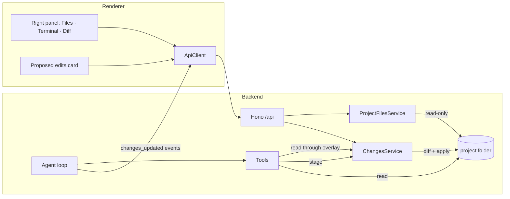
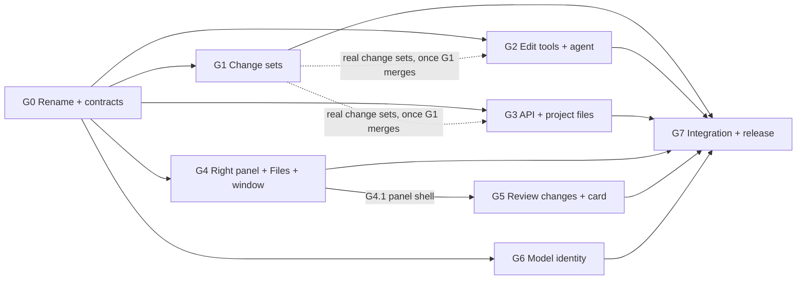

# OpenVern — v0.2 plan

> **Status:** planned · **Owner:** Stefanos · **Last updated:** 2026-11-02
> **Design:** [`docs/design/FilesPanel.dc.html`](design/FilesPanel.dc.html) ("Right panel · files") and
> [`docs/design/ReviewChanges.dc.html`](design/ReviewChanges.dc.html) ("Review changes"), exported from the canvas.
> The V0 boards (`Main`, `NewChat`) are still the reference for everything else.

## How to use this document (read first if you are an agent)

1. Read **§1–§5 in full**, then **your goal in §6**. §4 (contracts) is the source of truth for every type, route,
   event and tool. Do not change a contract without updating §4 in the same PR and saying so in the PR description.
2. Work on a branch named `v0.2/<goal-id>-<slug>` (e.g. `v0.2/g1-change-sets`). Touch only the paths your goal
   **owns**. If you must touch another goal's file, keep it minimal and call it out in the PR (§7 lists the known
   shared files).
3. New dependencies: only the ones listed in §2. Anything else needs a reason in the PR.
4. Tick the boxes in your goal as you finish each item, and tick your row in **§9** when its acceptance passes.
5. Every PR must pass `npm run typecheck && npm run lint && npm test`.
6. Never commit `reports/` or `research_notes/` (see `AGENTS.md`).

---

## 1. Goal and scope

### 1.1 What v0.2 is for

The agent can **change the project**: create, edit and delete files. Every change is a **proposal**: nothing touches
disk until the user reviews it in the new **Review changes** pane and applies it. Around that, v0.2 adds the **right
panel** (Files, Terminal, Diff), names the app **OpenVern**, and makes the model introduce itself as itself.

This is **review mode**, the first of the two write modes in `PRODUCT.md` ("the user decides who holds the write
key"). **Auto mode** comes in the next minor version: edits are written as the model responds, and only high-risk
edits (and later commands) stop for approval. v0.2 doesn't build auto mode or a mode switch, but it must not make auto
mode harder to add (G1.8, G2.8, G5.5).

"Sidebar" in the request means the design's **right panel**: a toggle in the chat header opens it, and its launcher
offers Files, Terminal and Diff. The left sidebar (projects and chats) is unchanged.

### 1.2 v0.2 is done when

- The app is called **OpenVern** everywhere a user can see it, and upgrading from 0.1 keeps projects, chats and settings.
- In a project chat with a tools-capable model, the agent can propose file creations, edits and deletions with
  `write_file`, `edit_file` and `delete_file`. Its own later reads see what it proposed.
- A **Proposed edits** card appears in the conversation. The **Review changes** pane (the Diff surface) shows every
  changed file as unified or split hunks. The user accepts or rejects each hunk, then applies. Only accepted hunks are
  written.
- The model is told what was applied, rejected or skipped at the start of its next turn.
- The **right panel** works as designed. **Terminal** is always disabled. **Files** is disabled in chats without a
  project. **Diff** is disabled until the current chat has proposed edits.
- The window has a **minimum size of 1080×720**. At that size and above, with any panel open, nothing wraps or overlaps.
- Asked "Hi, who are you?", the model says which model it is, who made it, that it runs in OpenVern v0.2, and what it
  is good at.
- The acceptance checklist (§8) passes in web dev, Electron dev and the AppImage.

### 1.3 Non-goals for v0.2

**Auto mode**, the review/auto mode switch and any risk classification of edits (next minor version) · running
commands or a real terminal · renaming or moving files · editing binary files · writing outside a project root · a
working folder for chats without a project (planned for a later minor version) · undoing edits after they are applied
(use git) · editing files by hand in the viewer · keeping half-finished hunk decisions across a reload · per-project
edit settings · everything already listed as a V0 non-goal (other providers, branching, compaction, light theme,
Windows/macOS…).

---

## 2. Decisions (locked for v0.2)

| Area | Decision | Why |
|---|---|---|
| Edit model | **Review mode only: propose → review → apply.** Edit tools stage changes in a per-chat change set; disk is written only by Apply. No mode switch in the UI | The design: "Nothing is written until you apply". Auto mode is the next minor version |
| Room for auto mode | Staging and applying are separate steps in core, `apply` doesn't assume a person made the decisions, every applied batch keeps its full diff, and all review-mode wording sits in one module | Auto mode = stage, then apply at once (holding only high-risk edits), with the diff still viewable |
| Granularity | Accept or reject **per hunk**. Undecided hunks are left out on Apply | The design's footer hint |
| Change set | **One pending change set per chat**, built up across turns. Tools read through it, so the agent sees its own proposals | Lets the agent edit the same file twice, or create a file and then edit it |
| Edit tools | `edit_file` (exact string replace), `write_file` (create or overwrite), `delete_file` | Exact-match replace is the format models are most reliable with; `write_file` covers new files; delete completes "make changes" |
| Where edits are possible | Project chats with a model that supports tools. Loose chats get no edit tools | Matches V0's read tools; loose chats have no folder yet |
| Diffing | Server-side with the **`diff`** (jsdiff) package, 3 lines of context. The renderer only draws hunks | One implementation for the review pane, the apply step and the tool output |
| Apply safety | Every path is re-checked through the sandbox at apply time. Files are written atomically (temp file + rename, keeping the file mode). A file that changed on disk since it was proposed is **skipped**, not merged | A symlink or edit can appear between proposal and apply |
| Next-turn context | A provider-only `changesNote` on the next user message says what happened to the proposals | The model must not assume its edits landed |
| App name | **OpenVern** for every user-visible string. Internal identifiers move to `openvern` too, with a one-time copy of the 0.1 data | Renaming later only gets more expensive |
| Version | `0.2.0` | |
| Right panel | Toggle in the chat header (`Ctrl+]`), launcher with Files / Terminal / Diff, tabs for open files. Open/closed is remembered | The design |
| Window size | Electron `minWidth 1080`, `minHeight 720`. The layout row never wraps. The narrow-window sidebar overlay (D19) is removed | The design's `flex-wrap` drops the pane below the chat at small widths. 272 sidebar + 420 chat + 380 panel = 1072 |
| Model identity | The system prompt names the model, its maker and OpenVern's version, and summarises the model's OpenRouter description | The model can only say what it is told |
| New dependency | `diff` (jsdiff, ships its own types) | The only one |

---

## 3. Architecture changes

### 3.1 Overview



1. During a turn, `edit_file`, `write_file` and `delete_file` **stage** content in the chat's change set
   (`<dataDir>/changes/<chatId>.json`). `read_file`, `list_files` and `search` read **through** the change set.
2. Each successful stage emits `changes_updated`. The renderer updates the **Proposed edits** card under the assistant
   turn that last changed the set.
3. The user opens **Review changes**, decides per hunk and presses **Apply**. `POST /chats/:id/changes/apply`
   re-checks every file, writes the accepted hunks, records an applied batch and clears the pending set.
4. At the next user message, the agent attaches a `changesNote` (written, rejected, skipped, still pending) for the
   model only.

### 3.2 Change set lifecycle

| Event | Effect on the pending set | Disk |
|---|---|---|
| Edit tool succeeds | File staged (base content captured the first time it is touched); `revision` + 1 | — |
| Staged content equals the base again | File dropped from the set | — |
| Apply | Accepted hunks written; rejected, undecided and conflicting ones dropped; the set is cleared; an `AppliedBatch` is recorded | Written |
| Discard (or Apply with every hunk rejected) | Set cleared, recorded for the next note | — |
| New user message | Pending set kept; a snapshot is taken for retry; `changesNote` attached | — |
| Retry of a turn | Pending set restored to that turn's snapshot | — |
| Stop mid-turn | Whatever was staged stays proposed | — |
| Chat deleted | Change set file deleted | — |
| Chat moved to another project or to "Chats" with pending edits | Refused (`conflict`): "Apply or discard the proposed edits first." | — |
| Project removed | Pending sets of its chats are discarded | — |
| Apply or discard while the chat is streaming | Refused (`conflict`) | — |

### 3.3 Security model additions

- Edit tools use `resolveInProject` like the read tools: no absolute paths, no `..`, no symlink escapes, the deny list
  (`.env*`, keys, `.git/`, `secrets.json`, data dirs) applies to writes as well. For a path that doesn't exist yet,
  the nearest existing ancestor must resolve inside the root.
- At apply time every path is resolved again. An existing target that is now a symlink is refused (`blocked`).
  Writes go to a temp file in the same directory, then `rename`, so a hard-linked file outside the project is never
  modified. New parent directories are created only inside the root.
- Staged content must be valid UTF-8 text, at most `LIMITS.writeFileMaxBytes`, and must not contain a
  `«redacted:…»` placeholder. Writing a placeholder back would destroy the real secret, so the tool tells the model to
  use `edit_file` around it instead.
- `edit_file` matches against the real file, which the model never saw unredacted. A match that would need a
  redacted value fails with a message that says so.
- Existing binary files can't be edited or overwritten. Deleting a binary file is allowed.
- The Files panel uses the same walker, ignore rules and deny list as the tools. Hidden files stay hidden.

### 3.4 Data directory additions

```
<dataDir>/
  changes/<chatId>.json   pending change set, its retry snapshot, applied batches, unreported events
```

Packaged data dir: `~/.config/openvern` (was `~/.config/harness`). See G0.4 for the migration.

---

## 4. Shared contracts (source of truth)

G0 lands all of this, with stubs where the implementation belongs to a later goal.

### 4.1 Domain types — `src/shared/types.ts` (additions)

```ts
export type ChangeKind = 'create' | 'modify' | 'delete';
export type HunkDecision = 'accepted' | 'rejected';

export interface DiffHunk {
  /** `${oldStart}:${8-char hash of lines}`. Stable while that file's proposal is unchanged. */
  id: string;
  oldStart: number; // 1-based; 0 for a new file
  oldLines: number;
  newStart: number;
  newLines: number;
  /** Nearest enclosing declaration above the hunk (best effort), '' when none. The label after the range. */
  header: string;
  /** Unified lines, each prefixed with ' ', '+' or '-'. */
  lines: string[];
}

export interface FileChange {
  path: string; // project-relative, forward slashes
  kind: ChangeKind;
  add: number;
  del: number;
  hunks: DiffHunk[];
  /** True when the diff has more than LIMITS.diffMaxLinesPerFile lines; `hunks` is then empty. */
  tooLarge?: boolean;
}

export interface PendingChanges {
  /** Bumps whenever the proposal changes. Apply must echo it. */
  revision: number;
  /** The assistant message that last changed the proposal. The card sits under its turn. */
  messageId: Id;
  files: FileChange[]; // sorted by path
  totalAdd: number;
  totalDel: number;
}

export type ApplyConflictReason = 'changed_on_disk' | 'deleted_on_disk' | 'exists_on_disk' | 'blocked';

export interface AppliedBatch {
  id: Id;
  appliedAt: IsoDate;
  messageId: Id; // PendingChanges.messageId at apply time
  written: FileChange[]; // only the accepted hunks, as written
  rejectedHunks: number;
  skippedHunks: number; // undecided at apply time
  conflicts: { path: string; reason: ApplyConflictReason }[];
}

export interface ChatChanges {
  pending: PendingChanges | null;
  applied: AppliedBatch[]; // oldest first
}

/** The light form used by stream events and the card (no hunks). */
export interface ChangeSummary {
  revision: number;
  messageId: Id;
  files: { path: string; kind: ChangeKind; add: number; del: number }[];
  totalAdd: number;
  totalDel: number;
}

export interface ProjectFileEntry {
  path: string; // project-relative, forward slashes
  type: 'file' | 'dir';
}
export interface ProjectFileTree {
  entries: ProjectFileEntry[]; // sorted: dirs first, then case-insensitive name, depth-first
  truncated: boolean;
}
export interface ProjectFileContent {
  path: string;
  size: number;
  totalLines: number;
  content: string | null; // null when binary
  binary: boolean;
  truncated: boolean; // over LIMITS.viewerMaxBytes: content is the first part
}

// UserMessage gains:
//   /** Provider-only: what happened to proposed edits since the previous turn. Never shown in the UI. */
//   changesNote?: string;

// ModelInfo gains (optional, so 0.1 model caches still load):
//   description?: string; // OpenRouter's model description
//   author?: string;      // display name of the maker, e.g. "DeepSeek"
```

### 4.2 Errors — `src/shared/errors.ts`

- New code `changes_stale` (not retryable): "The proposed edits changed while you were reviewing. Review them again."
- `internal` message: "Something went wrong inside OpenVern."
- Apply and discard during a run, and moving a chat that has pending edits, use the existing `conflict` code with the
  specific message.

### 4.3 HTTP API — `src/shared/api.ts` (additions)

| Route | Method | Body / query | Response |
|---|---|---|---|
| `/projects/:id/files` | GET | — | `ProjectFileTree` |
| `/projects/:id/files/content` | GET | `?path=` | `ProjectFileContent` |
| `/projects/:id/files/attach` | POST | `{ path }` | `AttachmentRef` (unbound, same limits as uploads) |
| `/chats/:id/changes` | GET | — | `ChatChanges` |
| `/chats/:id/changes` | DELETE | — | `ChatChanges` (pending discarded) |
| `/chats/:id/changes/apply` | POST | `{ revision, decisions }` | `ApplyChangesResponse` |

```ts
export const attachProjectFileBody = z.object({ path: z.string().min(1) });
export const applyChangesBody = z.object({
  revision: z.number().int().nonnegative(),
  /** path → hunk id → decision. Hunks not listed are undecided and left out. */
  decisions: z.record(z.string(), z.record(z.string(), z.enum(['accepted', 'rejected']))),
});
export interface ApplyChangesResponse {
  batch: AppliedBatch;
  changes: ChatChanges;
}
```

### 4.4 Stream events — `src/shared/events.ts`

```ts
| { type: 'changes_updated'; messageId: Id; changes: ChangeSummary | null } // null: nothing pending any more
```

The grammar becomes `… (tool_call → tool_result → changes_updated?)* …`. `changes_updated` follows the `tool_result`
of every edit tool call that staged something.

### 4.5 Constants — `src/shared/constants.ts`

```ts
export const APP_NAME = 'OpenVern';
/** Lower-case form for paths, the protocol host, storage keys and env vars. */
export const APP_SLUG = 'openvern';
export const APP_ID = 'dev.stefanos.openvern';
export const CLIENT_HEADER = 'X-OpenVern-Client';

LIMITS += {
  writeFileMaxBytes: 256 * 1024,
  pendingFilesPerChat: 50,
  editResultDiffLines: 40, // diff excerpt in an edit tool's output
  fileTreeMaxEntries: 20_000,
  viewerMaxBytes: 1024 * 1024,
  diffMaxLinesPerFile: 5_000,
};

export const LAYOUT = {
  sidebar: 272,
  conversationMin: 420,
  panelMin: 380,
  panelFiles: 380,
  panelViewer: 560,
  panelDiff: 600,
  panelDiffSplit: 800,
  splitMin: 640, // below this panel width Split is disabled
  windowMinWidth: 1080,
  windowMinHeight: 720,
} as const;
```

Env vars: `OPENVERN_DATA_DIR`, `OPENVERN_FAKE_PROVIDER`. Protocol origin: `app://openvern`. Preload bridge:
`window.openvern`. IPC: `openvern:pick-directory`. localStorage keys: `openvern.*`.

### 4.6 Tools — `src/core/tools/` (additions)

| Tool | Args | Output to the model | Row summary |
|---|---|---|---|
| `edit_file` | `{ path, old_string, new_string, replace_all = false }` | Diff excerpt (≤ `editResultDiffLines`), `+a −d`, "Proposed, not written yet." | path |
| `write_file` | `{ path, content }` | "Proposed new file (N lines)" or a diff excerpt for an overwrite | path |
| `delete_file` | `{ path }` | "Proposed deleting path (N lines)" | path |

- `edit_file` errors: no match ("re-read the file; whitespace must match exactly; redacted values can't be matched"),
  several matches without `replace_all` (the count and their line numbers), `old_string === new_string`.
- Every edit tool refuses with a clear message when `ctx.changes` is absent.

```ts
// ToolContext gains:
//   /** Present only when this chat may propose edits. Read tools use it as an overlay. */
//   changes?: ToolChanges;

export interface ToolChanges {
  /** null = not staged, read the disk. */
  read(relPath: string): Promise<{ kind: 'staged'; content: string } | { kind: 'deleted' } | null>;
  staged(): Promise<{ path: string; kind: ChangeKind }[]>;
  /** content null = delete. Validates (§3.3) and returns the new summary (null when the set became empty). */
  stage(relPath: string, content: string | null): Promise<{ file: FileChange | null; summary: ChangeSummary | null }>;
}
```

### 4.7 Core services — `src/core/types.ts` (additions)

```ts
export interface ChangesService {
  get(chatId: Id): Promise<ChatChanges>;
  /** One per assistant step: stages are attributed to `messageId`. */
  tools(input: { chatId: Id; projectRoot: string; messageId: Id }): ToolChanges;
  /** At a new user message: remember the pending set so a retry of this turn can restore it. */
  snapshot(chatId: Id, userMessageId: Id): Promise<void>;
  /** Retry: restore the snapshot taken for this user message. Never touches disk. */
  restore(chatId: Id, userMessageId: Id): Promise<void>;
  /** The text for the next user message's `changesNote`; marks those events as reported. */
  takeNote(chatId: Id): Promise<string | undefined>;
  apply(input: {
    chatId: Id;
    projectRoot: string;
    revision: number;
    decisions: Record<string, Record<string, HunkDecision>>;
  }): Promise<ApplyChangesResponse>;
  discard(chatId: Id): Promise<ChatChanges>;
  removeForChat(chatId: Id): Promise<void>;
}

export interface ProjectFilesService {
  tree(projectId: Id, signal?: AbortSignal): Promise<ProjectFileTree>;
  read(projectId: Id, relPath: string): Promise<ProjectFileContent>;
  /** Added in G3: raw bytes for "Attach" (images aren't text). Same sandbox as `read`. */
  readBytes(projectId: Id, relPath: string): Promise<{ name: string; bytes: Uint8Array }>;
}

// CoreDeps gains `version: string`; Core gains `changes`, `projectFiles`, `version`.
```

### 4.8 Renderer `ApiClient` (additions)

```ts
listProjectFiles(projectId: Id): Promise<ProjectFileTree>;
readProjectFile(projectId: Id, path: string): Promise<ProjectFileContent>;
attachProjectFile(projectId: Id, path: string): Promise<AttachmentRef>;
getChatChanges(chatId: Id): Promise<ChatChanges>;
applyChatChanges(chatId: Id, body: ApplyChangesBody): Promise<ApplyChangesResponse>;
discardChatChanges(chatId: Id): Promise<ChatChanges>;
```

`MockApiClient` implements all of them in G0, seeded from the design's sample data, so UI goals can start at once.
Query keys added in G0: `projectFiles(projectId)`, `projectFile(projectId, path)`, `chatChanges(chatId)`.

### 4.9 Next-turn note (`changesNote`)

Appended to the user message text for the provider only, e.g.:

```
[OpenVern] Since your last reply the user reviewed your proposed edits:
- Written: src/core/tools/index.ts (2 of 2 changes), src/shared/constants.ts (1 of 1)
- Rejected: src/core/tools/write-file.ts (new file, not created)
- Not written, changed on disk before apply: README.md
Nothing else is pending.
```

If edits are still pending: "N proposed files are still awaiting review. Your reads show your proposed versions."

---

## 5. Design reference

### 5.1 Right panel (`FilesPanel.dc.html`)

- **Toggle:** chat header, after the options menu and a 1×20 divider. Panel icon, `aria-pressed`,
  `aria-controls="right-panel"`, title "Toggle right panel (Ctrl ])". Pressed style: `surface-raised` +
  inset `border-control` ring.
- **Panel:** `aside#right-panel`, `sidebar` background, left border `border`. Slides in from 12 px over 0.22 s
  (`cubic-bezier(.16,1,.3,1)`), with no motion when reduced motion is on. Width animates on `flex-basis`: Files 380,
  open file 560, Diff 600 / 800 (split).
- **Tab strip:** "Files" tab, one tab per open file (max 180 px, `title` = path, a close button labelled
  "Close {name}"), a "+" button ("Open a panel", pressed while the launcher shows), and "Close panel" on the right.
  Closing the active tab selects its neighbour, else Files.
- **Launcher, "Open a panel":** rows with an icon, label, hint and key chip.
  - Files · F · "Browse the project, read-only". Disabled in a chat without a project: "Only for chats in a project".
  - Terminal · T · disabled, "Not available yet".
  - Diff · D · "Review the edits this chat proposed". Disabled, "Available after the current chat has made edits",
    until the chat has pending or applied edits.
  - Disabled rows: `faint` text, opacity 0.6, not-allowed cursor.
- **Files:** the project name and a "Collapse all" button. A "Filter files" field: matching files are shown flat, as
  dimmed `dir/` + name, and "No files match "q"." when nothing matches. Tree rows are 28 px mono 12.5 px, with
  14 px indent per level, a chevron, and folder (`accent-2`) or file (`faint`) icons. The current file uses
  `surface-raised`. The footer has a lock icon and "Ignored and secret files are hidden (.env, .git, keys)".
- **Open file:** a breadcrumb (project button → Files › `dir/` + name), "N lines", an "Attach" button (title
  "Attach to message", adds the file to the reply composer), and a code area on `code` with 48 px line numbers and
  mono 12.5/20.

### 5.2 Review changes (`ReviewChanges.dc.html`)

- **Proposed edits card** (in the assistant turn): `tool` background, 14 px radius, border `border-tool`
  (`border-hover` while the pane is open). It shows "Proposed edits", "N files", +a / −d totals, and file rows
  (status badge, dimmed dir + name, +/−) that open the pane on that file. The footer has an accent dot, "Nothing is
  written until you apply." and the progress ("x of y changes reviewed"), plus a "Review changes" / "Reviewing" button.
  After apply the card reads "Edits applied" and "Wrote N changes to M files · K rejected".
- **Pane:** a header with "Review changes", the totals, a Unified / Split segmented control ("Diff layout") and
  "Close review". Below it, the changed-files list (badge, path, state label: Accepted, Rejected, Partly accepted,
  "x of y"; +/−).
- **Diff:** `code` background. The file header shows the path and "New file", "N changes" or "Deleted file". Each hunk
  header shows the range in `#a9b8f0`, the declaration label, and Reject / Accept, or once decided a pill
  (Accepted / Rejected) with Undo. Rejected hunks fade to opacity 0.42. A gap row says "N unchanged lines". The file
  ends with a "Next file" button.
- **Apply bar:** the progress label and a hint: "Undecided changes are left out when you apply.",
  "Ready to write to disk." or "K rejected changes will be dropped.". Then Reject all, Accept all and the primary
  "Apply N", which is disabled when nothing is accepted.
- **Badges:** A uses the `success` tint, M the `accent` tint, D (not in the design) the `danger` tint.
- **Not in the design, needed:**
  - When every hunk is rejected, the primary button reads "Discard" and clears the proposal.
  - Split is disabled below `LAYOUT.splitMin`, with the tooltip "Needs a wider panel".
  - Conflicted files show "Changed on disk" in `danger`.
  - Apply and Discard are disabled while the chat is streaming.
  - An "Applied" section lists earlier batches read-only.
- **Ignore:** the sample conversation in the board (a confirm hook, "projects that haven't opted in") is placeholder
  text, not a spec. The "/impeccable…" leftover was removed from the copy in `docs/design/`.

### 5.3 New tokens (`tokens.css`, added in G0)

| Token | Value |
|---|---|
| `--color-diff-add-bg` / `-add-num-bg` / `-add-num` / `-add-sign` / `-add-text` | `rgb(159 212 179 / .09)` / `/ .10` / `#8fc2a4` / `#9fd4b3` / `#e8f4ee` |
| `--color-diff-del-bg` / `-del-num-bg` / `-del-num` / `-del-sign` / `-del-text` | `rgb(229 134 95 / .11)` / `/ .12` / `#d89a84` / `#f09a7c` / `#f6e4dc` |
| `--color-diff-text` / `--color-diff-range` | `#bcc4dc` / `#a9b8f0` |
| `--color-segment-on` | `#283160` |
| `--width-panel-files` / `-viewer` / `-diff` / `-diff-split` | 380 / 560 / 600 / 800 px |

---

## 6. Goals

Sizes: S (≤ ½ day), M (1–2 days), H (3+ days) for one agent.

### G0 — Foundation: OpenVern rename + v0.2 contracts · M · blocks everything

**Owns:** whatever it touches. It lands alone, before any other goal starts.

- [x] G0.1 Constants per §4.5 (`APP_NAME`, `APP_SLUG`, `APP_ID`, `CLIENT_HEADER`). `version` is threaded through
      `CoreDeps` from `pkg.version` (dev) and `app.getVersion()` (Electron).
- [x] G0.2 Package and build: in `package.json`, name `openvern`, productName `OpenVern`, version `0.2.0`, and a new
      description. In `electron-builder.yml`, appId, productName, `executableName: openvern`, `StartupWMClass` and
      `artifactName: OpenVern-${version}-x86_64.${ext}`. Also `build/icon.svg` title. `scripts/install-local.sh`
      installs `openvern.*` and also removes the `harness.*` files that 0.1 installed (on install and on `--uninstall`).
- [x] G0.3 Internal identifiers per §4.5: env vars, `app://openvern`, client header, `window.openvern`, IPC channel,
      localStorage keys, `[openvern]` log prefixes, Electron profiles `~/.config/openvern`, `openvern-dev` and
      `openvern-preview`. The tools' data-dir deny list covers `~/.config/openvern` **and** the legacy `~/.config/harness`.
- [x] G0.4 Migration. If the new data dir has no `settings.json`, `projects.json` or `chats/`, and
      `~/.config/harness` has them, **copy** `settings.json`, `secrets.json`, `projects.json`, `chats/`, `attachments/`
      and `cache/`, then write a `migrated-from-harness` marker. Leave the old dir alone (0.1 still runs from it).
      A stored key that no longer decrypts counts as "no key": log one line and let Settings ask again, never crash.
      (safeStorage's keyring entry may follow the app name.) Tests with a fake home.
- [x] G0.5 Docs and tests: README, `PRODUCT.md` (the name is decided), `DESIGN.md` and `.impeccable/design.json` name,
      `src/server/README.md`, and tests that assert "harness". The `createHarness` test helper keeps its name.
- [x] G0.6 Contracts §4.1–§4.8 with typed stubs. Tokens §5.3. Query keys. `MockApiClient` implements every new method,
      seeded with the design's sample (3 files, 4 hunks, the file tree), and emits `changes_updated` from its fake
      stream when a message contains `[mock:edit]`.

**Acceptance:** checks pass. `npm run dev` shows OpenVern. A 0.1 data dir comes up with its projects and chats.
`git grep -in harness` finds only the test-harness helper, the migration code and history.

### G1 — Change sets (core) · H

**Owns:** `src/core/changes/**`, `src/core/storage/paths.ts` (the `changes/` dir). Adds the `diff` dependency.
**Depends on:** G0.

- [ ] G1.1 Store at `<dataDir>/changes/<chatId>.json`, using the atomic JSON file and per-chat mutex like chats. Each
      file records `path`, `kind`, `baseHash`, `baseContent | null`, `content | null`, `lastMessageId`. The store also
      holds `revision`, the retry snapshot, applied batches and unreported events.
- [ ] G1.2 `stage`: validates per §3.3 and caps at `pendingFilesPerChat`. Captures the base on first touch. A file
      whose staged content equals its base is dropped; so is a created file that is then deleted. Bumps `revision`.
- [ ] G1.3 Overlay for tools: `read` and `staged` per §4.6.
- [ ] G1.4 Diff: `structuredPatch` with 3 lines of context. Hunk ids per §4.1. Hunk `header` is the nearest preceding
      line that looks like a declaration (regex, best effort). +/− counts and `tooLarge`. Diffs ignore CRLF vs LF, and
      writes keep the file's original line endings and final-newline state.
- [ ] G1.5 `apply`: `changes_stale` when `revision` differs. For each file:
      - re-read disk and compare its hash with `baseHash` (`changed_on_disk` / `deleted_on_disk` / `exists_on_disk`);
      - re-resolve the path (`blocked`);
      - build base + accepted hunks (applied bottom-up), then write atomically, keeping the mode and creating parents
        inside the root. A delete unlinks only if accepted and unchanged.
      Then record the `AppliedBatch`, clear pending and queue the note events.
- [ ] G1.6 `discard`, `removeForChat`, `snapshot`/`restore`, `takeNote` (text per §4.9).
- [ ] G1.7 Tests:
      - create, modify and delete;
      - staging the same file twice; no-op collapse;
      - partial apply (1 of 2 hunks gives the exact expected bytes);
      - CRLF and no-final-newline files;
      - each conflict reason, including a symlink swapped in after staging;
      - a denied path, a stale revision, restore, and the note text.
- [ ] G1.8 Room for auto mode (no auto-mode code): `apply` takes decisions from any caller, so core can later apply
      "all accepted" straight after a stage. An exported `acceptAll(pending)` helper builds that decision map. Applied
      batches keep the full hunks that were written, so the Diff surface can show them without the pending set.

**Acceptance:** tests pass. Applying the design's sample with c1 accepted and the rest decided reproduces the exact
expected files.

### G2 — Edit tools + agent loop · H

**Owns:** `src/core/tools/**`, `src/core/agent/**` (except `identity.ts`), `src/core/providers/fake.ts`.
**Depends on:** G0. Builds against an in-memory `ToolChanges`, then wires to G1.

- [ ] G2.1 `edit_file`, `write_file` and `delete_file` per §4.6, with zod args, descriptions written for the model
      (when to use which, paths relative to the root, "proposed, not written"), and `signal` honoured.
- [ ] G2.2 Sandbox for paths that don't exist yet (nearest existing ancestor inside the root). Deny list and data dirs
      apply. Binary files and redaction placeholders are refused per §3.3.
- [ ] G2.3 `read_file`, `list_files` and `search` read through the overlay: staged content, created files listed,
      deleted files hidden. `read_file` says "(proposed version, not on disk yet)" in its header.
- [ ] G2.4 Agent: the edit tools are offered only in a project chat with a tools-capable model. `ToolContext.changes`
      comes from `changes.tools(...)` per assistant step. Each staging result is followed by `changes_updated`.
      `snapshot` at a new user message, `restore` on retry. `takeNote` goes into `UserMessage.changesNote`, and
      `buildHistory` appends it for the provider only.
- [ ] G2.5 System prompt tools section. Remove "You cannot modify files". Explain the three tools, that edits are
      proposals the user reviews, to read before editing, to prefer `edit_file` for small changes, and to summarise
      what was proposed and why. Never say files were written, and don't paste whole proposed files into the answer.
      This is the only part of `system-prompt.ts` G2 edits (G6 owns the identity part).
- [ ] G2.6 Fake provider markers for e2e: `[fake:edit=<path>]`, `[fake:write=<path>]`, `[fake:delete=<path>]`.
- [ ] G2.7 Tests:
      - argument and match errors, overlay reads;
      - event order (`tool_result` then `changes_updated`);
      - no edit tools in loose chats or with tool-less models;
      - retry restore, and the note replayed in history.
- [ ] G2.8 Room for auto mode: the review-mode wording (edit tool outputs such as "Proposed, not written yet", the
      prompt lines about review, the `changesNote` intro) lives in one module (`src/core/agent/edit-mode.ts`), so auto
      mode can supply its own text without touching the tools or the loop.

**Acceptance:** tests pass. With the fake provider, a scripted turn proposes 3 files and changes nothing on disk.

### G3 — API server, project files, HTTP client · M

**Owns:** `src/server/**`, `src/core/project-files/**`, `src/core/index.ts`, `src/renderer/lib/http-api-client.ts`
(+ test). **Depends on:** G0. Wires G1 when it lands.

- [x] G3.1 `ProjectFilesService`: `tree` uses the walker (same ignore and deny rules, `fileTreeMaxEntries`,
      `truncated`). `read` is sandboxed, with `viewerMaxBytes`, binary detection and the line count.
- [x] G3.2 Routes per §4.3. Attach reads through `ProjectFilesService` and then `attachments.create`, so type and size
      limits match uploads.
- [x] G3.3 Chat lifecycle per §3.2: deleting a chat removes its change set. Moving a chat with pending edits gives
      `conflict`. Removing a project discards its chats' pending edits. Apply and discard while running give
      `conflict`.
- [x] G3.4 Compose `changes` and `projectFiles` in `createCore`. `HttpApiClient` methods.
- [x] G3.5 Tests:
      - the client header is required on the new routes;
      - `?path=../x`, absolute paths and denied files are refused;
      - `changes_updated` survives the SSE round trip;
      - apply and discard while running give `conflict`.

**Acceptance:** route and security tests pass. The tree route finishes in under 2 s on a ~10k-file repo.

### G4 — UI: right panel, Files, window size · H

**Owns:** `src/renderer/features/right-panel/**`, `src/renderer/features/files/**`, `src/renderer/app/AppShell.tsx`,
`ChatScreen.tsx`, `shortcuts.ts`, `useMediaQuery.ts` (deleted), `src/renderer/features/chat-header/**`,
`src/renderer/stores/ui.ts`, `src/main/window.ts`. In `features/composer/` it only adds an `addAttachmentRef` hook
for the Attach button. **Depends on:** G0 (mock API).

- [ ] G4.1 **(early PR, unblocks G5)** Panel shell per §5.1: header toggle, `Ctrl+]` (ignored while a dialog is open),
      tab strip, close, animation, and a surface slot API so G5 can plug Diff in. Open state persisted
      (`openvern.rightPanelOpen`). The active surface and open tabs are kept per chat in memory.
- [ ] G4.2 Launcher with the enabled and disabled rules in §5.1. F/T/D work while the launcher has focus. Opening the
      panel shows Files when it is enabled, otherwise the launcher.
- [ ] G4.3 Files surface: tree, filter, no-matches, collapse all, footer, truncated notice. It refetches when the panel
      opens and after an apply.
- [ ] G4.4 File viewer tab: breadcrumb, line count, Attach (the file becomes a chip in the reply composer), line
      numbers, horizontal scroll, binary and truncated placeholders. Shiki highlighting via the existing highlighter
      if it costs nothing extra; otherwise plain text.
- [ ] G4.5 Layout:
      - the AppShell row never wraps (`flex-nowrap`);
      - the panel is `flex: 0 1 <width>` with `min-width: LAYOUT.panelMin`, and the chat has
        `min-width: LAYOUT.conversationMin`;
      - Electron gets `minWidth`/`minHeight` from `LAYOUT`;
      - the browser build sets the same min size on the root, so the page scrolls instead of reflowing;
      - remove the D19 narrow overlay, `useMediaQuery` and their tests.
- [ ] G4.6 Tests:
      - disabled rules (loose chat, no edits yet, Terminal);
      - filter, and tab close fallback;
      - persistence; the shortcut is blocked while a dialog is open.

**Acceptance:** matches `FilesPanel.dc.html`. At 1080×720, with the sidebar open and each surface open in turn,
nothing wraps or overlaps (e2e overflow check).

### G5 — UI: review changes + proposed edits card · H

**Owns:** `src/renderer/features/changes/**`. Card placement in `src/renderer/features/conversation/**`.
`changes_updated` handling in `src/renderer/stores/runs.ts`.
**Depends on:** G0 (mock API); G4.1 for the panel slot (it can build the components in isolation before that).

- [ ] G5.1 Proposed edits card per §5.2, under the assistant turn whose message id matches
      `PendingChanges.messageId` (or `AppliedBatch.messageId` for "Edits applied"). File rows open the pane on that file.
- [ ] G5.2 Diff surface per §5.2:
      - files list with state labels and conflict markers;
      - unified rows (old no., new no., sign, code) and split rows (paired −/+, hatched empty side);
      - gap rows, Next file;
      - a `tooLarge` placeholder.
- [ ] G5.3 Hunk decisions: Accept, Reject, Undo, Accept all, Reject all. They live in a renderer store keyed by chat +
      revision + hunk id and are not persisted. Progress labels and hints per §5.2.
- [ ] G5.4 Apply bar:
      - "Apply N" calls apply; "Discard" when all are rejected;
      - both are disabled while streaming;
      - on `changes_stale`, refetch and keep decisions for hunk ids that still exist;
      - other errors show inline.
- [ ] G5.5 Applied batches listed read-only in the pane, newest first. Diff stays enabled once a chat has edits. Build
      this view as its own component that takes `AppliedBatch[]`: in auto mode it becomes the main way to see changes
      that were already written.
- [ ] G5.6 Live: `changes_updated` updates the card and the `chatChanges` query during streaming. The pane re-diffs
      when the revision changes.
- [ ] G5.7 Tests: decisions and labels, apply payload, stale handling, card placement, and the streaming disable.

**Acceptance:** matches `ReviewChanges.dc.html`. The full flow works on the mock API and on the real backend once G1–G3
have landed.

### G6 — Model identity · S

**Owns:** `src/core/providers/openrouter.ts` (model mapping only), `src/core/providers/models.ts`,
`src/core/agent/identity.ts`, and the identity lines in `system-prompt.ts` (one small commit; G2 rebases).
**Depends on:** G0.

- [x] G6.1 `ModelInfo.description` and `author`:
      - `author` is the part before ": " in OpenRouter's name; failing that, a slug map (deepseek → DeepSeek,
        anthropic → Anthropic, openai → OpenAI, google → Google, meta-llama → Meta, mistralai → Mistral AI,
        qwen → Alibaba (Qwen), x-ai → xAI, moonshotai → Moonshot AI, z-ai → Zhipu AI); failing that, the slug.
      - The model's display name is the part after ": ".
      - The cache validator accepts entries without these fields.
- [x] G6.2 `buildIdentity(model, version)`, used by the loose and project prompts. It says:
      - "You are <model> (<id>), made by <author>, running inside OpenVern v<version>, a desktop app for working on
        local code projects. OpenVern is the app, not your name."
      - When asked who or what you are: name the model and its maker, mention OpenVern, and say in a sentence or two
        what the model is good at, based on its description (first ~500 chars, links stripped).
      - Don't claim to be OpenVern or another model.
      - Unknown models: id and maker from the slug, and say you have no details about strengths.
      - Routers such as `openrouter/auto`: say the request is routed by OpenRouter and the model may vary.
- [x] G6.3 Tests: prompts for DeepSeek, Claude, an unknown id and `openrouter/auto`; trimming; both prompt variants.

**Acceptance:** tests pass. Manual §8 B14 with three real models; any model that ignores the prompt is recorded in §10.

Example answer this should produce: *"Hi! I'm DeepSeek V3.1, a model made by DeepSeek, running here through OpenVern
v0.2.0. I'm a strong general model and particularly good at coding, reasoning and following long instructions."*

### G7 — Integration, QA, release · M

**Depends on:** G0–G6.

- [ ] G7.1 e2e (`scripts/e2e/`), with the fake provider:
      - propose edits via markers, then check the disk is unchanged;
      - partial apply, then check the disk bytes;
      - conflict after an outside edit; retry restore;
      - panel disabled states; Files filter, open and attach.
- [ ] G7.2 Screenshots at 1080×720 and 1440×900 with Files, an open file and Diff (unified and split), plus the
      overflow check. Drop the 800×600 and 720×600 shots.
- [ ] G7.3 Docs: README (writes, review flow, new limits, env vars, data dir, migration), `DESIGN.md` (right panel,
      review pane, diff tokens), `PRODUCT.md`.
- [ ] G7.4 Upgrade test: install 0.1.0, chat, then install 0.2.0. Projects and chats are there, and the key works or is
      asked for once.
- [ ] G7.5 AppImage on CachyOS and Arch, then tag `v0.2.0`.

---

## 7. Parallelisation and hand-off



Solid arrows: the goal can't start before the other has merged. Dashed arrows: the goal starts right away against a
fake in-memory change set, and switches to G1's real one once G1 merges.

| Wave | Goals (in parallel) | Notes |
|---|---|---|
| 1 | G0 | One agent. The rename touches ~40 files, so nothing else starts until it is merged. |
| 2 | G1, G2, G3, G4, G6 | Disjoint paths. G2 and G3 use an in-memory `ToolChanges` / `ChangesService` until G1 merges. G4 and G6 need nothing else. |
| 2b | G5 | Starts on the components right away; mounts in the panel once G4.1 is merged. |
| 3 | G7 | After everything has merged. |

**Shared files** (keep edits small and mention them in the PR):

| File | Goals | Rule |
|---|---|---|
| `src/core/agent/system-prompt.ts` | G2 (tools section), G6 (identity lines) | G6 lands first as one small commit |
| `src/renderer/features/composer/attachments.ts` | G4 | Adds `addAttachmentRef` only |
| `src/renderer/features/conversation/*` | G5 | G4 doesn't touch it |
| `src/shared/*`, `src/core/types.ts` | G0 | Later goals change them only by updating §4 |

**Hand-off packet per agent:** this file (§1–§5 plus its goal), the repo, and `docs/design/`. UI goals also get the
two boards.

---

## 8. Acceptance checklist (v0.2 definition of done)

Run on: web dev, Electron dev, and the AppImage on CachyOS and Arch.

- [ ] B1 The name is OpenVern everywhere visible: window title, wordmark, "Reply to OpenVern…", errors, AppImage and
      launcher entry. The app shows no "harness".
- [ ] B2 Upgrading over a 0.1 data dir keeps projects, chats and settings. The API key still works or is asked for
      once, with no crash.
- [ ] B3 The header toggle and `Ctrl+]` open and close the right panel, and the state survives a restart.
- [ ] B4 Launcher: Terminal is disabled ("Not available yet"). In a chat without a project, Files is disabled. Diff is
      disabled until the chat proposes an edit.
- [ ] B5 Files: tree, filter, "No files match", collapse all, open and close file tabs, line numbers. Attach adds the
      file to the composer. `.env`, keys and `.git` are not shown.
- [ ] B6 Asked for a change, the agent's tool rows show `edit_file` / `write_file` / `delete_file`. A "Proposed edits"
      card appears, and **disk is unchanged**.
- [ ] B7 Review: unified and split, per-hunk Accept, Reject and Undo, rejected hunks dimmed, progress text,
      Accept all and Reject all. Apply is disabled at 0 accepted; Discard appears when everything is rejected.
      Next file works.
- [ ] B8 Apply writes exactly the accepted hunks. The card turns into "Edits applied · Wrote N changes to M files".
      The Files viewer shows the new content.
- [ ] B9 A file edited outside the app after the proposal is skipped as "changed on disk"; the others apply.
- [ ] B10 In the next message, the model can say what was applied and what was rejected.
- [ ] B11 Retrying a turn that proposed edits restores the proposal to what it was before that turn.
- [ ] B12 Writes to `.env`, `../outside`, `.git/config`, a symlink leading out of the project, and the data dir are
      refused when staging and when applying.
- [ ] B13 The window can't go below 1080×720. At that size, with sidebar and any panel open, nothing wraps or overlaps.
      Split is disabled when the panel is too narrow.
- [ ] B14 "Hi, who are you?" with a DeepSeek, a Claude and a Qwen or Llama model: the answer gives model and maker,
      "OpenVern v0.2", and strengths.
- [ ] B15 A chat without a project has no edit tools; Files and Diff are disabled there.
- [ ] B16 `npm run typecheck && npm run lint && npm test` and `npm run e2e` pass. The AppImage starts from the launcher.

---

## 9. Completion tracker

| Goal | Owner (agent/model) | Branch / PR | Done |
|---|---|---|---|
| G0 Rename + contracts | Sonnet 5.5 subagent | `v0.2/g0-foundation` | [x] |
| G1 Change sets | | `v0.2/g1-change-sets` | [ ] |
| G2 Edit tools + agent | | `v0.2/g2-edit-tools` | [ ] |
| G3 API + project files | Sonnet 5.5 subagent | `v0.2/g3-api` | [x] |
| G4 Right panel + Files + window | | `v0.2/g4-right-panel` | [ ] |
| G4.1 Panel shell (early PR) | | `v0.2/g4-1-panel-shell` | [ ] |
| G5 Review changes + card | | `v0.2/g5-review` | [ ] |
| G6 Model identity | Sonnet 5.5 subagent | `v0.2/g6-identity` | [x] |
| G7 Integration + release | | `v0.2/g7-integration` | [ ] |
| §8 on CachyOS / Arch / browser | | | [ ] |

---

## 10. Risks and open items

| Risk | Mitigation |
|---|---|
| Models fumble exact-match edits (whitespace, stale reads) | Errors that say what to do (re-read, line numbers of the matches); `write_file` as the fallback |
| The model says "done" before anything is written | The tool output says "proposed, not written", the prompt rule, and `changesNote` next turn |
| A user's own edits land between proposal and apply | Base-hash check; the file is skipped and reported, never merged |
| Hunk application edge cases (CRLF, no final newline, adjacent hunks) | G1.7 byte-exact tests |
| safeStorage key unreadable after the rename | Treated as "no key", Settings asks again (G0.4) |
| Some models ignore the identity prompt | Recorded under B14; nothing else to do in v0.2 |
| 1080×720 too big for a small screen | 1366×768 still fits; the constants live in `LAYOUT` if it needs to change |
| Very large proposals | `pendingFilesPerChat`, `writeFileMaxBytes`, `diffMaxLinesPerFile` |

Open:

- Should the Files viewer mark files with pending edits (an A/M/D dot linking to Diff)? It's cheap after G1 and G4;
  left to G7 if time allows.
- Undo after apply (revert a batch) would need the stored base content G1 already keeps. That's a candidate for the
  next minor version.

## 11. After v0.2 (backlog)

- **Auto mode (next minor version):** a review/auto switch. In auto mode, edits are written as the model responds and
  stay viewable as diffs in the Diff surface; only high-risk edits (and commands, once they exist) wait for approval.
  It builds on G1.8, G2.8 and G5.5. Still to decide then: what counts as high-risk (e.g. deletes, many files at once,
  config and lock files, files outside the usual source tree), and whether the mode is per chat, per project or global.
- A working folder for chats without a project (e.g. under Documents), so Files and edits work there.
- A real Terminal surface and running commands.
- Rename/move tools · revert an applied batch · persisted hunk decisions · per-project edit settings.
