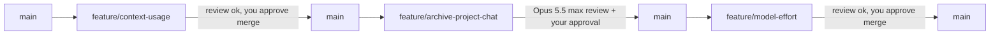

# OpenVern — v0.3 plan

> **Status:** approved 2026-11-05 · **Owner:** Stefanos · **Last updated:** 2026-11-05
> **Design:** [`docs/design/context-usage.html`](design/context-usage.html) ("Context usage") for F1. F2 and F3
> have no board: they reuse existing components (§5).
> **Orchestration:** `orchestrator-ruleset.md` v1. §7 assigns models and efforts per stage.

## How to use this document (read first if you are an agent)

1. Read **§1–§5 in full**, then **your feature in §6**. §4 (contracts) is the source of truth for every type,
   route, body and event. If you change a contract, update §4 in the same branch and say so in the summary.
2. Work only on your feature's branch (§7). Touch only the paths your feature **owns**. If you need a file the
   plan doesn't mention, **stop and report**. Don't touch it (ruleset §9).
3. New dependencies: **none** are planned. If one turns out to be needed, stop and ask.
4. Tick the boxes in your feature as you finish each item.
5. Every branch must pass `npm run typecheck && npm run lint && npm test`, the secret scan and `npm audit` (§7.4).
6. Never commit `reports/` or `research_notes/` (see `AGENTS.md`). Stage files by path.

---

## 1. Goal and scope

### 1.1 What v0.3 is for

Three features, each on its own branch:

| ID | Feature | Branch |
|---|---|---|
| F1 | **Context usage**: a counter in the chat header, plus a popover with the model, total cost, total tokens and dates | `feature/context-usage` |
| F2 | **Archive project chats**: the archive that loose chats got in `baa9511`, extended to chats in a project | `feature/archive-project-chat` |
| F3 | **Model effort**: a reasoning-effort selector next to the model picker, sent to OpenRouter as `reasoning.effort` | `feature/model-effort` |

### 1.2 v0.3 is done when

- In a chat with at least one finished reply, the header shows `used / limit` between Chat options and the
  right-panel toggle. Clicking it opens the Context popover as designed. The counter is **not shown** in a new,
  empty chat.
- A chat in a project can be archived and unarchived from Chat options. Archived project chats leave the project's
  list and sit in a collapsed **Archived** group inside that project.
- For a model that supports reasoning, the composer offers an effort selector (Default, None, Minimal, Low, Medium,
  High, Extra high, Max). The choice is remembered per chat and for new chats, and reaches OpenRouter.
- Checks and tests pass on each branch and on the trial merge of all three (§7.3).

### 1.3 Non-goals for v0.3

Compaction or trimming when the context is full · per-message usage in the conversation · a budget or cost limit ·
counting title-generation requests in the totals · bulk archive or archive-on-a-timer · archiving whole projects ·
effort for models that don't list `reasoning` · `reasoning.max_tokens` or `exclude` · showing reasoning text.

---

## 2. Decisions (locked 2026-11-05)

| Area | Decision | Why |
|---|---|---|
| F1 "Context used" | `promptTokens + completionTokens` of the **latest assistant message that has usage** | The design's rule. After a retry the truncated turns no longer count |
| F1 "Total tokens" / "Total cost" | **Cumulative counters stored on the chat file**, increased whenever an assistant message with usage is appended | Retry truncates messages, so summing messages would undercount ("every request in the chat") |
| F1 old chats | Missing totals are backfilled from the stored messages when the file is read | No migration step |
| F1 cost unknown | `costUsd` stays `null` until some request reports a cost; then shown as `—` | OpenRouter sometimes omits `cost` |
| F1 visibility | Hidden while the chat has no finished request (`usage.requests === 0`). This covers `/new` and a just-created chat during its first reply. The design's "New chat · 0 / 256k" state is **dropped** | Your instruction: "button not show in new empty chat" |
| F1 updating | Figures come from `ChatSummary.usage`. While a run is active the counter shows the usage captured when it started (`RunState.usageBefore`); the new figures appear once the run has settled (trailing `chat_updated` plus the settle refetch), never while streaming | The design's "Updating" rule |
| F1 Provider row | A constant label `OpenRouter` (`PROVIDER_LABEL`) | OpenRouter is the only provider |
| F2 semantics | `archived` applies to **any** chat. Moving a chat between projects or to/from "Chats" **keeps** the flag | Simplest rule; nothing silently unarchives |
| F2 sidebar | Each expanded project lists its active chats, then an **Archived N** toggle (collapsed by default) built from the existing loose-chat toggle, extracted into a shared `ArchivedGroup` | Reuse; no new design |
| F2 counts | The project row's count shows **active** chats only (computed in the renderer). The server's `chatCount` is unchanged, because the remove-project dialog uses it | The count matches what's listed |
| F2 auto-expand | Opening an archived project chat expands its project and that project's Archived group | Same as loose chats today |
| F2 header crumb | `PROJECT · ARCHIVED /` for an archived project chat. Loose ones keep `ARCHIVED /` | Reuses the existing crumb |
| F2 guards | Keep today's guards: archive changes are refused while the chat is running or starting (`conflict`). Pending edits **don't** block archiving | Archiving only hides the chat |
| F3 values | `ReasoningEffort = 'none' \| 'minimal' \| 'low' \| 'medium' \| 'high' \| 'xhigh' \| 'max'`, or `null` = **Default** (no `reasoning` field sent) | Every level OpenRouter offers. Unsupported levels are mapped to the nearest supported one by OpenRouter |
| F3 `none` on a model that requires reasoning | OpenRouter answers 400 ("Reasoning is mandatory…"). The adapter maps it to `invalid_request` with "This model can't turn reasoning off. Pick another effort." | The error says what to do |
| F3 support | `ModelInfo.supportsReasoning` = `supported_parameters` includes `reasoning`. The selector is hidden for other models. A stored effort is kept but not sent | Avoids sending a field the model rejects |
| F3 storage | `Chat.effort` (the effort of the latest turn, like `model`), `PublicSettings.lastEffort` for new chats, and `chatEfforts` in the runs store next to `chatModels` | Mirrors how the model choice already works |
| F3 title requests | Never send an effort | Keeps titles cheap |
| Dependencies | None | |

---

## 3. Architecture changes

```mermaid
flowchart LR
  subgraph Renderer
    H[ChatHeader] --> CU[ContextUsageButton + popover]
    C[Composer] --> EP[EffortPicker]
    S[Sidebar / ProjectRow] --> AG[ArchivedGroup]
  end
  subgraph Backend
    L[Agent loop] -- effort --> P[OpenRouter provider]
    L -- assistant msg with usage --> CS[ChatsService]
    CS -- usage totals in summary --> L
  end
  CU -. ChatSummary.usage .-> CS
  EP -. send/retry body .effort .-> L
  AG -. PATCH archived .-> CS
```

- **F1:** `ChatsService.appendMessage` adds an assistant message's usage to `chat.usageTotals`. `summarize()` builds
  `ChatSummary.usage` from those totals plus the latest assistant usage. The loop's trailing `chat_updated` carries it.
- **F2:** `ChatsService.update` drops the "only chats without a project" rule and the "moving into a project
  clears the flag" rule. The PATCH route keeps its run-claim guard but only for `archived !== undefined`.
- **F3:** `sendMessageBody` / `retryBody` gain `effort`. The loop stores it on the chat, and passes it in
  `ProviderRequest.effort` when `modelInfo.supportsReasoning`. OpenRouter adds `reasoning: { effort }`.

---

## 4. Shared contracts (source of truth)

### 4.1 `src/shared/types.ts`

```ts
// F1
export interface ChatUsage {
  /** prompt + completion tokens of the latest assistant message with usage; 0 when none. */
  contextTokens: number;
  /** Cumulative over every provider request in the chat, including retried and truncated ones. */
  promptTokens: number;
  completionTokens: number;
  /** Sum of reported costs; null when no request has reported one. */
  costUsd: number | null;
  /** Number of provider requests counted. 0 = the counter is hidden. */
  requests: number;
}
// ChatSummary gains:  usage: ChatUsage;

// F2: ChatSummary.archived doc comment becomes:
//   /** Hidden under "Archived" (in "Chats" or inside its project) in the sidebar. */

// F3
export type ReasoningEffort = 'none' | 'minimal' | 'low' | 'medium' | 'high' | 'xhigh' | 'max';
export const REASONING_EFFORTS: readonly ReasoningEffort[]; // in that order (lives in constants.ts)
// ChatSummary gains:  effort: ReasoningEffort | null;   // effort of the latest turn; null = model default
// ModelInfo gains:    supportsReasoning?: boolean;       // optional so older model caches still load
// PublicSettings gains: lastEffort: ReasoningEffort | null;
```

### 4.2 `src/shared/api.ts`

```ts
// F2: updateChatBody loses its .refine(); `archived` is allowed together with any projectId.
// F3:
const reasoningEffort = z.enum(['none', 'minimal', 'low', 'medium', 'high', 'xhigh', 'max']);
sendMessageBody: + effort: reasoningEffort.nullable().optional()   // omitted = keep the chat's current effort
retryBody:       + effort: reasoningEffort.nullable().optional()
updateSettingsBody: + lastEffort: reasoningEffort.nullable().optional()
```

### 4.3 Core

```ts
// src/core/providers/types.ts — ProviderRequest gains:
effort?: ReasoningEffort; // set only when the model supports reasoning and the chat's effort is not null

// src/core/storage/schemas.ts — chat file gains (with .catch / backfill, see F1.1):
usageTotals: { promptTokens: number; completionTokens: number; costUsd: number | null; requests: number };
effort: ReasoningEffort | null; // .catch(null)
```

- `chats/index.json` carries a `usageBackfilled: true` marker. F1 added `usage` to every index entry, so an index
  written before it has no marker: `list()` rebuilds that index from the chat files (which backfills each chat's
  totals) instead of serving entries without usage.
- `usageTotals` lives on disk only. `get`, `create` and `truncateAfterLastUser` strip it before returning a `Chat`;
  callers read the derived `usage` from the chat or its summary.
- Downgrade caveat: a 0.2 build rewrites chat files without `usageTotals`. After an upgrade, those chats are
  re-backfilled from their stored messages, so turns discarded by earlier retries are lost from the totals.

No new routes or stream events. `chat_updated` now carries `usage` and `effort` through `ChatSummary`.

### 4.4 Renderer `ApiClient`

No new methods. `sendMessage` / `retry` pass `effort`. `MockApiClient` mirrors the new rules: usage totals
(the fake turn adds `120 + 48`), project-chat archive and `effort` handling.

---

## 5. Design reference

### 5.1 F1 Context usage: `docs/design/context-usage.html`

Follow the board exactly. In summary:

- **Counter:** in `ChatHeader`, between `<ChatOptionsMenu>` and the divider before `<RightPanelToggle>`. A 40 px
  ghost button in mono 12.5 px with tabular numbers, `used` then `/ limit` in `text-faint`. Screen-reader prefix
  "Context used: ". `aria-haspopup="dialog"`, `aria-expanded`, title "Context used in this chat". Open state = the
  pressed `RightPanelToggle` style. Only the used figure changes colour: `accent-2` at ≥ 80 %, `danger` at ≥ 95 %.
- **Popover:** the existing `PopoverContent`, `align="end"`, `sideOffset={8}`, width 352, padding 16/18/18,
  `role="dialog"`, `aria-label="Context"`. It contains a "Context" heading, then the percentage (22 px) and
  `used / limit`, with the exact counts in the tooltip. Below that, a 6 px bar with `role="progressbar"`, a rule,
  and a 2-column `dl`: Provider, Model, Total cost, Total tokens used, Created, Last activity.
- **Unknown limit:** the percentage reads `—`, the tail reads `used`, the bar is empty, and a note says "This model
  doesn't report a context limit."
- **Number rules:** copy the board's `shortCount`, `shortLimit`, `exact`, `money` and `contextView` as tested pure
  functions. The thresholds are 80 and 95. Values above 0 and under 1 % read `<1%`.
- **Dates:** `Nov 5, 2026, 2:14 PM` (`Intl.DateTimeFormat('en-US', { dateStyle: 'medium', timeStyle: 'short' })`).
  Created = `chat.createdAt`, Last activity = `chat.updatedAt`.
- **Motion:** the popover's entry animation and the bar's width transition, both off under reduced motion.
- **Dropped from the board:** the "New chat 0 / 256k" cell (see §2).

### 5.2 F2 Archive project chats: no board, reuse

- **Chat options menu:** the existing Archive / Unarchive item (`Archive` / `ArchiveRestore` icons), now shown for
  every chat. It is disabled while streaming, as today.
- **Sidebar:** extract the loose-chat Archived toggle from `Sidebar.tsx` into `ArchivedGroup`, with the chevron,
  "Archived", the count, `aria-expanded` and the list. Use it in "Chats" and inside each expanded project, after the
  active chats. In a project, use the project list's 30 px indent. Show "No chats yet" only when the project has no
  chats at all. When every chat is archived, show only the toggle.

### 5.3 F3 Model effort: no board, reuse

- **Trigger:** same `triggerClass` ghost button as `ModelPicker`, placed just before it, reading `Effort: High` (or
  `Effort: Default`). Title: "Reasoning effort". Hidden when the model doesn't support reasoning.
- **Menu:** the existing `Menu` with a `MenuRadioGroup`, like "Move to project" in `ChatOptionsMenu`. Items:
  Default ("The model's own setting"), None ("No reasoning"), Minimal, Low, Medium, High, Extra high, Max. It opens upward
  (`side="top"`, `align="end"`), like the model picker.
- **Hint:** under the list, one `text-faint` line: "Higher effort thinks longer and costs more."

---

## 6. Features

Sizes: S (≤ ½ day), M (1–2 days), H (3+ days) for one agent.

### F1: Context usage · M · `feature/context-usage`

**Owns:** `src/renderer/features/context-usage/**` (new), `src/core/storage/chats.ts` (`appendMessage`,
`create`), `src/core/storage/schemas.ts` (usage fields, `summarize`), the `ChatUsage` contract, `ChatHeader.tsx`
(one mount line), `mock-api-client.ts` (usage only), and `src/shared/sample-data.ts`.

- [x] F1.1 Storage: `usageTotals` on the chat file. `appendMessage` adds the usage of an assistant message to it
      (`requests + 1`, costs summed when present). If the field is missing on read, backfill it from the stored
      messages. `summarize()` returns `usage` (§4.1), with `contextTokens` taken from the latest assistant message
      that has usage.
- [x] F1.2 Loop: check that the trailing `chat_updated` carries the new `usage` after every run, including
      stopped and errored runs that recorded usage. Change `loop.ts` only if it doesn't.
- [x] F1.3 `format.ts` (pure): `shortCount`, `shortLimit`, `exact`, `money`, `contextView(used, limit)` per §5.1.
- [x] F1.4 `ContextUsageButton` + `ContextUsagePopover` per §5.1. The limit comes from the models query
      (`contextLength`). The model name comes from `modelName()`.
- [x] F1.5 Mount it in `ChatHeader`, hidden while `usage.requests === 0`.
- [x] F1.6 Mock client and sample data carry usage, so `npm run dev:web` with the mock shows all levels.

**Tests** (unit + component; no e2e, since this is low risk and not a core create/save/delete flow):
- format: under 1,000 exact; `97.3k`; `12k` (trailing .0 dropped); limits `256k`, `1M`, `1.05M`; `<1%`; 79.9 → ok,
  80 → high, 95 → full; null limit → unknown; `money(0.004)` → `<$0.01`; `money(null)` → `—`.
- storage: totals add up across tool-call steps; after a retry the totals keep the truncated turn and
  `contextTokens` follows the new latest reply; a stopped message with usage counts; a 0.2 chat file without
  totals is backfilled; `costUsd` stays null when no cost is reported.
- loop: the final `chat_updated` has `usage.requests` equal to the number of steps.
- component: hidden with 0 requests; renders `used / limit`; the `data-level` changes at 80 and 95; Esc closes and
  returns focus to the counter; the unknown-limit note; the progressbar's `aria-valuenow`.

**Manual check (styling):** compare with the board at 1080×720 and 1440×900: the counter's placement, the open
state, the three panel variants and reduced motion.

### F2: Archive project chats · S–M · `feature/archive-project-chat`

**Owns:** `src/core/storage/chats.ts` (`update` only), `src/server/routes/chats.ts` (PATCH handler only),
`src/shared/api.ts` (`updateChatBody`), the `archived` doc comments in `src/shared/types.ts` and
`src/core/types.ts`, `src/renderer/features/sidebar/**`, `ChatOptionsMenu.tsx`, the crumb in `ChatHeader.tsx`,
`mock-api-client.ts` (`updateChat` only), `src/renderer/features/projects/ProjectMenu.tsx` (the remove dialog's
error, F2.7), and `scripts/e2e/archive.mjs` (new).

- [x] F2.1 Core: `update` accepts `archived` for any chat and never changes the flag on a move. Update the doc
      comment on `ChatsService.update`.
- [x] F2.2 API: remove the `.refine()` from `updateChatBody`.
- [x] F2.3 Route: simplify the PATCH guard. The run claim and the fresh read stay, but they only apply when
      `body.archived !== undefined`. Moves keep only the pending-edits check. The `conflict` messages are unchanged.
      **High-risk area (concurrency):** keep the claim-then-reread order exactly. The change only narrows *when*
      it runs.
- [x] F2.4 Mock client parity with F2.1–F2.3.
- [x] F2.5 Renderer: the `ArchivedGroup` extraction, its use in `ProjectRow`, active counts, auto-expand, the menu
      item for every chat, and the crumb (§5.2).
- [x] F2.6 e2e `scripts/e2e/archive.mjs`, wired into `run-web.sh` and `run-electron.sh`.
- [x] F2.7 The "Remove project" confirm dialog shows the mutation's error inline and stays open, the way other dialogs
      in the app show errors (follow `RenameDialog` or `ConfirmDialog`'s existing error prop if there is one). F1 made
      `projects.remove` refuse with `conflict` ("Some chats couldn't be read, so the project wasn't removed. Try
      again.") while `chats/` can't be listed. Today the dialog just stays open with no message. Added 2026-11-05.

**Tests** (unit + component + e2e, because the task is high risk):
- storage: archive and unarchive a project chat; the flag survives project → project, project → loose and
  loose → project moves; a rename leaves it alone; `updatedAt` doesn't change.
- routes: archiving a running project chat → `conflict`; archiving while a turn is starting (claim held) →
  `conflict`; archiving with pending edits succeeds; a move without `archived` while running works as before; the
  schema accepts `{ projectId: '<id>', archived: true }`.
- sidebar: a project's Archived toggle shows the count, starts collapsed and lists newest first; the row count is
  active only; "No chats yet" vs toggle-only; opening an archived project chat expands project and group; the loose
  group still works (existing tests stay green).
- menu/header: Archive shows for project chats; Unarchive when archived; disabled while streaming; the crumb text.
- project menu: a failing `deleteProject` shows its message in the dialog, which stays open; a retry that
  succeeds closes it.
- e2e (web + Electron, fake provider): create a project chat, archive it, and check it is gone from the active list;
  expand Archived and open it; unarchive; reload, and the state is kept.

### F3: Model effort · M · `feature/model-effort`

**Owns:** `src/core/providers/{types,openrouter,models}.ts`, `src/core/providers/fake.ts` (records the effort it
was given, for tests), `src/core/agent/loop.ts` (effort pass-through and persistence),
`src/core/storage/{chats,schemas}.ts` (`effort` field only), settings storage (`lastEffort`),
`src/shared/{types,api,constants}.ts` (§4 F3 parts), `src/server/routes/{chats,settings}.ts` (body pass-through
only), `src/renderer/features/composer/**` (new `EffortPicker.tsx`), `src/renderer/stores/runs.ts`
(`chatEfforts`), `NewChatScreen.tsx`, `http-api-client.ts`, and `mock-api-client.ts` (effort only).

- [x] F3.1 `mapModels`: `supportsReasoning`. The cache validator accepts entries without it, which count as
      `false` until the 1 h TTL refresh.
- [x] F3.2 OpenRouter: `body.reasoning = { effort }` only when `req.effort` is set. Title requests never set it.
      The "reasoning is mandatory" 400 maps to the message in §2.
- [x] F3.3 Loop: take `effort` from the body (omitted = the chat's stored effort), persist `Chat.effort` when it
      changes (like `model`), and put it in `ProviderRequest` only if `modelInfo.supportsReasoning`.
- [x] F3.4 Settings: `lastEffort`, updated when a new chat is sent (the same place `lastModel` is updated).
- [x] F3.5 `EffortPicker` per §5.3, mounted in `Composer` before `ModelPicker`. The runs store gets `chatEfforts` /
      `setChatEffort`. `ReplyComposer` and `NewChatScreen` pass the effort to `send` / `retry`.
- [x] F3.6 Mock and HTTP clients send `effort`.

**Tests** (unit + component; no e2e, low risk):
- openrouter: the body has `reasoning.effort` when set and no `reasoning` key when null; `mapModels` reads
  `supportsReasoning` from the fixture (`claude-sonnet-4.5` true, `deepseek-chat-v3.1` false); an old cache entry
  without the field loads.
- api: `effort: 'bogus'` and `'NONE'` → 400; `'none'`, `null` and omitted are accepted.
- openrouter errors: the "Reasoning is mandatory" 400 maps to the §2 message.
- loop: the effort reaches the provider for a reasoning model and is dropped for a non-reasoning one; omitting
  `effort` keeps the stored one; a retry uses the retry body's effort; `chat.effort` is persisted and in
  `chat_updated`.
- settings: `lastEffort` round-trips; it defaults to `null`.
- component: hidden for a model without reasoning; selecting High shows "Effort: High" and sends `effort: 'high'`;
  the choice stays per chat and doesn't leak between chats; a new chat starts from `lastEffort`.

---

## 7. Orchestration (ruleset v1)

### 7.1 Task tags

| Feature | Type | Risk | Why |
|---|---|---|---|
| F1 Context usage | implement | **low** | Additive fields in chat storage (backfilled, no data loss) and a read-only UI. No trigger in §11 |
| F2 Archive project chats | implement | **high** | Edits the run-claim guard in `routes/chats.ts` (§11 "Concurrency"). The change is small, but it is in that code |
| F3 Model effort | implement | **low** | A new enum validated by zod on a local, client-header-guarded route, plus an optional field in the model cache. Not a trust boundary in the §11 sense, and the cache *logic* doesn't change. **Unsure about** the cache field: treated as low, but say if you want it high |

Fast path: none qualifies (every feature spans several files).

### 7.2 Models and efforts per stage

Exact ids from `orchestrator_capabilities` (2026-11-05). **This session uses only Opus 5.5 for frontier work.**
GPT 6.1 Sol is not used at all, because it bills OpenRouter credits (decision of 2026-11-05).

| Stage | F1 (low) | F2 (high) | F3 (low) |
|---|---|---|---|
| Tag + plan | Opus 5.5 (orchestrator), this document | same | same |
| Implementation | DeepSeek V4.1 Flash 1017 · `opencode` / `openrouter/deepseek/deepseek-v4.1-flash-1017` · variant `high` (= standard) | Opus 5.5 · `claudeAgent` / `claude-opus-5-5` · `high` (= above standard)† | DeepSeek V4.1 Flash 1017 · variant `high` |
| Test code | Haiku 5.5 · `claudeAgent` / `claude-haiku-5-5` · `high` (small, above standard) | DeepSeek V4.1 Flash 1017 · `high` (medium, standard) | Haiku 5.5 · `high` |
| e2e script (automation) | — | Haiku 5.5 · `medium` (small, standard) | — |
| Static checks | always (§7.4) | always | always |
| Review (fresh context, different model) | Opus 5.5 · `high`: the diff spans storage, agent, shared and renderer (ruleset: "large or span several modules"), so the review skips Sonnet 5.5 | Opus 5.5 · `max`, a separate run with no implementer reasoning† + **your approval before merge** | Opus 5.5 · `high` (spans core, server and renderer) |
| Debug / fix after review | DeepSeek V4.1 Flash 1017 · `max`* | Opus 5.5 · `high` | DeepSeek V4.1 Flash 1017 · `max`* |
| Gitleaks config (automation) | Haiku 5.5 · `medium`, in parallel with F1's implementation | — | — |
| Integration review (§7.3) | Opus 5.5 · `high` | | |

† Exception agreed for this session: F2 is implemented and reviewed by Opus 5.5, which breaks "reviewer must be a
different model". To compensate, the review runs at `max` in a separate run that sees only the plan, the diff and the
tests, and you approve before merge.
\* "Above standard" for DeepSeek is `extra high`, but this OpenCode model offers only `none/low/high/max`.
`max` is the nearest level above `high`.

Test code is written in a **separate stage from implementation**, from the test list in §6. The implementer
writes only what is needed to compile. The test writer gets §6, the diff and the contracts, but not the implementer's
reasoning.

### 7.3 Order and branches

The three features share files (`src/shared/types.ts`, `src/shared/api.ts`, `src/core/storage/{chats,schemas}.ts`,
`mock-api-client.ts`, `ChatHeader.tsx`, and `routes/chats.ts` for F2 and F3). The ruleset says to run them
**sequentially**. Proposed order and flow:



For each feature:

1. Cut the branch from the latest `main`.
2. Implement.
3. Static checks.
4. Write the tests.
5. Run the tests.
6. Review.
7. Fix (escalation per ruleset §8).
8. Report to you.

**I only merge into `main` (locally, no push) after you say so**, and I never push.

Parallel work (ruleset §7, separate worktrees, no shared files): the gitleaks setup (§7.4) runs next to F1's
implementation and lands on `feature/context-usage` as its own commit. Inside a feature, the stages depend on each
other, so they run in order.

At the end, Opus 5.5 (frontier) does an **integration review** of the combined result on a throwaway local branch
`integration/v0.3` and runs the static checks, `npm test` and `npm run e2e` there.

### 7.4 Static checks (every change)

- `npm run typecheck && npm run lint && npm test`
- Dependency audit: `npm audit --omit=dev` (report any high or critical findings; don't auto-fix)
- Secret scan: `gitleaks git --config .gitleaks.toml` on the branch's commits, and `gitleaks dir` on the working
  tree. `.gitleaks.toml` extends the default rules and allowlists the fake OpenRouter keys used by tests, the mock
  client and the e2e scripts (e.g. `sk-or-v1-0123456789abcdefa1b2`, `sk-or-v1-mock0000…`), by exact value or a
  narrow regex, never by whole path.

---

## 8. Acceptance checklist (v0.3)

Run on web dev and Electron dev. The AppImage only if you want a 0.3.0 release (not part of this plan).

- [ ] C1 A new chat (`/new`, and a just-created chat during its first reply) shows no context counter. After the
      first reply it shows `used / limit`.
- [ ] C2 The counter turns `accent-2` at 80 % and `danger` at 95 %. A model with no limit shows `/ —` and the note.
- [ ] C3 The popover matches the board: Provider, Model, cost, total tokens, Created, Last activity. Esc and an
      outside click close it, and focus returns to the counter.
- [ ] C4 After a retry, the total tokens and cost still include the discarded turn.
- [ ] A1 A project chat can be archived and unarchived. It moves into and out of the project's Archived group, and
      the project count shows active chats.
- [ ] A2 Archiving is refused while the reply streams. Moving an archived chat keeps it archived.
- [ ] A3 Loose-chat archiving behaves exactly as in `baa9511`.
- [ ] E1 A reasoning model shows the effort selector and a non-reasoning model hides it.
- [ ] E2 The chosen effort is sent (visible in the OpenRouter activity log, or via `try:openrouter`), is kept per chat
      across reloads, and new chats start from the last one used.
- [ ] Z1 Typecheck, lint, the unit tests and `npm run e2e` pass on `integration/v0.3`.

---

## 9. Completion tracker

| Feature | Implementer | Reviewer | Branch | Done |
|---|---|---|---|---|
| F1 Context usage | DeepSeek V4.1 Flash 1017 | Opus 5.5 (high) | `feature/context-usage` | [ ] |
| F2 Archive project chats | Opus 5.5 (high) | Opus 5.5 (max, separate run) + human | `feature/archive-project-chat` | [ ] |
| F3 Model effort | DeepSeek V4.1 Flash 1017 | Opus 5.5 (high) | `feature/model-effort` | [ ] |
| Integration review | Opus 5.5 | | `integration/v0.3` (local only) | [ ] |

---

## 10. Risks and open items

| Risk | Mitigation |
|---|---|
| OpenRouter's `cost` is missing for some routes | `costUsd: null` → `—`; never shown as $0.00 |
| `contextTokens` underestimates the next request (it doesn't include the new user message) | That's the design's definition ("what the next turn builds on") |
| A model listed with `reasoning` still rejects some levels | OpenRouter maps unsupported levels to the nearest one. `none` on a mandatory-reasoning model gets the §2 message |
| Old model cache without `supportsReasoning` hides the selector for up to 1 h | Acceptable. The TTL refreshes it |
| F2 route change reopens a race fixed in `baa9511` | High-risk review at max, plus the existing claim tests kept green |

Answered 2026-11-05: F1 hides the counter until the first reply (the "0 / 256k" state is dropped) · F3 offers every
OpenRouter level · sequential with local merges into `main`, parallel where files don't overlap · gitleaks with an
allowlist for the test keys · Opus 5.5 for all frontier work and no GPT 6.1 Sol this session · DeepSeek stays on
medium-tier work.
